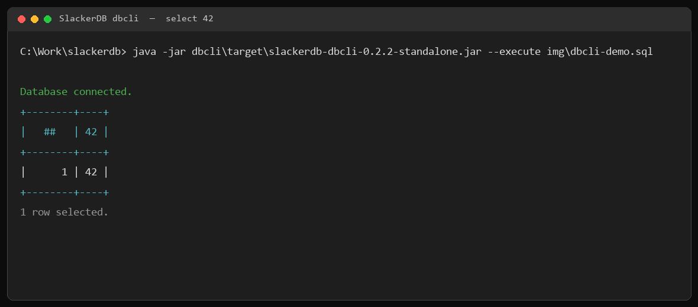

.RobotSlacker
image::robotslacker.jpg[RobotSlacker]

== SlackerDB（DuckDB PostgreSQL 代理）

=== 什么是 SlackerDB？

SlackerDB 是一个基于 Java 的服务层，把 DuckDB 放到网络上。
它能遵循 PostgreSQL 通讯协议，因此标准的 PostgreSQL JDBC驱动无需任何专用驱动即可连接；同时它让多个客户端能够共用同一份DuckDB 库 —— **这是单进程的 DuckDB 做不到的**。在此之上，它还提供了一条用于导入和导出数据的批量 COPY 通道，以及一层注册式 SQL， 把查询变成可缓存的 HTTP 端点，。

它既可以作为独立服务器（`dbserver`,`dbproxy`）运行，**也可以直接嵌入你的 Java 应用**。

==== 能力

* *PostgreSQL 通讯协议* —— 标准 PostgreSQL 客户端开箱即连：JDBC、ODBC、libpq、psql、Python，
* *PostgreSQL 数据字典兼容* —— 对一些数据库连接工具需要访问的数据字典进行仿真处理。如 DBeaver，Postgres fdw，psql, 在这些工具下，你看到的SlackerDB和一个PG数据库没有两样。
* *多会话访问* —— 一份 DuckDB 库同时服务多个并发客户端会话，具备连接池、会话级状态，SQL 在网络 I/O 线程之外执行。
* *查询取消* —— 客户端取消与 `KILL SESSION` 能命中真正正在执行的那条语句。
* *高性能数据搬运* —— 支持 PostgreSQL `COPY … FROM STDIN` 与 `COPY … TO STDOUT` 的 CSV 与 BINARY 两种形式，甚至支持部分字段的导出导出（这是PG目前也不支持的）。
* *注册式 SQL 服务* —— 在运行时把参数化 SQL 注册为具名 HTTP 端点，自带结果缓存、服务版本与按服务设定的搜索路径。
* *服务器管理接口* —— 管理端口提供状态与指标、数据库备份、日志查看与文件上传下载。
* *WebSocket 异步 SQL* —— 异步执行 SQL 并分页取回结果，适用于单次请求装不下或太慢的查询。
* *可嵌入设计* —— 既可独立进程运行，也可嵌入 Java 代码；多个实例可在不同端口上并行运行。
* *插件系统* —— 基于 PF4J 的可扩展插件框架，用于自定义功能、HTTP 端点与后台任务，支持运行时加载/启动/停止/卸载。
* *数据加密* —— 利用 DuckDB 原生加密实现静态数据保护。
* *命令行访问* —— 支持一个类似psql的自定义命令行客户端，不仅可以执行批处理SQL脚本，各种SQL语句，还能进行复杂的并发作业协同，SQL运行结果比对等。
* *作业编排*  —— 利用插件能力，提供基于HOP运行的作业编排，用来定时执行基于工作流的作业调度。
* *控制台访问*  —— 当前工作进展中。 将提供完整的，基于浏览器的图形访问工作台。
* *数据库代理*   —— 支持通过代理管理多个数据库实例，并通过统一端口来连接到不同的实例上。

==== 使用场景

* *分析型应用后端* —— 作为支持 PostgreSQL 连接的 BI 工具、仪表盘和报表应用的数据引擎。
* *共享内部数据集* —— 想要 DuckDB 的分析性能和强大SQL能力，但需要它能通过网络访问、不想让分析的过程成为黑箱。把已有的 `.duckdb` 文件装载一次，让多个团队与工具并发查询，无需搬迁或更换平台。
* *Java 内嵌服务* —— 在 Java 应用内部提供一个可联网的分析型存储，并对外提供数据访问点。

=== 使用方式

==== 从源码构建：

....
    构建前请确认当前机器上已经存在如下必要的文件：
    # 1：符合版本要求的JDK （JDK21）
    # 2：符合版本要求的Maven （Maven 3.9.16）
    # 3：符合版本要求Node （Node v24） （只针对web控制台，如果确定不需要这个功能，可以不考虑）
    # 上述文件都应该存在于PATH内，可以直接被访问。

    # 下载源代码
    git clone ...
    # 编译
    cd slackerdb
    mvn clean compile package -Dmaven.test.skip=true

    # 所有编译结果都会放在 dist 目录中：
    #    slackerdb-dist_0.2.2.zip
    #        发布包 —— standalone 形式的 Jar 包、插件 Jar 包、
    #        默认配置文件以及启停脚本。
    #    slackerdb-src_0.2.2.zip
    #        源码包 —— 完整的多模块 Maven 工程，内容等同于一次浅克隆
    #        （不含 git 历史，也不含任何编译产物）。解开后在该目录里
    #        执行同样的 maven 命令，即可从源码重新构建全部产物。

    # 默认不构建 PDF；需要生成 PDF 并放入 dist/ 和发布包时加 -Ppdf：
    #    mvn -Ppdf clean compile package -Dmaven.test.skip=true
....

==== 如何在离线环境上进行开发

在联网机器上安装一次插件，然后生成 `offline/javarepo` 和 `offline/npmrepo`：

....
    mvn -f offline-package-maven-plugin/pom.xml install
    mvn -Poffline-package validate
....

命令同时生成 `offline/javarepo.zip` 和 `offline/npmrepo.zip`，并删除未压缩的
`javarepo/`、`npmrepo/` 目录。把这两个 zip 拷到离线机器，解压到同一目录即可。

构建前请确认当前机器上已经安装了必要的JDK，Maven，Node，并且文件都能够被通过PATH的方式正常访问。

离线机上先用包内的 Maven 仓库安装插件（先把 `javarepo.zip`、`npmrepo.zip`
解压到 `<offline>`）：

执行如下命令完成构建：
....
    mvn -o -Dmaven.repo.local.tail=<offline>/javarepo clean package -pl !dbdesk -am
    或者
    NPM_CONFIG_CACHE=<offline>/npmrepo NPM_CONFIG_OFFLINE=true mvn -o -Dmaven.repo.local=/tmp/m2 -Dmaven.repo.local.tail=<offline>/javarepo package
....

==== 启动数据库服务器

....
    java -jar dbserver/target/slackerdb-dbserver-0.2.2-standalone.jar start
....

==== 停止数据库服务器

....
    java -jar dbserver/target/slackerdb-dbserver-0.2.2-standalone.jar stop
....

==== 查看数据库状态

....
    java -jar dbserver/target/slackerdb-dbserver-0.2.2-standalone.jar status
....

==== 启动数据库代理

....
    java -jar dbproxy/target/slackerdb-dbproxy-0.2.2-standalone.jar start
....

==== 停止数据库代理

....
    java -jar dbproxy/target/slackerdb-dbproxy-0.2.2-standalone.jar stop
....

==== 查看代理状态

....
    java -jar dbproxy/target/slackerdb-dbproxy-0.2.2-standalone.jar status
....

==== 服务器配置文件模板

....
# 数据库名称，默认为空。
data=

# 数据文件保存路径
# ":memory:" 表示内存模式（重启后数据会丢失）
data_dir=:memory:

# 运行期间的临时文件目录
# 磁盘模式：   未指定时默认为 data_dir
# 内存模式：   未指定时默认为系统临时目录
# 建议：       为 temp_dir 使用高性能存储
temp_dir=

# 扩展插件目录
# 默认：$HOME/.duckdb/extensions
extension_dir=

# 自定义插件目录
# 默认：无
plugins_dir=

# 以后台守护进程方式运行（true/false）。默认是false
daemon=

# PID 文件位置
# - 服务器运行期间独占锁定
# - 如果文件已被其他进程锁定，启动会中止
# - 未配置则不创建文件，也不加锁。
pid=

# 日志输出目标（逗号分隔）
# "CONSOLE" 表示标准输出，文件路径表示写入文件日志
log=CONSOLE,logs/slackerdb.log

# 日志详细级别
log_level=INFO

# 主服务端口
#  0 = 随机分配端口
# -1 = 禁用网络接口
# 默认：0（即随机分配端口）
port=

# 用于指示是否启用数据加密。
# 如果启用，访问数据库前必须提供密钥。
# 默认：false
data_encrypt=false

# 管理 API 端口
#  0 = 随机分配端口
# -1 = 禁用接口（默认）
port_x=

# 网络绑定地址
bind=0.0.0.0

# 客户端连接空闲超时（秒）
client_timeout=600

# 组播服务发现：本服务向哪个组播组通报自己。
# 格式：<组IP>:<端口>（IPv6 组需加方括号：[ff02::1]:46666）
# IPv4 组必须在 224.0.0.0/4 之内，其中 224.0.0.0/24 为保留段会被拒绝。
# 默认：不启用服务发现。
advertise_address=

# 发送组播通告所用的本机网卡。
# 可填网卡名（eth0、Ethernet）或本机 IPv4 地址；留空则自动选择第一块可用网卡
# advertise_address 为空时本参数被忽略。
advertise_nic=

# 数据库打开模式。
# 默认：READ_WRITE
access_mode=READ_WRITE

# 最大并发连接数
# 默认：256
max_connections=

# 最大工作线程数
# 默认：CPU 核心数
max_workers=

# 业务处理线程（在 Netty I/O 线程之外执行 SQL）
# 默认：0 = 跟随 max_connections（每个会话一个业务线程）
#  >0 = 显式指定线程数
# 该值建议应接近并发活跃会话数。
business_threads=

# 数据库引擎线程数
# 默认：memory_limit (GB) / 10（最小为 1）
# 建议：根据工作负载进行调整
threads=

# 用于计算内存限制的自动工作负载阈值
# 取值范围：>0 且 <=1，默认：0.8
# 当未设置 memory_limit 时用于计算默认的 memory_limit
auto_workload_threshold=

# 内存使用限制（支持 K/M/G 后缀）
# 默认：系统总内存的 80%
# -1 = 无限制（仅内存模式）
memory_limit=

# 数据库模板文件
template=

# 初始化脚本
# 仅在首次启动时执行
# 接受：.sql 文件或目录
# 若指定目录，该目录下所有文件都会被执行
init_script=

# 启动脚本
# 每次启动时执行
# 接受：.sql 文件或目录
# 若指定目录，该目录下所有文件都会被执行
startup_script=

# 系统区域设置
# 默认：操作系统设置
locale=

# SQL 命令历史
# ON = 启用跟踪
# OFF = 禁用（默认）
sql_history=OFF

# 连接池中的最小空闲连接数
connection_pool_minimum_idle=3

# 连接池中的最大空闲连接数
connection_pool_maximum_idle=10

# 连接生命周期（毫秒）
connection_pool_maximum_lifecycle_time=900000

# 查询结果缓存配置（单位：字节）
# - 仅缓存 API 请求结果（JDBC 查询不受影响）
# - 默认：1GB（1073741824 字节）
# - 设置为 0 可禁用缓存
query_result_cache_size=

# 数据服务历史
#  ON = 启用跟踪
# OFF = 禁用（默认）
data_service_history=

# 数据服务 schema 初始化文件/路径
# - 接受：
#   * JSON 文件路径（单个 schema）
#   * 目录路径（加载所有 *.service 文件）
# - Schema 文件应包含 JSON 格式的服务定义
data_service_schema=

# 启动时加载的 MCP 定义
# - 接受：
#   * JSON 文件路径（单个配置）
#   * 目录路径（按名字顺序加载所有 *.mcp 文件）
# - 每个工具条目可设置 "handler": "builtin:<名称>" 以绑定到真实实现
#   （run_sql、list_tables、describe_table、sample_rows、list_services、
#    open_session、close_session）。未设置 "handler" 的工具只会回显入参。
# 默认：空（不加载 MCP 定义；内置工具始终可用）
mcp_config=

# MCP LLM 服务器配置
# 格式：<service>:<ip>:<port>:<model>
# 示例：openai:api.openai.com:443:gpt-4
# 默认：空（无 LLM 服务器配置）
mcp_llm_server=

# 用于需要身份验证的服务的 MCP LLM API 密钥
# 示例：sk-xxxxxxxxxxxxxxxxxxxxxxxxxxxxxxxx
# 默认：空（无 API 密钥）
mcp_llm_key=

# Unix 域套接字文件路径
# 用于 UDS（Unix Domain Socket）连接，替代 TCP
# 默认：空（UDS 禁用，使用 TCP）
# 注意：仅在 Linux/macOS 上支持。在 Windows 上会被忽略。
socket=

# Quack 远程服务地址
# 格式：IP:PORT（例如 0.0.0.0:9494）
# 默认：无（Quack 禁用）
quack_addr=
....

==== 代理配置文件模板

....
# PID 文件位置
# - 服务器运行期间独占锁定
# - 如果文件已被其他进程锁定，启动会中止
# - 未配置则不创建文件，也不加锁。
pid=

# 日志输出目标（逗号分隔）
# "CONSOLE" 表示标准输出，文件路径表示写入文件日志
log=CONSOLE,logs/slackerdb-proxy.log

# 日志级别
log_level=INFO

# 以后台守护进程方式运行（true/false）
# 命令行写法：--daemon true|false，裸写 --daemon 等价于 true。
# 命令行上显式给出 --daemon 时以此为准，覆盖本配置项。
# 只有 start 子命令支持后台运行。
daemon=

# 主服务端口
#  0 = 随机分配端口
# -1 = 禁用网络接口
# 默认：0（随机分配端口）
port=0

# 管理 API 端口
#  0 = 随机分配端口
# -1 = 禁用接口（默认）
port_x=

# 网络绑定地址
bind=0.0.0.0

# 组播服务发现：从哪个组播组接收后端数据库的通告。
# 格式：<组IP>:<端口>（IPv6 组需加方括号：[ff02::1]:46666）
# 没有默认值：留空即不启用发现
# 必须与 dbserver 的 advertise_address **逐字一致**
listener_address=

# 实例根目录。每个子目录是一个数据库实例，子目录名即别名。
# 留空 = 不启用实例管理
# 目录结构见"实例管理"一节。
data_dir=

# 客户端连接空闲超时（秒）
client_timeout=600

# 最大工作线程数
# 默认：CPU 核心数
max_workers=

# 系统区域设置
# 默认：操作系统设置
locale=
....

注意：所有参数都是可选的。 +
你可以只保留需要修改的参数。 +
未配置的参数将使用默认值。

==== 服务发现

UDP组播发现：dbserver 周期性向一个组播组报告"我在这儿"，代理加入同一个组收听，并据此维护别名到后端的映射。

[cols="1,2",options="header"]
|===
| 模块 | 说明
| dbserver `advertise_address=<组IP>:<端口>` | 一个网段内的组播组
| dbserver `advertise_nic=<网卡名或本机IP>` | 留空自动选第一块可用网卡
| dbproxy `listener_address=<组IP>:<端口>` | 必须与 dbserver 的 `advertise_address` 逐字一致
|===

==== 多实例管理

配置 `data_dir` 后，代理可以在本机托管多个数据库实例：**每个实例是一个独立的 dbserver 进程**。

....
instances/
  sales/                     # 目录名 = 别名（连接串里的 database）
    instance.conf            # 唯一事实源：库名、两个端口、pid、日志路径
    bin/start.sh|bat         # 前台启动
    bin/start-daemon.sh|bat  # 后台启动
    bin/stop.sh|bat          # 优雅停止（PG 口管理帧）
    bin/status.sh|bat
    data/sales.db
    logs/server.log          # dbserver 日志
    logs/console.log         # 子进程 stdout/stderr
    instance.pid
....

别名与库名可以不同（`--name` 指定库名，缺省等于别名）；别名唯一，重复创建返回 409。

[cols="1,2",options="header"]
|===
| 命令 | 说明
| `dbproxy create --alias sales [--name sales] [--start false]` | 创建实例并默认启动
| `dbproxy resume --alias sales` | 启动一个已停止的实例
| `dbproxy shutdown --alias sales` | 优雅停止（保留数据与目录）
| `dbproxy restart --alias sales` | 停止后重新启动
| `dbproxy destroy --alias sales` | 停止并删除整个实例目录
| `dbproxy list [--json]` | 列出所有实例的**实时**状态
| `dbproxy status` | 代理状态 + 实例表
|===

管理口对应端点（代理自身）：

* `GET /status`
* `GET /capabilities`
* `GET /admin/databases`
* `GET /admin/databases/别名`
* `POST /admin/databases/别名/start`
* `POST /admin/databases/别名/shutdown`
* `POST /admin/databases/别名/restart`
* `DELETE /admin/databases/别名`
* `GET /admin/databases/别名/logs?lines=200`

行为约定：

* **两类后端**：`management` = `data_dir` 下扫描到的实例（代理可治理）；`external` = 通过组播注册进来的后端。
  状态与 `list` 里的 `SOURCE` 列会区分两者。**外部后端只转发数据**：`start`/`shutdown`/`restart`/`destroy`
  一律返回 409，也不会出现在实例目录里。
* **别名冲突内部优先**：`data_dir` 下存在同名实例时，外部通告会被丢弃。
  已存在的同名外部条目会被立即摘除。
* **不级联**：`dbproxy stop` 只停代理，实例会继续运行。
* **不自动恢复**：代理重启后不会自动拉起任何实例。
* **可绕过代理**：直接执行实例目录下的 `bin/start-daemon`、`bin/stop` 即可；
  代理每次状态查询都会重新探测（`/health` + pid + 命令行校验），所以手工启停也能被正确识别。

==== JDBC 支持

SlackerDB 提供完整的 PostgreSQL 线路协议兼容性，允许你使用标准 JDBC 驱动进行连接。这使你能够使用任何兼容 PostgreSQL 的 JDBC 客户端，以获得最佳集成体验。

*PostgreSQL JDBC 驱动*
你可以使用标准的 PostgreSQL JDBC 驱动（`org.postgresql.Driver`），连接 URL 格式为 `jdbc:postgresql://host:port/database`。当你希望复用现有的 PostgreSQL 工具链时，这很有用。

*SlackerDB JDBC 驱动*
为了更好的集成和更多特性，请使用原生 SlackerDB JDBC 驱动（`org.slackerdb.jdbc.Driver`）。连接 URL 格式为 `jdbc:slackerdb://host:port/database`。该驱动包含在发行包中。

驱动 `slackerdb-dbdriver` 保持 **Java 17 字节码**，JDK 17 应用可以直接加载；服务端、代理和 dbcli 等其余产物要求 Java 21。

*连接示例*

....
// PostgreSQL JDBC 驱动
String url = "jdbc:postgresql://127.0.0.1:3175/db1";
Connection conn = DriverManager.getConnection(url, "main", "");
conn.setAutoCommit(false);

// SlackerDB JDBC 驱动
String url = "jdbc:slackerdb://127.0.0.1:3175/db1";
Connection conn = DriverManager.getConnection(url, "main", "");
conn.setAutoCommit(false);
....

*工具集成*

你可以从IDE数据库工具 DBeaver 连接到 SlackerDB。 +
你可以从Postgres的psql命令行连接到 SlackerDB。 +
其他工具我们不能穷举验证。

*使用 PostgreSQL 驱动* +
下载 PostgreSQL 服务器，然后像连接 pg 一样连接数据库。

*使用自定义驱动* +
由于原生 Postgres 客户端经常使用一些 DuckDB 并不具备的数据字典信息， +
你可以使用以下设置创建一个通用 JDBC 驱动： +
....
Dbeaver:
Database -> Driver Manager -> New
   Database type: generic database.
   Class name:    org.slackerdb.jdbc.Driver
   URL template:  jdbc:slackerdb://{host}:{port}/[{database}]
....

*ODBC 与 Python*
SlackerDB 还通过相同的 PostgreSQL 线路协议支持 ODBC 和 Python 连接。设置细节请参考相应客户端的文档。

==== Unix 域套接字（UDS）支持

SlackerDB 支持 Unix 域套接字（UDS）连接，用于本地进程间通信。与 TCP 回环连接相比，UDS 提供更低的延迟和更高的吞吐量，非常适合同一机器上的本地客户端-服务器通信。

NOTE: UDS 仅在 Linux 和 macOS 上支持。在 Windows 上，`socket` 参数会被忽略，并打印一条日志消息。

===== 服务器配置

你可以通过在服务器配置文件中设置 `socket` 参数来启用 UDS：

....
# dbserver/conf/dbserver.conf
socket=/tmp/.s.slackerdb.4309
....

或者使用 `--socket` 命令行参数：

....
java -jar dbserver/target/slackerdb-dbserver-0.2.2-standalone.jar start --socket /tmp/.s.slackerdb.4309
....

配置了 `socket` 后，服务器会同时监听 TCP 端口和 UDS 套接字。客户端可以通过任一方式连接。

===== 通过 UDS 进行 JDBC 连接

要通过 UDS 使用 SlackerDB JDBC 驱动连接到 SlackerDB，请使用 `jdbc:slackerdb://` 协议，并设置 `socketFactory` 和 `socketFactoryArg` 连接参数：

....
// 使用 UDS 的 SlackerDB JDBC 驱动
String url = "jdbc:slackerdb:///mem";
Properties props = new Properties();
props.setProperty("user", "");
props.setProperty("password", "");
props.setProperty("socketFactory",
        "org.slackerdb.jdbc.UnixDomainSocketFactory");
props.setProperty("socketFactoryArg", "/tmp/.s.slackerdb.4309");

Connection conn = DriverManager.getConnection(url, props);
conn.setAutoCommit(false);
....

`UnixDomainSocketFactory` 类包含在 SlackerDB JDBC 驱动中，它使用 Java 内置的 `UnixDomainSocketAddress` API来建立 UDS 连接。

要点：
* `socketFactory` 参数必须设置为 `org.slackerdb.jdbc.UnixDomainSocketFactory`
* `socketFactoryArg` 参数指定 UDS 套接字文件路径
* 使用 `jdbc:slackerdb://` 协议（而不是 `jdbc:postgresql://`）
* 使用 UDS 时 URL 中的主机部分会被忽略；请使用 `///database` 格式

==== 例子一：标准 JDBC

以下示例使用发行包自带的 SlackerDB JDBC 驱动（`org.slackerdb.jdbc.Driver`）。
如果使用标准 PostgreSQL JDBC 驱动，只需把 URL 改成 `jdbc:postgresql://...`，并把
`CopyManager` / `BaseConnection` 的包名从 `org.slackerdb.jdbc.*` 换成 `org.postgresql.*`。

===== 连接、建表、插入、查询

[source,java]
----
import java.sql.*;

public class JdbcDemo {
    public static void main(String[] args) throws Exception {
        Class.forName("org.slackerdb.jdbc.Driver");
        String url = "jdbc:slackerdb://127.0.0.1:3175/db1";

        try (Connection conn = DriverManager.getConnection(url, "main", "");
             Statement stmt = conn.createStatement()) {
            stmt.execute("CREATE TABLE IF NOT EXISTS demo(id INTEGER, name VARCHAR)");
            stmt.executeUpdate("INSERT INTO demo VALUES (1, 'Alice'), (2, 'Bob')");

            try (ResultSet rs = stmt.executeQuery(
                    "SELECT id, name FROM demo ORDER BY id")) {
                while (rs.next()) {
                    System.out.println(rs.getInt("id") + "\t" + rs.getString("name"));
                }
            }
        }
    }
}
----

===== 使用 CopyManager 导入、导出

[source,java]
----
import java.io.StringReader;
import java.io.StringWriter;
import java.sql.Connection;
import java.sql.DriverManager;
import org.slackerdb.jdbc.copy.CopyManager;
import org.slackerdb.jdbc.core.BaseConnection;

public class CopyDemo {
    public static void main(String[] args) throws Exception {
        Class.forName("org.slackerdb.jdbc.Driver");
        String url = "jdbc:slackerdb://127.0.0.1:3175/db1";

        try (Connection conn = DriverManager.getConnection(url, "main", "")) {
            CopyManager copy = new CopyManager((BaseConnection) conn);

            long imported = copy.copyIn(
                    "COPY demo (id, name) FROM STDIN WITH (FORMAT csv)",
                    new StringReader("3,Carol\n4,Dave\n"));

            StringWriter out = new StringWriter();
            long exported = copy.copyOut(
                    "COPY demo TO STDOUT WITH (FORMAT csv)", out);

            System.out.println("imported=" + imported + ", exported=" + exported);
            System.out.println(out);
        }
    }
}
----

==== 性能调整
* 在能满足客观条件的情况下，尽可能的使用COPY来导出，导入数据，其处理速度远超过标准SELECT和INSERT

==== HTTP管理服务
* 以下 HTTP 端点提供基础的管理功能，例如备份、文件上传/下载、日志查看和状态监控。当管理端口（port_x）启用时，这些端点可用。

===== /backup (POST)

执行同步数据库备份。备份文件保存在服务器工作目录的 `backup/` 子目录中，文件名为 `<backupTag>.db`。`backupTag` 不能为空，也不能包含路径符号或点号（`<>:"|?*\/.`）。

.请求体（JSON）：
[source,json]
----
{
  "backupTag": "mybackup"
}
----

.响应示例（成功）：
[source,json]
----
{
  "retCode": 0,
  "retMsg": "Successful."
}
----

===== /backups (POST/GET)

异步备份任务，适用于需要查看进度并下载结果的调用方。

* `POST /backups`，请求体 `{"backupTag":"mybackup"}`，返回 `202` 与 `{"id":"...","status":"RUNNING"}`。
* `GET /backups` 列出已知任务。
* `GET /backups/{id}` 返回任务状态（`RUNNING`、`COMPLETED`、`FAILED`）。
* `GET /backups/{id}/download` 下载已完成的备份文件。

===== /logfile (GET)

以纯文本返回配置的服务端日志。

.查询参数：
* `lines`（可选）—— 只返回最后 N 行（最大 10000）。不传则返回整个文件。

.示例：
 GET /logfile?lines=500

===== /download (GET)

从服务器的目录下载文件。

.查询参数：
* `filename`（必填）—— 目录的文件路径。

.示例：
 GET /download?filename=logs/slackerdb.log

该端点支持 Range 请求，用于分片下载。

===== /upload (POST)

将文件上传到服务器的 `./uploads/` 目录。

.查询参数：
* `filename`（必填）—— 目标文件名。只取其中的文件名部分（不含目录），其中的 `\ / : * ? " < > |` 等非法字符会被替换为 `_`。

.表单数据：
* `file`（必填）—— 要上传的文件。

.使用 curl 的示例：
[source,bash]
----
curl -X POST -F "file=@local.txt" "http://localhost:8080/upload?filename=uploads/remote.txt"
----

.响应：
[source,json]
----
"uploaded: uploads/remote.txt"
----

===== /viewLog (GET)

从服务器的 `./logs/` 目录读取日志文件的最后 N 行。

.查询参数：
* `filename`（必填）—— 相对 `./logs/` 目录的日志文件路径。
* `lines`（可选）—— 要返回的行数（默认 100，最大 10000）。

.示例：
 GET /viewLog?filename=logs/slackerdb.log&lines=50

.响应（字符串 JSON 数组）：
[source,json]
----
[
  "2025-12-04 10:00:00 INFO  Server started",
  "2025-12-04 10:00:01 INFO  Listening on port 8080"
]
----

===== /status (GET)

返回全面的服务器状态信息，包括服务器详情、数据库指标、配置参数、使用统计、已安装扩展和活跃会话。

.示例：
 GET /status

.响应（节选）：
[source,json]
----
{
  "server": {
    "status": "RUNNING",
    "version": "0.2.2",
    "build": "2025-12-04 10:00:00.000 UTC",
    "pid": 12345,
    "now": "2025-12-04 15:20:00",
    "bootTime": "2025-12-04 10:00:00",
    "runTime": "5 hours, 20 minutes, 0 seconds"
  },
  "database": {
    "version": "v1.0.0",
    "size": "1.2 GB",
    "memoryUsage": "256 MB",
    "walSize": "0 B"
  },
  "parameters": {},
  "usage": {},
  "extensions": [],
  "sessions": []
}
----

==== PL/SQL 支持

SlackerDB 内置了一个用于**匿名块**的 PL/SQL 引擎：声明变量、分支、循环、遍历游标、
将数据取入变量并处理异常 —— 这一切都构建在 DuckDB 之上。

===== 运行一个块

将块包裹在 `DO $$ ... $$`（PostgreSQL 风格）中，然后像发送其他语句一样发送它：

[source,sql]
----
DO $$
DECLARE
    CURSOR cur IS SELECT id, name FROM users WHERE active = true;
    v_id   BIGINT;
    v_name TEXT;
    total  INTEGER := 0;
BEGIN
    OPEN cur;
    LOOP
        FETCH cur INTO v_id, v_name;
        EXIT WHEN cur%NOTFOUND;

        IF v_name IS NULL THEN
            CONTINUE;
        ELSIF length(v_name) > 20 THEN
            UPDATE users SET name = substr(:v_name, 1, 20) WHERE id = :v_id;
        ELSE
            INSERT INTO audit(user_id, note) VALUES (:v_id, 'ok: ' || :v_name);
        END IF;

        total := total + 1;
        EXIT WHEN total >= 1000;
    END LOOP;
    CLOSE cur;
EXCEPTION
    WHEN NO_DATA_FOUND THEN
        INSERT INTO audit(user_id, note) VALUES (NULL, 'no rows');
    WHEN OTHERS THEN
        ROLLBACK;
        RAISE;
END;
$$;
----

支持的包裹形式：`DO $$ ... $$`、`DO $tag$ ... $tag$`、裸 `$$ ... $$`，以及未包裹的
`DECLARE ... BEGIN ... END;` 脚本（后者需要客户端不拆分语句 ——
参见下面的 *客户端注意事项*）。一个查询字符串可以包含多条语句；它们会按顺序执行。

===== 典型示例

下面四个例子都是**自包含**的：每个都自己建表，复制到任意客户端即可直接执行。
注意两个约定：结构部分（`IF`、`WHILE`、`FETCH INTO`、赋值）里变量可以裸写；而**内嵌 SQL
里的变量必须写成 `:name`**（绑定参数）。

*变量、IF/ELSIF 分支与 WHILE 循环*：

[source,sql]
----
DO $$
DECLARE
    i     INTEGER := 1;
    total INTEGER := 0;
BEGIN
    CREATE OR REPLACE TABLE demo_numbers(n INTEGER, kind TEXT);

    WHILE i <= 6 LOOP
        IF i % 2 = 0 THEN
            INSERT INTO demo_numbers VALUES (:i, 'even');
        ELSIF i % 3 = 0 THEN
            INSERT INTO demo_numbers VALUES (:i, 'multiple of 3');
        ELSE
            INSERT INTO demo_numbers VALUES (:i, 'other');
        END IF;
        total := total + i;
        i := i + 1;
    END LOOP;

    INSERT INTO demo_numbers VALUES (:total, 'sum');
END;
$$;
----

结果：`demo_numbers` 里有 6 行分类（`other`/`even`/`multiple of 3`）以及 1 行汇总
`(21, 'sum')`。

*游标遍历 + `%NOTFOUND` + 异常处理*：

[source,sql]
----
DO $$
DECLARE
    CURSOR cur IS SELECT id, name FROM demo_emp ORDER BY id;
    v_id    INTEGER;
    v_name  TEXT;
    v_total INTEGER := 0;
BEGIN
    CREATE OR REPLACE TABLE demo_emp(id INTEGER, name TEXT);
    INSERT INTO demo_emp VALUES (1, 'alice'), (2, 'bob'), (3, 'carol');
    CREATE OR REPLACE TABLE demo_audit(id INTEGER, note TEXT);

    OPEN cur;
    LOOP
        FETCH cur INTO v_id, v_name;
        EXIT WHEN cur%NOTFOUND;

        IF v_name IS NULL THEN
            CONTINUE;
        END IF;

        INSERT INTO demo_audit VALUES (:v_id, 'ok: ' || :v_name);
        v_total := v_total + 1;
    END LOOP;
    CLOSE cur;

    INSERT INTO demo_audit VALUES (0, 'count = ' || CAST(:v_total AS TEXT));
EXCEPTION
    WHEN OTHERS THEN
        INSERT INTO demo_audit VALUES (-1, 'failed');
END;
$$;
----

结果：`demo_audit` 得到 `1/2/3` 三条 `ok: <name>`，外加 `(0, 'count = 3')`。

*`SELECT ... INTO` 与按错误码分支的异常处理*：

[source,sql]
----
DO $$
DECLARE
    v_name TEXT;
    v_cnt  INTEGER;
BEGIN
    CREATE OR REPLACE TABLE demo_dept(id INTEGER, name TEXT);
    INSERT INTO demo_dept VALUES (1, 'sales'), (2, 'hr');

    SELECT count(*) INTO v_cnt FROM demo_dept;

    BEGIN
        SELECT name INTO v_name FROM demo_dept WHERE id = 99;
    EXCEPTION
        WHEN NO_DATA_FOUND THEN
            v_name := '(not found)';
        WHEN TOO_MANY_ROWS THEN
            v_name := '(too many rows)';
    END;

    CREATE OR REPLACE TABLE demo_result(cnt INTEGER, name TEXT);
    INSERT INTO demo_result VALUES (:v_cnt, :v_name);
END;
$$;
----

结果：`demo_result` 得到 `(2, '(not found)')` —— 查不到行时 `SELECT INTO` 抛
`NO_DATA_FOUND`，被内层块接住。

*动态 SQL：`EXECUTE IMMEDIATE` + `USING` + `INTO`*：

[source,sql]
----
DO $$
DECLARE
    v_table TEXT := 'demo_dyn';
    v_id    INTEGER := 7;
    v_cnt   INTEGER;
BEGIN
    EXECUTE IMMEDIATE 'CREATE OR REPLACE TABLE ' || v_table || '(id INTEGER)';
    EXECUTE IMMEDIATE 'INSERT INTO ' || v_table || ' VALUES (?)' USING v_id;
    EXECUTE IMMEDIATE 'SELECT count(*) FROM ' || v_table INTO v_cnt;
    EXECUTE IMMEDIATE 'INSERT INTO ' || v_table || ' VALUES (?)' USING v_cnt * 10;
END;
$$;
----

结果：`demo_dyn` 得到 `7` 和 `10` 两行；`USING` 的值按占位符出现顺序绑定（`?`、`:1`、
`:name` 都可以，也支持没有 `USING` 时的 `:name` 作用域取值）。

===== 支持的内容

[cols="22%,78%",options="header",]
|===
|范围 |支持情况

|声明 |`DECLARE` 变量，类型包括 `INTEGER`/`SMALLINT`/`BIGINT`/`DECIMAL(p,s)`/`REAL`/`DOUBLE`/`VARCHAR(n)`/`CHAR(n)`/`TEXT`/`BOOLEAN`/`DATE`/`TIME`/`TIMESTAMP [WITH TIME ZONE]`/`INTERVAL`，支持 `NOT NULL`、默认值，以及 `CURSOR name [(params)] IS <query>`

|赋值 |`x := expr;` 和 `LET x = expr;`

|条件控制 |`IF / ELSIF / ELSE / END IF`（也支持 `ELSEIF`、`ENDIF`、`==`、`!=`、`&&`、`!`）

|循环 |`LOOP`、`WHILE cond LOOP`、`FOR i IN [REVERSE] a..b LOOP`（包含边界）、`FOR i IN [v1, v2] LOOP`、`EXIT [WHEN cond]`、`CONTINUE [WHEN cond]`、带标签的循环

|游标 |`OPEN` / `FETCH ... INTO` / `CLOSE`、`%FOUND`、`%NOTFOUND`、`%ROWCOUNT`、`%ISOPEN`

|查询 |`SELECT ... INTO v1[, v2]`（必须恰好一行）、任意 DuckDB SQL 语句、SQL 文本中的 `:name` 绑定变量

|动态 SQL |`EXECUTE IMMEDIATE <SQL 文本> [INTO 目标...] [USING 值...]`：SQL 文本在运行期求值（可用 `\|\|` 拼接），占位符支持 `?` / `:1` / `:name`，`USING` 按出现顺序绑定；无 `INTO` 时结果集被丢弃，有 `INTO` 时按单行语义（`NO_DATA_FOUND` / `TOO_MANY_ROWS` / `24000`），占位符与 `USING` 个数不符报 `07001`

|异常 |`EXCEPTION WHEN NO_DATA_FOUND / TOO_MANY_ROWS / ZERO_DIVIDE / OTHERS / <custom> THEN`、`RAISE`、`RAISE name`、在处理器内部重新抛出、嵌套块（旧式 `EXCEPTION:` 等价于 `WHEN OTHERS`）

|表达式 |算术运算、`\|\|` 连接、比较、`IS [NOT] NULL`、`LIKE`、`IN`、`BETWEEN`、`CASE`、带短路求值的逻辑 `AND`/`OR`/`NOT`，以及任意 DuckDB 函数
|===

===== 值得了解的语义

* 变量初始值为 `NULL`（而不是 `0`）。
* `FOR i IN 1..5` 迭代 **1,2,3,4,5**（两端边界都包含）；
  `FOR i IN REVERSE 5..1` 迭代 5,4,3,2,1。
* `EXIT` 只跳出最内层循环；`EXIT label` 跳出指定名称的循环。
* `SELECT ... INTO` 返回 0 行时抛出 `NO_DATA_FOUND`，多于一行时抛出 `TOO_MANY_ROWS` ——
  它绝不会静默地选取某一行。
* **字符串字面量**中的 `:name` 不会被替换（`'Hello :name'` 是字面文本；请使用 `||`）。
* 表达式使用**绑定参数**求值 —— 值绝不会被拼接进 SQL 文本。
* 除以零会抛出 `ZERO_DIVIDE`，因此 `WHEN ZERO_DIVIDE` 可以正常工作。
* 块永远不会返回结果集；请把结果写入表。
* 失控循环会被语句预算（200000 条语句）中止 → `54000`。

===== 错误码

[cols="22%,78%",options="header",]
|===
|SQLSTATE |含义

|`42601` |语法或语义错误（未知变量/游标、重复声明、不支持的类型）—— 会附带 `行:列` 报告
|`P0002` / `P0003` |`NO_DATA_FOUND` / `TOO_MANY_ROWS`
|`22012` |`ZERO_DIVIDE`
|`22001` / `22003` / `22P02` / `22007` / `42804` |字符串过长 / 数值超出范围 / 数值文本非法 / 日期时间非法 / 数据类型不匹配
|`24000` |游标状态无效；`INTO` 目标数量不匹配
|`P0001` |用户 `RAISE`
|`57014` |被 `CancelRequest` / `KILL SESSION` 取消（长时间运行的 PL/SQL 循环可被中断）
|`54000` |超出语句预算（可能是无限循环）
|===

===== 客户端注意事项

PL/SQL 块必须**不被拆分**地到达服务器。SlackerDB 自带的 JDBC 驱动在扩展协议中
会按顶层分号拆分语句；它能识别$$引用，因此 `DO $$ ... $$` 会作为一条语句发送，
而未包裹的 `DECLARE ... END;` 块则不会。

[cols=",",options="header",]
|===
|块形式 |扩展协议（默认） |简单查询协议（`preferQueryMode=simple`、psql）

|`DO $$ ... $$` |正常 |正常
|裸 `$$ ... $$` |正常 |正常
|未包裹的 `DECLARE ... END;` |会被驱动拆分 —— 请改用 `DO $$` |正常
|===

===== 类型与隐式转换

变量在声明时确定类型。每次赋值都会按以下规则把值转换为声明的类型：

[cols="30%,70%",options="header",]
|===
|源类型 → 目标类型 |结果

|NULL → 任意类型 |正常（保持为 NULL）
|数值类型之间 |正常；拓宽是无损的，收窄按四舍五入，**溢出会抛出 `22003`**
|字符串 → 数值/日期/时间/时间戳 |当文本能按该字面量解析时正常，否则为 `22P02`（日期时间则为 `22007`）
|数值/日期/时间/时间戳 → 字符串 |正常（标准文本形式）
|字符串 → `VARCHAR(n)`/`CHAR(n)` 且长度超过 `n` |**`22001` —— 绝不静默截断**
|任何涉及 `BOOLEAN` 的情况（NULL 除外） |`42804` —— 请使用显式函数或 `CAST`
|其他任何情况 |`42804`
|===

标识符不区分大小写，默认折叠为小写，除非使用引号（`"Mixed"` 会保留大小写）。
未初始化的变量为 `NULL`；`NOT NULL` 声明会拒绝 NULL 赋值（`22004`）。

===== 循环边界

[cols="45%,55%",options="header",]
|===
|形式 |迭代次数

|`FOR i IN 1..1` |1（i = 1）
|`FOR i IN 1..5` |5 —— **两端边界都包含**
|`FOR i IN 1..0`、`FOR i IN 5..1` |0
|`FOR i IN REVERSE 5..1` |5 → 5,4,3,2,1
|`FOR i IN REVERSE 1..5` |0
|`FOR i IN -3..-1` |3 → -3,-2,-1
|`FOR i IN [v1, v2, v3]` |列表每个元素迭代一次（兼容形式）
|`WHILE NULL LOOP` |0（NULL 视为 false）
|永不退出的 `LOOP` |被语句预算中止 → `54000`
|===

循环变量是隐式的、只读的，并且在循环外部不可见。`EXIT` / `CONTINUE`
只影响最内层循环；`EXIT name` 跳出带有该标签的循环：

[source,sql]
----
<<outer_loop>>
LOOP
    ...
    EXIT outer_loop WHEN done = 1;
END LOOP outer_loop;
----

===== 表达式语义

* 优先级由高到低：`**` → 一元 `-` / `NOT` → `* / %` → `+ -` → `||` → 比较
  （`= <> < <= > >=`、`IS [NOT] NULL`、`LIKE`、`IN`、`BETWEEN`）→ `AND` → `OR`。
* 条件中的 `NULL` 视为 false；`AND`/`OR` 会短路求值，因此 `false AND (1/0 = 1)` 是合法的。
* `||` 是**字符串连接**（SQL 语义）—— 逻辑或请使用 `OR`。
* 每个变量值都作为绑定参数传递；值绝不会被拼接进 SQL 文本。
* 函数调用会委托给 DuckDB，因此任意 DuckDB 标量函数都可用（接受 `schema.func`
  这类限定名）。

保留自早期版本的兼容别名：

[cols="30%,70%",options="header",]
|===
|别名 |等价形式

|`LET x = e` |`x := e`
|`PASS` |`NULL;`
|`BREAK` |`EXIT`
|`==` `!=` `&&` `!` |`=` `<>` `AND` `NOT`
|`ELSEIF` / `ENDIF` |`ELSIF` / `END IF`
|`EXCEPTION:` + 语句 |`EXCEPTION WHEN OTHERS THEN`
|`FOR :i IN 1 TO 5` |`FOR i IN 1..5`
|`FOR i IN [v1, v2]` |列表迭代
|`%notfound`、`%found`、`%rowcount`、`%isopen` |不区分大小写的游标属性
|===

===== 游标状态机

|===
|状态 \ 操作 |OPEN |FETCH |CLOSE |`%ISOPEN` |`%FOUND` |`%NOTFOUND` |`%ROWCOUNT`

|已关闭（已声明，未打开） |正常 |`24000` |`24000` |false |`24000` |`24000` |`24000`
|已打开，有可用行 |`24000` |正常，计数 +1 |正常 |true |true |false |n
|已打开，无行 |`24000` |正常 → EOF，notFound=true |正常 |true |false |true |0
|已打开，到达 EOF 之后 |`24000` |正常（保持 EOF，变量保留其值） |正常 |true |false |true |n
|取值后已关闭 |正常 |`24000` |`24000` |false |`24000` |`24000` |`24000`
|===

在块中打开的游标会在该块结束时自动关闭（包括异常路径）；
允许在 `CLOSE` 之后再次 `OPEN`，这会重置 `%ROWCOUNT`。

===== 语句路由

* 包裹形式：`DO $$ … $$`、`DO $tag$ … $tag$`、裸 `$$ … $$`，或未包裹的 `DECLARE … END;` 脚本。
* 美元引用（dollar quoting）遵循 PostgreSQL 规则：内部没有转义，匹配的标签结束字符串 ——
  当主体本身需要包含 `$$` 时，请使用其他标签（`$body$ … $body$`）。
* 在简单查询协议中，一个查询字符串可以包含由分号分隔的多条语句；
  它们会按顺序执行，每条语句返回自己的 `CommandComplete`（以及结果集）。
* PL/SQL 块本身不返回行：`CommandComplete` 报告 `DO`。请使用 `DESCRIBE` 可见的
  语句（普通查询）或将结果写入表来获得输出。
* 在扩展协议中，PL/SQL 门户被描述为 `NoData`，并且不绑定任何参数。

===== 限制与已知缺口

存储过程、函数、触发器、包、记录/`%ROWTYPE`、集合、游标 `FOR` 循环和 `GOTO` **均不受**支持。

* 除以零只在除数可以在本地解析（字面量、变量、游标
  属性）时被检测到；由查询计算出的除数会保留后端行为（`Infinity`）。
* `TIMESTAMP WITH TIME ZONE` 保留后端表示形式；值不会被规范化为 UTC。
* 失败的块不会自行回滚 —— 请在 `EXCEPTION` 处理器中或从客户端发出 `ROLLBACK`，
  这与 PostgreSQL 的 `DO` 完全一致。

==== 数据服务

* 数据服务依赖 port_x 工作，请确保你已在
服务器配置中或通过命令参数启用它。需要特别注意的是，
我们并未考虑数据安全性。这意味着数据服务必须在**可信环境**中工作。

===== 用户登录

用户登录（注意：这是可选的）。登录成功后服务器返回一个令牌，之后需要携带它才能使用上下文功能。 +
令牌是一串不透明的随机字符串（UUID 的 Base64URL 编码），**不是 JWT**，服务器只把它当作内存中的会话 ID 使用 +
（也就是说，令牌仅用于关联该会话的上下文变量；没有它，`/api/setContext`、`/api/removeContext` 等接口会直接报错）。 +
如果你的程序不使用上下文功能，可以完全忽略登录这一步。 +

[cols=",",options="header",]
|===
|属性 |值
|协议 |HTTP
|方法 |POST
|路径 |`+/api/login+`
|===

响应示例：

....
成功响应（200）

  {
    "retCode": 0,
    "token": "yJhbGciOiJIUzI1NiIsInR5cCI6IkpXVCJ9",
    "retMsg": "Login successful."
  }
....

===== 用户登出

用户登出

[cols=",",options="header",]
|===
|属性 |值
|协议 |HTTP
|方法 |POST
|路径 |`+/api/logout+`
|===

请求头：

[cols=",",options="header",]
|===
|属性 |值
|Authorization |NzJjYjE3NmQtN2Y2ZC00OWMyLWIwODAtYTU1MDE3YzVmZDU1
|===

这里的令牌信息来自之前调用 /login 时获得的内容

响应示例：

....
成功响应（200）

  {
    "retCode": 0,
    "retMsg": "Successful."
  }
....

===== 设置上下文

设置上下文

[cols=",",options="header",]
|===
|属性 |值
|协议 |HTTP
|方法 |POST
|路径 |`+/api/setContext+`
|===

请求头：

[cols=",",options="header",]
|===
|属性 |值
|Authorization |NzJjYjE3NmQtN2Y2ZC00OWMyLWIwODAtYTU1MDE3YzVmZDU1
|===

这里的令牌信息来自之前调用 /login 时获得的内容

请求体：

[cols=",",options="header",]
|===
|属性 |值
|key1 |value1
|key2 |value2
|… |…
|keyx |valuex
|===

你可以一次设置一个或多个键值对，也可以通过多次
调用 setContext 来设置多个键值对。

响应示例：

....
成功响应（200）

  {
    "retCode": 0,
    "retMsg": "Successful."
  }
....

===== removeContext

移除上下文

[cols=",",options="header",]
|===
|属性 |值
|协议 |HTTP
|方法 |POST
|路径 |`+/api/removeContext+`
|===

请求头：

[cols=",",options="header",]
|===
|属性 |值
|Authorization |NzJjYjE3NmQtN2Y2ZC00OWMyLWIwODAtYTU1MDE3YzVmZDU1
|===

这里的令牌信息来自之前调用 /login 时获得的内容

请求体：

[cols=",",options="header",]
|===
|属性 |值
|removedKeyList |[key1,key2, ….]
|===

你可以一次移除一个或多个键值对，也可以通过多次
调用 removeContext 来移除多个键值对。

响应示例：

....
成功响应（200）

  {
    "retCode": 0,
    "retMsg": "Successful."
  }
....

===== registerService

注册一个服务

[cols=",",options="header",]
|===
|属性 |值
|协议 |HTTP
|方法 |POST
|路径 |`+/api/registerService+`
|===

请求体：

[width="100%",cols="20%,80%",options="header",]
|===
|属性 |值
|serviceName |服务名称

|serviceVersion |服务版本

|serviceType |服务类型，GET/POST

|searchPath |SQL 默认搜索路径，可选参数

|sql |SQL 语句，可以用 `${var1}` 这样的占位符引用上下文变量或请求参数

|description |描述（可选，缺省为 `NO DESCRIPTION.`）

|category |服务分类（可选，用于按分类分组保存；不能包含 `\ / : * ? " < > \|` 等字符）

|snapshotLimit |查询结果缓存时长（可选），例如 `3 hours` / `30 minutes` / `45 seconds`；默认空（0），即不缓存

|parameters |参数默认值列表（可选）：JSON **字符串**形式的数组，元素形如 `{"name":"var1","defaultValue":"..."}`；当查询 API 未提供该参数时使用这里的默认值。
|===

snapshotLimit 格式：3 hours / 30 minutes / 45 seconds

请求示例：

....
  {
    "serviceName": "queryTest1",
    "serviceVersion": "1.0",
    "serviceType": "GET",
    "sql": "SELECT 1"
  }
....

请求示例（带参数默认值）：

....
  {
    "serviceName": "queryTest2",
    "serviceVersion": "1.0",
    "serviceType": "GET",
    "sql": "SELECT * FROM t WHERE id = ${id}",
    "parameters": "[{\"name\":\"id\",\"defaultValue\":\"1\"}]"
  }
....

响应示例：

....
成功响应（200）

  {
    "retCode": 0,
    "retMsg": "Successful."
  }
....

===== unRegisterService

注销一个服务

[cols=",",options="header",]
|===
|属性 |值
|协议 |HTTP
|方法 |POST
|路径 |`+/api/unRegisterService+`
|===

请求体：

[width="100%",cols="20%,80%",options="header",]
|===
|属性 |值
|serviceName |服务名称
|serviceVersion |服务版本
|serviceType |服务类型，GET/POST
|===

请求示例：

....
  {
    "serviceName": "queryTest1",
    "serviceVersion": "1.0",
    "serviceType": "GET"
  }
....

响应示例：

....
成功响应（200）

  {
    "retCode": 0,
    "retMsg": "Successful."
  }
....

===== listRegisteredService

列出所有服务

[cols=",",options="header",]
|===
|属性 |值
|协议 |HTTP
|方法 |GET
|路径 |`+/api/listRegisteredService+`
|===

响应示例：JSON 数组（**不含** `retCode` / `retMsg` 包装），每个元素是一个已注册服务：

....
成功响应（200）

  [
    {
      "serviceName": "Query1",
      "serviceVersion": "1.0",
      "category": null,
      "searchPath": "",
      "sql": "SELECT 1",
      "description": "NO DESCRIPTION.",
      "serviceType": "GET",
      "snapshotLimit": "0 seconds",
      "parameter": {}
    }
  ]
....

===== /api/\{apiVersion}/\{apiName}

API 查询

[cols=",",options="header",]
|===
|属性 |值
|协议 |HTTP
|方法 |POST 或 GET
|路径 |`+/api/{apiVersion}/{apiName}+`
|===

请求头：

[width="100%",cols="18%,82%",options="header",]
|===
|属性 |值
|Authorization |NzJjYjE3NmQtN2Y2ZC00OWMyLWIwODAtYTU1MDE3YzVmZDU1

|snapshotLimit |可选。用于覆盖服务定义。0 表示
不缓存结果
|===

这里的令牌信息来自调用 /login 时获得的内容。 +
令牌是可选的，如果你的 SQL 语句中使用了上下文，
则必须设置它。 +
snapshotLimit 格式：3 hours / 30 minutes / 45 seconds

GET 请求示例：

....
  GET /api/1.0/queryApi?context1=xxx&context2=yyy
....

POST 请求示例：

....
  POST /api/1.0/queryApi

  {
    "context1": "xxx",
    "context2": "yyy",
  }
....

响应示例：

....
成功响应（200）

  {
    "retCode": 0,
    "retMsg": "Successful",
    "description": "test 1",
    "cached": false,
    "timestamp": "2025-12-04 15:20:00",
    "data":
      {
        "columnNames":["col1","col2","col3"],
        "columnTypes":["INTEGER","INTEGER","VARCHAR"],
        "dataset":[[1,2,"中国"]],
        "timestamp": 1777770000000,
        "affectedRows": 1
      }
  }
....

请求未注册的服务时返回 **HTTP 404**，响应体为
`{"retCode": 404, "retMsg": "GET /api/1.0/xxx is not registered."}`。

`${var}` 占位符**始终**会被校验：如果某个占位符取不到值（请求里没带、`parameters`
里没有默认值、也没有对应的令牌上下文变量），请求会以 `retCode = -1`、
`retMsg = "Missing required parameters: <名称列表>"` 被拒绝——SQL 绝不会带着字面量
`${var}` 被执行。

===== 返回值类型

HTTP 数据服务与 SQL REPL 使用同一套 JSON 表示，客户端不需要了解驱动差异：

[cols="1,2",options="header",]
|===
|值类型 |JSON 表示

|INTEGER/BIGINT/HUGEINT/DECIMAL/DOUBLE |数字
|VARCHAR/UUID/INTERVAL |字符串
|BOOLEAN |true/false
|DATE/TIME |ISO-8601 字符串（`2026-10-09`、`12:34:56`）
|TIMESTAMP |不带时区的 ISO-8601 字符串（`2026-10-09T12:34:56`）
|TIMESTAMP WITH TIME ZONE |带偏移量的 ISO-8601 字符串（`2026-10-09T20:34:56+08:00`）
|BLOB |Base64 字符串
|LIST/ARRAY |JSON 数组
|STRUCT |以字段名为键的 JSON 对象
|MAP |JSON 对象
|JSON |真实 JSON 值（不是被转义的字符串，也不是驱动内部结构）
|NULL |null
|===

结果集会一次性物化到单个响应里：数据服务 API 没有游标/流式变体，超大结果受内存限制。

==== MCP 服务器

SlackerDB 在管理端口上运行一个 Model Context Protocol（模型上下文协议，MCP）服务器，
让 AI 助手与其他 MCP 客户端能够查看和查询数据库。

本实现以规范的 **`2026-07-28`** 修订版为目标，同时接受更早的修订版（双代兼容），
因为已安装的客户端普遍滞后于规范。

===== 协议面

[cols="1,3",options="header",]
|===
|项 |行为

|传输 |Streamable HTTP：所有消息都是对 `/mcp` 的 `POST`（`/jsonrpc` 保留为兼容别名）。
|会话 |**协议层面没有会话。** `initialize` 握手与 `Mcp-Session-Id` 已在 `2026-07-28` 中移除。
每个请求都在 `params._meta` 里自带协议版本与客户端能力
（`io.modelcontextprotocol/protocolVersion`、`.../clientCapabilities`）。
版本不匹配返回 `UnsupportedProtocolVersionError`（`-32020`）。
|`server/discover` |已按规范强制要求实现。公布支持的协议版本、能力、服务器身份与使用说明。
以普通 `POST` 发送。
|GET 请求 |返回 `405 Method Not Allowed`（并带 `Allow: POST`）。规范已移除 GET 端点，
而已安装的客户端会探测它来判断服务端是否提供 SSE 流——405 正是文档规定的"不提供"答复，
因此这样能让较旧的 SDK 客户端正常连上。
|结果信封 |所有结果都带 `resultType`（`complete` 或 `input_required`）。
|缓存 |`tools/list`、`prompts/list`、`resources/list`、`resources/read` 与
`resources/templates/list` 都带 `ttlMs` 与 `cacheScope`。
|`tools/list` |确定性顺序（按名字排序），以保证客户端缓存与 LLM 提示词缓存持续生效。
|已移除的方法 |`ping` 与 `logging/setLevel` 会明确返回"已在 2026-07-28 移除"的错误，
而不是被静默接受。`GET /sse` 端点已删除；日志级别改为按请求通过 `_meta` 指定。
|===

===== 内置工具

[cols="1,3",options="header",]
|===
|工具 |说明

|`open_session` |打开一个有状态的 SQL 会话并返回**服务端铸造的 handle**。把该 handle 传给
`run_sql`，即可让临时表、事务与会话设置在多次调用之间存活。会话空闲后过期，也可由
`close_session` 关闭。
|`close_session` |关闭会话并立即释放其连接。
|`run_sql` |执行 SQL（默认返回全部行），可通过 `max_rows` 限制返回行数；结果里还带
`read_only`、`statement_type`（`query`/`update`）与 `elapsed_ms`。
|`list_tables` |以 `tables` 数组返回表与视图，每项为 `{schema, name, type}`，可按 schema 过滤。
|`describe_table` |某个表或视图的列定义（名称、类型、是否可空、默认值），以 `columns` 结果网格返回，
并带上解析后的 `schema`/`table`。
|`sample_rows` |从表中取少量真实数据样本。
|`list_services` |已注册的数据服务（见 *数据服务*），用于让 agent 优先使用受治理、可缓存、
带版本的服务，而不是随手写 ad-hoc SQL。每条都会给出调用端点与其参数；服务的 SQL 文本刻意不下发。
同一份清单也可以作为资源 `slackerdb://services` 读取，因为并非所有 MCP 客户端都会消费资源。
|===

由于协议级会话已不存在，跨调用状态按规范规定的方式表达：作为普通工具参数传递的**显式 handle**
（规范自己的指导里举的动机案例就是"一个数据库事务"）。

===== 执行策略

* **权限跟随服务器。** MCP 是内部工具，不再额外施加只读限制；`run_sql` 可以执行读写语句，
  最终权限由服务器自身的 `access_mode` 决定。`open_session(read_only)` 仅为兼容旧客户端保留，
  已不再生效。
* **返回行数。** `run_sql` 默认返回全部行；可用 `max_rows` 限制返回行数，`0` 或负数表示不限制。
  `truncated` 仅在显式设置正数上限并确实被截断时为 `true`。
* **无语句超时。** MCP 不再施加应用层语句超时。
* **与其它入口同一条执行路径。** 工具调用从 dbserver 的普通连接池取连接，
  因此连接数上限与会话处理对 agent 的作用与对其它客户端完全一致。

===== 资源与提示词

[cols="1,2",options="header",]
|===
|URI / 名称 |内容

|`slackerdb://schema/tables` |所有表与视图及其 schema 和类型。
|`slackerdb://schema/table/{table}` |某个表的列定义（资源模板）。
|`slackerdb://services` |已注册的数据服务（见 *数据服务*），用于让 agent 优先使用受治理、
可缓存、带版本的服务，而不是随手写 ad-hoc SQL。服务的 SQL 文本刻意不下发。
|`answer_with_services`（提示词）|一条"优先使用服务"的作答策略，可直接交给模型。
|===

===== 配置

定义可以在启动时从 `mcp_config` 加载（单个 JSON 文件，或一个包含 `*.mcp` / `*.service` 文件的目录）：

[source,properties]
----
mcp_config=conf/mcp_config_example.service
----

工具条目可以绑定到内置实现，而不是挂一个回显桩：

[source,json]
----
{
  "name": "query",
  "description": "Execute SQL",
  "handler": "builtin:run_sql"
}
----

可识别的 `builtin:` handler 有 `run_sql`、`list_tables`、`describe_table`、`sample_rows`、
`open_session`、`close_session` 与 `list_services`；旧别名 `query`、`sql`、`runquery`、`tables`、
`show_tables`、`describe` 与 `sample` 会映射到对应实现。

发行包里的 `conf/mcp_config_example.service` 就是这样一份可用样例：一个回显桩、两个把内置工具挂到自定义
名字下的绑定（`top_tables` -> `list_tables`、`peek_rows` -> `sample_rows`），以及一个静态资源。内置工具
本身始终存在，永远不需要声明。带 `handler` 的条目无需自带 `inputSchema`：服务端改用内置实现的真实
schema（含 `outputSchema`），声明因此不会与实现漂移。

命名与保存另有两条规则。**内置工具已用的名字是保留的**：配置里这样的声明会在加载时被跳过，
`/mcp/registerMCPTool` 与 `/mcp/loadMCPTool` 的单对象形式会以 `retCode = -1` 拒绝，数组形式则跳过该条
——否则 `tools/list` 会同时列出两条同名工具，而调用永远落到内置实现上。绑定关系也能安全往返：`saveMCPTool` / `dumpMCPTool` 会把
`"handler": "builtin:<名字>"` 写回文件，因此保存后重启，工具仍然挂在真实实现上，不会退化成回显桩。

可选的 `mcp_llm_server` / `mcp_llm_key` 用于启用私有的 `/aichat` WebSocket 端点，
它把自然语言问题路由到已注册的数据服务（`<service>:<ip>:<port>:<model>`；
支持 `ollama` 与 `openai`）。它与 MCP 协议面相互独立。

===== 接入 MCP 客户端（以 DeepSeek Harness 为例）

端点在**管理端口**上，因此要启用管理接口（配置项 `port_x` / 命令行 `--portx`，默认 `-1` 表示关闭），
并把端口写死——留空会随机分配，客户端配置无法指向它。

**1. 带 MCP 启动服务端。**

[source,shell]
----
java -jar slackerdb-dbserver-0.2.2-standalone.jar --conf conf/dbserver.conf \
  --port 15432 --portx 18080 start
----

`--mcp-config` 这里刻意不写：它本就可选，内置工具无需任何配置即可使用，它只是用来额外声明自己的工具与资源
（见上面的 `mcp_config` 配置项）。

**2. 让客户端连到 `http://<host>:18080/mcp`**，传输方式选 Streamable HTTP。以 DeepSeek Harness 为例，
在 profile 补丁（`$DSH_HOME/profiles/<profile>/cordis.patch.yml`）里加一行：

[source,yaml]
----
- insert:
    - id: mcp-slacker
      name: '@deepseek-ai/dsh-mcp-client'
      config:
        serverName: slacker
        transport: streamable-http
        url: 'http://127.0.0.1:18080/mcp'
----

每台服务器要用不同的 `serverName`；该命名空间属于本地配置，不采用服务端自称的名字。

**3. 在客户端里提问验证。** 服务器上的工具会以 `+mcp__<serverName>__<工具名>+` 的形式交给模型，
直接点名工具最省事：

[source,text]
----
用 mcp__slacker__run_sql 执行 SELECT 42 AS answer，把结果告诉我。
----

// 下面两处写法不是笔误，既避开严格解析器的报错，也保证 HTML/PDF 渲染正确：
// 1) `+...+` 是单加号行内透传：行内代码里的双下划线仍会触发强调替换（渲染成 mcp*slacker*run_sql，
//    下划线被吃掉），透传只做特殊字符替换，既保住下划线也照常转义 < >。
// 2) 两个相邻方括号会被当成块 ID 定界符，而 `42` 作 ID 不合法（ID 不能以数字开头），
//    严格的解析器会报 "Block ID pattern invalid"；故首方括号改用字符引用 &#91;，渲染结果不变。
模型会调用 `+mcp__slacker__run_sql+`，拿到 `rows = &#91;[42]]`。不点名也能用
（"用 SlackerDB 的 MCP 工具查一下 SELECT 42 AS answer"），但把工具名写出来命中率最稳。

==== MCP 工具管理

本节中的端点用于在运行时注册和管理 MCP 工具定义。它们是供脚本与管理客户端使用的管理操作，
不属于 *MCP 服务器* 所描述的 MCP 协议面。

===== registerMCPTool

注册一个 MCP 工具。

[cols=",",options="header",]
|===
|属性 |值
|协议 |HTTP
|方法 |POST
|路径 |`+/mcp/registerMCPTool+`
|===

请求体：

[width="100%",cols="20%,80%",options="header",]
|===
|属性 |值
|name |工具名称（必填）。与内置工具同名的会被拒绝。

|description |工具描述（必填）

|inputSchema |入参的 JSON Schema（此处必填；从 `mcp_config` 加载的条目在声明了 `handler` 时可省略）

|category |工具分类（可选）；保存到目录时用作文件名
|===

由此注册的工具是回显桩：没有 `handler`，调用时只会把入参回显回来。绑定真实实现的工具来自 `mcp_config`。

请求示例：

....
  {
    "name": "queryDatabase",
    "description": "Echo the request back, for connectivity checks",
    "category": "database",
    "inputSchema": {
      "type": "object",
      "properties": {"sql": {"type": "string"}},
      "required": ["sql"]
    }
  }
....

响应示例：

....
成功响应（200）

  {
    "retCode": 0,
    "retMsg": "Tool registered successfully"
  }
....

===== unregisterMCPTool

注销一个 MCP 工具。

[cols=",",options="header",]
|===
|属性 |值
|协议 |HTTP
|方法 |POST
|路径 |`+/mcp/unregisterMCPTool+`
|===

请求体：

[width="100%",cols="20%,80%",options="header",]
|===
|属性 |值
|name |工具名称（必填）
|===

请求示例：

....
  {
    "name": "queryDatabase"
  }
....

响应示例：

....
成功响应（200）

  {
    "retCode": 0,
    "retMsg": "Tool unregistered successfully"
  }
....

===== loadMCPTool

从 JSON 加载 MCP 工具定义。

[cols=",",options="header",]
|===
|属性 |值
|协议 |HTTP
|方法 |POST
|路径 |`+/mcp/loadMCPTool+`
|===

请求体：工具定义的 JSON 数组或单个工具定义对象。名字已被内置工具占用的定义，在数组形式下会被跳过，
在单对象形式下以 `retCode = -1` 拒绝。

响应示例：

....
成功响应（200）

  {
    "retCode": 0,
    "retMsg": "Tools loaded successfully"
  }
....

===== saveMCPTool

将 MCP 工具定义保存到配置文件。

绑定到内置实现的工具会带着 `"handler": "builtin:<名字>"` 一起写回，因此加载保存后的文件仍保持绑定，
不会退化成回显桩。

[cols=",",options="header",]
|===
|属性 |值
|协议 |HTTP
|方法 |POST
|路径 |`+/mcp/saveMCPTool+`
|===

响应示例：

....
成功响应（200）

  {
    "retCode": 0,
    "retMsg": "Tools saved successfully",
    "savedPath": "/path/to/config/file"
  }
....

===== dumpMCPTool

将 MCP 工具定义导出为 JSON 以供下载。

[cols=",",options="header",]
|===
|属性 |值
|协议 |HTTP
|方法 |POST
|路径 |`+/mcp/dumpMCPTool+`
|===

响应：带 Content-Disposition 头的 JSON 文件下载。

==== MCP 资源

MCP（Model Context Protocol，模型上下文协议）资源提供了通过 MCP 协议注册、管理和访问资源的方式。这些资源可供 AI 助手和其他支持 MCP 的客户端使用，以访问数据、文件或其他资源。

===== registerMCPResource

注册一个 MCP 资源。

[cols=",",options="header",]
|===
|属性 |值
|协议 |HTTP
|方法 |POST
|路径 |`+/mcp/registerMCPResource+`
|===

请求体：

[width="100%",cols="20%,80%",options="header",]
|===
|属性 |值
|name |资源名称（必填）

|type |资源类型（必填，例如 "file"、"database"、"api"）

|description |资源描述（必填）

|uri |资源 URI 或路径（必填）

|metadata |附加元数据（可选对象）

|access_method |访问方式（可选，例如 "read"、"write"、"both"）
|===

请求示例：

....
  {
    "name": "customerData",
    "type": "database",
    "description": "Customer database table",
    "uri": "duckdb://localhost/customers",
    "metadata": {
      "schema": "public",
      "table": "customers"
    },
    "access_method": "read"
  }
....

响应示例：

....
成功响应（200）

  {
    "retCode": 0,
    "retMsg": "Resource registered successfully"
  }
....

===== unregisterMCPResource

注销一个 MCP 资源。

[cols=",",options="header",]
|===
|属性 |值
|协议 |HTTP
|方法 |POST
|路径 |`+/mcp/unregisterMCPResource+`
|===

请求体：

[width="100%",cols="20%,80%",options="header",]
|===
|属性 |值
|name |资源名称（必填）
|===

请求示例：

....
  {
    "name": "customerData"
  }
....

响应示例：

....
成功响应（200）

  {
    "retCode": 0,
    "retMsg": "Resource unregistered successfully"
  }
....

===== loadMCPResource

从 JSON 加载 MCP 资源定义。

[cols=",",options="header",]
|===
|属性 |值
|协议 |HTTP
|方法 |POST
|路径 |`+/mcp/loadMCPResource+`
|===

请求体：资源定义的 JSON 数组或单个资源定义对象。

响应示例：

....
成功响应（200）

  {
    "retCode": 0,
    "retMsg": "Resources loaded successfully"
  }
....

===== saveMCPResource

将 MCP 资源定义保存到配置文件。

[cols=",",options="header",]
|===
|属性 |值
|协议 |HTTP
|方法 |POST
|路径 |`+/mcp/saveMCPSource+`
|===

响应示例：

....
成功响应（200）

  {
    "retCode": 0,
    "retMsg": "Resources saved successfully",
    "savedPath": "/path/to/config/file"
  }
....

===== dumpMCPResource

将 MCP 资源定义导出为 JSON 以供下载。

[cols=",",options="header",]
|===
|属性 |值
|协议 |HTTP
|方法 |POST
|路径 |`+/mcp/dumpMCPSource+`
|===

响应：带 Content-Disposition 头的 JSON 文件下载。

==== MCP 服务

MCP（Model Context Protocol，模型上下文协议）服务提供了通过 MCP 协议注册、管理和调用服务的方式。这些服务可供 AI 助手和其他支持 MCP 的客户端使用。

===== registerMCPService

注册一个 MCP 服务。

[cols=",",options="header",]
|===
|属性 |值
|协议 |HTTP
|方法 |POST
|路径 |`+/mcp/registerMCPService+`
|===

请求体：

[width="100%",cols="20%,80%",options="header",]
|===
|属性 |值
|name |服务名称（必填）

|apiName |API 名称（必填）

|version |服务版本（必填）

|method |服务方法，GET/POST（必填）

|description |服务描述（必填）

|category |服务分类（可选）

|capabilities |能力列表（可选数组）

|use_cases |使用场景列表（可选数组）

|parameters |参数列表（可选的对象数组，包含 name、type、required、description）

|examples |示例列表（可选的对象数组，包含 user_query、parameters）
|===

请求示例：

....
  {
    "name": "queryCustomer",
    "apiName": "queryCustomer",
    "version": "1.0",
    "method": "GET",
    "description": "Query customer information",
    "category": "database",
    "capabilities": ["query", "filter"],
    "use_cases": ["customer lookup", "data analysis"],
    "parameters": [
      {
        "name": "customer_id",
        "type": "integer",
        "required": true,
        "description": "Customer ID to query"
      }
    ],
    "examples": [
      {
        "user_query": "Get customer with ID 123",
        "parameters": {"customer_id": 123}
      }
    ]
  }
....

响应示例：

....
成功响应（200）

  {
    "retCode": 0,
    "retMsg": "Service registered successfully"
  }
....

===== unregisterMCPService

注销一个 MCP 服务。

[cols=",",options="header",]
|===
|属性 |值
|协议 |HTTP
|方法 |POST
|路径 |`+/mcp/unregisterMCPService+`
|===

请求体：

[width="100%",cols="20%,80%",options="header",]
|===
|属性 |值
|name |服务名称（必填）
|===

请求示例：

....
  {
    "name": "queryCustomer"
  }
....

响应示例：

....
成功响应（200）

  {
    "retCode": 0,
    "retMsg": "Service unregistered successfully"
  }
....

===== loadMCPService

从 JSON 加载 MCP 服务定义。

[cols=",",options="header",]
|===
|属性 |值
|协议 |HTTP
|方法 |POST
|路径 |`+/mcp/loadMCPService+`
|===

请求体：服务定义的 JSON 数组或单个服务定义对象。

响应示例：

....
成功响应（200）

  {
    "retCode": 0,
    "retMsg": "Services loaded successfully"
  }
....

===== saveMCPService

将 MCP 服务定义保存到配置文件。

[cols=",",options="header",]
|===
|属性 |值
|协议 |HTTP
|方法 |POST
|路径 |`+/mcp/saveMCPService+`
|===

响应示例：

....
成功响应（200）

  {
    "retCode": 0,
    "retMsg": "Services saved successfully",
    "savedPath": "/path/to/config/file"
  }
....

===== dumpMCPService

将 MCP 服务定义导出为 JSON 以供下载。

[cols=",",options="header",]
|===
|属性 |值
|协议 |HTTP
|方法 |POST
|路径 |`+/mcp/dumpMCPService+`
|===

响应：带 Content-Disposition 头的 JSON 文件下载。

==== SQL REPL 服务器

SQL REPL 服务器提供了一个异步 WebSocket 接口，用于执行 SQL 查询并分页获取结果。
它适用于希望避免阻塞客户端的长时间运行查询，并使用双向 WebSocket 通道，
使客户端能够取消正在执行的语句并分页取回结果。

要使用它，请确保在服务器配置中启用了管理端口（port_x）。

===== WebSocket 端点

连接到 WebSocket 端点：

[cols=",",options="header",]
|===
|属性 |值
|协议 |WebSocket（ws:// 或 wss://）
|路径 |`+/sql/ws+`
|===

连接后，你可以发送具有以下通用格式的 JSON 消息：

....
{
  "id": "unique-request-id",   // 用于匹配响应，会被原样回显
  "type": "message-type",      // 取值之一：start、exec、fetch、cancel、close
  "data": { ... }              // 该消息类型特有的负载，缺省为 {}
}
....

服务器返回的消息同样由 `id`、`type`（与请求相同）和 `data` 三部分组成；
**没有** `retCode` / `retMsg` 字段，成败通过 `data.status` 判断。
参数校验失败或会话无效时，服务器返回一个不含 `id`、`type` 的错误对象：

....
{ "error": "Field 'sessionId' must be a string" }
....

可能出现的校验错误（都以这种不含 `id`/`type` 的形式返回）：`Field 'id' must be a string`、
`Field 'type' must be a string`、`Field 'data' must be an object`、`Unknown type: <type>`、
`Field 'sessionId' must be a string`、`Field 'sql' must be a string`、
`Field 'fetchSize' must be a number`、`Field 'maxRows' must be a number`、
`Field 'maxRows' must be a positive number`、`Invalid session`、
`Invalid taskId`、`Another SQL is already running`。

`maxRows` 是 API 单次返回的行数（分页大小），不是数据库查询上限，必须为正数。

===== 会话管理

会话通过发送 `start` 消息创建。服务器会返回一个 `sessionId`，后续属于同一会话的消息都必须包含它。

会话各自持有一条后端连接，回收路径有三条：

* 显式发送 `close` 消息（该 `sessionId` 立即失效）；
* 创建会话的连接消失——由 10 秒一次的心跳探活发现（当前使用的 Jetty/Javalin
  组合不会回调 WebSocket 的 `onClose`，所以不能依赖关闭回调）；
* 会话空闲（无 `start`/`exec`/`fetch`/`cancel`）超过 `client_timeout` 秒（默认 600）。
  正在执行任务的会话不会被空闲回收。

启动消息：

....
{
  "id": "1",
  "type": "start",
  "data": {}
}
....

响应：

....
{
  "id": "1",
  "type": "start",
  "data": { "sessionId": "session-123" }
}
....

该会话的所有后续消息（`exec`、`fetch`、`cancel`、`close`）都必须在其 `data` 字段中包含 `"sessionId": "session-123"`。

一个会话持有自己的后端连接，同一时刻**只能有一个任务在运行**；任务还没结束时再次发送 `exec`，
服务器返回 `{"error": "Another SQL is already running"}`。

===== 执行 SQL（异步）

提交一条 SQL 语句以异步执行。返回一个任务 ID，之后可用它来获取结果。

消息：

....
{
  "id": "2",
  "type": "exec",
  "data": {
    "sessionId": "session-123",
    "sql": "SELECT * FROM large_table",
    "fetchSize": 100   // 可选，默认 100；仅用于设置底层 Statement 的 fetchSize
  }
}
....

响应（任务提交后立即返回，此时任务仍在运行）：

....
{
  "id": "2",
  "type": "exec",
  "data": {
    "taskId": "550e8400-e29b-41d4-a716-446655440000",
    "status": "running"
  }
}
....

如果 SQL 执行失败，任务状态会变成 `error`，由 `fetch` 以 `data.status = "error"` 并附带
`data.error` 返回错误信息（提交 `exec` 的响应本身只表示任务已受理）。

`exec` 接受与 PostgreSQL 协议路径相同的 SQL，包括：

* **PL/SQL 匿名块**：`DO $$ ... $$`、裸 `$$ ... $$`，以及不带包装的
  `DECLARE ... BEGIN ... END;` 脚本，与 PG 路径使用同一个引擎执行；
* **多语句脚本**：按顺序逐条执行；若最后一条语句产生结果集，则 `fetch` 分页读取的就是
  该结果集，否则把脚本中 DML 的影响行数汇总为 `updateCount`。
  前面语句的结果集会被丢弃，因此脚本不是"一次拿多个结果集"的手段。

取值表示见上文 *返回值类型*（日期时间用 ISO-8601、BLOB 用 Base64、
LIST 用 JSON 数组、STRUCT/MAP 用 JSON 对象）。

===== 获取结果

获取指定任务 ID 的一页结果。每次最多返回 `maxRows` 行，并指示是否还有更多行。

消息：

....
{
  "id": "3",
  "type": "fetch",
  "data": {
    "sessionId": "session-123",
    "taskId": "550e8400-e29b-41d4-a716-446655440000",
    "maxRows": 100   // 可选，默认 100
  }
}
....

响应（`data` 中的 `status` 取值为 `running` / `completed` / `error` / `idle`）：

....
{
  "id": "3",
  "type": "fetch",
  "data": {
    "status": "completed",
    "columns": ["id", "name"],
    "rows": [
      {"id": 1, "name": "Alice"},
      {"id": 2, "name": "Bob"}
    ],
    "hasMore": false,     // 还有更多行时为 true
    "fetched": 2          // 该任务累计已读取的行数
  }
}
....

`data.status` 的取值与对应负载：

* `running` —— 任务仍在执行，负载**只有** `{"status": "running"}`（此时还没有 `rows` / `hasMore`）；
* `error` —— 执行失败，负载为 `{"status": "error", "error": "<错误信息>"}`；
* `completed` + 有结果集 —— 负载含 `columns`、`rows`、`hasMore`、`fetched`；`hasMore` 为 true 时继续 `fetch` 下一页；
* `completed` + 无结果集（INSERT/UPDATE/DDL 等）—— 负载为 `{"status": "completed", "updateCount": <影响行数>}`，不含 `rows`；
* `idle` —— 任务已结束且结果集/语句已关闭（行已取完），此时再 `fetch` 会得到这个状态。

你可以持续发送多条 `fetch` 消息，直到 `hasMore` 变为 false。每次调用返回下一页行。

===== 取消任务

取消当前会话正在执行的任务。该消息只读取 `sessionId`（`taskId` 会被忽略）：
服务器会中断正在执行的线程并调用 `Statement.cancel()`。

消息：

....
{
  "id": "4",
  "type": "cancel",
  "data": {
    "sessionId": "session-123"
  }
}
....

响应：

....
{
  "id": "4",
  "type": "cancel",
  "data": {
    "status": "canceled",   // 没有可取消的任务时为 "no-running-statement"
    "detail": "statement canceled"
  }
}
....

`status` 为 `canceled` 时，`detail` 是 `"future canceled"`（中断了执行线程）或
`"statement canceled"`（命中并取消了正在执行的语句）；没有可取消的任务时 `status` 为
`no-running-statement`、`detail` 为空字符串。取消成功后任务会被重置，之后再用旧的 `taskId`
`fetch` 会得到 `Invalid taskId` 错误。

===== 关闭会话

关闭会话并释放所有相关资源（包括任何待处理的任务）。

消息：

....
{
  "id": "5",
  "type": "close",
  "data": {
    "sessionId": "session-123"
  }
}
....

响应：

....
{
  "id": "5",
  "type": "close",
  "data": {
    "status": "closed"
  }
}
....

关闭后，该会话 ID 不再有效。

===== 工作流示例（使用 JavaScript/Node.js）

1. 连接到 WebSocket 端点：
+
[source,javascript]
----
const WebSocket = require('ws');
const ws = new WebSocket('ws://localhost:8080/sql/ws');
----

2. 创建一个会话：
+
[source,javascript]
----
ws.send(JSON.stringify({
  id: "1",
  type: "start",
  data: {}
}));
----

3. 执行一个长查询：
+
[source,javascript]
----
ws.send(JSON.stringify({
  id: "2",
  type: "exec",
  data: {
    sessionId: "session-123",
    sql: "SELECT * FROM huge_table",
    fetchSize: 500
  }
}));
----

4. 获取第一页：
+
[source,javascript]
----
ws.send(JSON.stringify({
  id: "3",
  type: "fetch",
  data: {
    sessionId: "session-123",
    taskId: "abc123",
    maxRows: 100
  }
}));
----

5. 继续获取后续页，直到 `hasMore` 变为 false。

6. 如有需要，可选择取消（`cancel` 只认 `sessionId`，取消该会话当前的任务）：
+
[source,javascript]
----
ws.send(JSON.stringify({
  id: "4",
  type: "cancel",
  data: {
    sessionId: "session-123"
  }
}));
----

7. 完成后关闭会话：
+
[source,javascript]
----
ws.send(JSON.stringify({
  id: "5",
  type: "close",
  data: {
    sessionId: "session-123"
  }
}));
----

*注意：* 上述示例假定你以异步方式处理收到的消息。在真实客户端中，你应按 `id` 匹配响应。

==== 在你的代码中嵌入数据库服务器

....
  // 创建配置，并按需修改
  ServerConfiguration serverConfiguration = new ServerConfiguration();
  serverConfiguration.setPort(4309);
  serverConfiguration.setData("data1");

  // 初始化数据库
  DBInstance dbInstance = new DBInstance(serverConfiguration);

  // 启动数据库
  dbInstance.start();

  // 关闭数据库
  dbInstance.stop();

  // 目前支持同时启动多个实例。
  // 但每个实例必须有自己的端口和实例名。
....

==== 在你的代码中嵌入数据库代理

....
    ServerConfiguration proxyConfiguration = new ServerConfiguration();
    proxyConfiguration.setPort(dbPort);
    ProxyInstance proxyInstance = new ProxyInstance(proxyConfiguration);
    proxyInstance.start();

    // 等待服务器就绪
    while (!proxyInstance.instanceState.equalsIgnoreCase("RUNNING")) {
        Sleeper.sleep(1000);
    }
....

==== 数据安全
基于 DuckDB 的安全加密机制，我们支持数据加密。

要使用此功能，你需要：

1. 将参数 data_encrypt 设置为 true。
2. 通过以下三种方式之一设置数据库密钥：
     . 环境变量：SLACKERDB_<dbName>_KEY（其中 <dbName> 替换为你的数据库实例名称）。
     . Java 属性：启动程序时以 -DSLACKERDB_<dbName>_KEY=... 指定。
     . 启动后通过语句指定：ALTER DATABASE <dbName> SET Encrypt Key <key>。

=== dbcli（命令行客户端）

发行包里还带一个命令行客户端 `dbcli`（Java 21+）：交互式连库写 SQL，或在 CI/批处理里跑脚本并校验结果。
它就是发行包里的 `jlib/slackerdb-dbcli-<版本>-standalone.jar`，由 `bin/dbcli.bat` / `bin/dbcli.sh` 启动。

[cols="1,3",options="header"]
|===
| 能力 | 说明

| SQL 客户端 | 交互式控制台 + 批处理脚本；语句以顶层 `;` 或行首 `/` 收尾，执行中可用 Ctrl-C 取消
| 结果校验 | `--ref` 把本次输出与参考文件比对；脚本里用 `_assert` 断言、`_compare` 比对
| 连接 | `_connect` 支持简写、`jdbc:slackerdb://` 与其它 `jdbc:<scheme>:` URL；`_load jdbcdriver` 可动态加载驱动
| 会话保持 | `_session` 保存/切换多个连接；
| 任务编排 | `_job` 并发作业；`_ssh`/SFTP、`_host`
| 远程访问 | `_ssh`/SFTP、`_host`
| 系统命令 | `_host`
| 输出 | `_set` 控制回显/摘要/结果集；`table`/`vertical`/`csv` 三种格式；`_spool` 落盘
|===

....
dbcli                                           # 交互式控制台
dbcli --execute script.sql                      # 跑脚本
dbcli --execute script.sql --logfile run.log --ref golden.ref   # 跑脚本并与参考文件比对
....

完整用法见 xref:dbcli/README-CN.adoc[dbcli/README-CN.adoc]

=== 已知问题

==== 1. 用户与密码授权

**我们不支持用户密码认证，保留这两个选项只是为了兼容性。** +
你可以随意填写任何内容，它没有任何实际作用。

==== 2. 对 DuckDB 数据类型支持有限

仅支持部分 DuckDB 数据类型，主要是简单类型，例如 int、number、double、varchar…… 复杂类型要么仍在 开发中，要么无法在 PG 协议中表示（blob、list、map……），它们会以显式错误被拒绝，而不是被静默转换。

上游限制（基于 `duckdb_jdbc` 2.0.0.0；DuckDB 预计近期会升级，我们也会跟随调整）：

* `COPY ... FROM STDIN` 写入 `BIGNUM`：DuckDB JDBC appender 没有 BIGNUM 的 C API 类型（`unsupported C API type: 35`），SlackerDB 当前无法支持。
* `COPY ... FROM STDIN` 写入 `BIT`、`INTERVAL`、`TIME_NS`、`VARIANT`：同样缺少 appender 类型，只能拒绝。
* `COPY ... TO STDOUT (FORMAT binary)` 导出 `INTERVAL`、`BIT`、`TIME_NS`、`BIGNUM`、`VARIANT`，以及嵌套的 `LIST`/`ARRAY`/`STRUCT`/`MAP`/`UNION`：这些类型在编码器里没有 PostgreSQL 的二进制表示，会在发出任何数据之前以 `0A000` 拒绝；这类查询请改用 CSV 或 text 格式。

==== 3. postgresql-fdw

SlackerDB 支持 PostgreSQL 线协议，因此可以用 `postgres_fdw` 把 SlackDB 实例挂成外部服务器。
协议层已经能承接 fdw 的会话与语句流量，**包括它读取数据所依赖的游标通道**。

PostgreSQL 17 的 `postgres_fdw` 实际会发的语句，以及当前状态：

*已支持*

* 连接初始化：`SET search_path`、`SET timezone`、`SET datestyle`、
  `SET intervalstyle`、`SET extra_float_digits`；startup 包里的 `application_name` 与
  `client_encoding`；`GSSENCRequest` 回 `N`。
* 扩展协议：Parse / Bind / Describe / Execute / Close / Sync / Flush —— 命名与匿名语句/门户、
  **逐列的结果格式协商**（Bind 里的 `Int16[R]` 被真正遵守，文本或二进制）、
  `PortalSuspended` 分批、`RETURNING`、`DEALLOCATE ALL` / `DEALLOCATE <name>`、
  `RESET ALL`、`DISCARD ALL`。
* 游标：`DECLARE ... CURSOR [WITH HOLD] FOR`、`FETCH`（`NEXT` / `FORWARD n` / `ALL` / 裸计数）、
  `MOVE`、`CLOSE [ALL]` —— 简单查询与扩展协议两条路径都可用。非 `WITH HOLD` 的游标与 PostgreSQL
  一样随事务结束销毁；`WITH HOLD` 要跨 `COMMIT` 存活，因此声明时就物化到内存。
  只支持向前方向：`BACKWARD` / `ABSOLUTE` / `RELATIVE` 明确回 `0A000`（DuckDB 的 JDBC 结果集不能后退）。
* 事务：`BEGIN` / `START TRANSACTION [ISOLATION LEVEL ...]` 会**真的**开启 DuckDB 事务，
  `COMMIT` / `COMMIT TRANSACTION` / `END` / `ROLLBACK` / `ABORT` 结束它（失败事务里的 `COMMIT`
  与 PostgreSQL 一样等价于回滚；没有事务时的 `COMMIT` 只回一条 NOTICE）。隔离级别：
  `READ ONLY` 原样透传并由 DuckDB 真正强制；`READ COMMITTED` / `REPEATABLE READ` 视为已满足；
  `SERIALIZABLE` / `DEFERRABLE` 接受但发 NOTICE 说明不受保证。
  `SET TRANSACTION ...` 在事务块内接受（带 NOTICE），在事务块外回 `25P01`。
* `SET <PostgreSQL 特有参数>`（例如 `statement_timeout`、`lock_timeout`、`server_version_num`）：
  接受、按会话记录，并回一条 `NOTICE` 说明不会生效；DuckDB 自己的参数照常透传。
* `ANALYZE <外部表>` 可用：PostgreSQL 为它发的两条语句
  （`SELECT pg_catalog.pg_relation_size('schema.table'::pg_catalog.regclass) / 8192` 与
  `SELECT reltuples, relkind FROM pg_catalog.pg_class WHERE oid = …`）都能回答 ——
  `regclass` 转换被翻译成**真正的 oid 查询**；行采样走游标。
  `relpages` 取自 DuckDB 自己的 `estimated_size`，因此小表会是 0；
  * 错误语义符合协议：扩展协议出错后会丢弃报文直到 `Sync`；`Describe`/`Close` 不存在的

*尚未实现*

* `SAVEPOINT` / `RELEASE SAVEPOINT` / `ROLLBACK TO SAVEPOINT`：DuckDB 没有子事务，
  因此它们是**可预期的报错**。
  特别是 `ROLLBACK TO SAVEPOINT` **不会**把整个事务回滚掉。
  对 fdw 的后果：只要远端语句处于本地子事务里，`postgres_fdw` 就会发 `SAVEPOINT sN`，
  因此**子事务里不能用外部表**（显式 `SAVEPOINT`，或 PL/pgSQL 的 `EXCEPTION` 块），
  而且这次失败还会让该 server 的连接在本事务内**彻底不可用**
  （`connection to server "sdb" cannot be used due to abort cleanup failure`）。
* `SELECT ... FOR UPDATE` / `FOR SHARE`：`postgres_fdw` 会把锁子句下推，而 DuckDB 直接拒绝
  （`Parser Error: SELECT locking clause is not supported!`），所以这类查询不可用。
  `ctid` 只有在外部表显式声明 `OPTIONS (rowid 'ctid')` 时才有意义；普通 `UPDATE`/`DELETE`
  **不需要远端主键**就能工作 —— （fdw不需要事务编号 `ctid`）。
* `SELECT ... FOR UPDATE` / `FOR SHARE`（DuckDB 没有行锁）以及
  `UPDATE`/`DELETE ... WHERE ctid = $1`（DuckDB 没有 `ctid`）。
* `IMPORT FOREIGN SCHEMA` 只有在 `import_collate 'false'` 时可用
  （`pg_collation.collnamespace` 未暴露）；列默认值导不过来（没有 `pg_get_expr`）。

*示例*

[source,sql]
----
CREATE EXTENSION postgres_fdw;
CREATE SERVER sdb FOREIGN DATA WRAPPER postgres_fdw
  OPTIONS (host '127.0.0.1', port '15499', dbname 'fdwdb',
           use_remote_estimate 'false');
CREATE USER MAPPING FOR CURRENT_USER SERVER sdb OPTIONS (user 'main', password 'main');
CREATE FOREIGN TABLE orders (id integer, amount numeric(38,4))
  SERVER sdb OPTIONS (schema_name 'main', table_name 'orders');

-- 也可以直接把表导进来（需要 import_collate 'false'）
IMPORT FOREIGN SCHEMA "main" FROM SERVER sdb INTO public
  OPTIONS (import_collate 'false');
----

其他限制：

* `dbname` 是服务端启动时的**实例名**（`--data fdwdb`），不是 PostgreSQL 意义上的库名。
* `import_collate` 是 `IMPORT FOREIGN SCHEMA` 的选项，**不能**写在 `CREATE SERVER` 里
  （PostgreSQL 会直接拒绝：`invalid option "import_collate"`）。
* `use_remote_estimate` 保持关闭：打开后 `postgres_fdw` 会去解析 PostgreSQL 的
  `EXPLAIN (cost=... rows=... width=...)` 文本，而 DuckDB 不产出这种格式。

=== 插件系统

SlackerDB 提供基于 PF4J 的插件框架，允许开发者扩展数据库服务器的功能。插件可以访问数据库连接、日志记录器和 Javalin Web 应用实例，从而能够注册自定义 HTTP 端点、执行后台任务或集成外部服务。

==== 插件机制概览

插件系统构建在 PF4J（Plugin Framework for Java）之上，并经过定制以提供数据库特定的上下文。核心组件包括：

* *DBPlugin* —— 抽象插件基类，继承 PF4J 的 `Plugin` 类并实现 `IDBPluginContext` 接口。插件必须继承该类并实现生命周期方法。
* *DBPluginContext* —— 插件上下文对象，包含数据库连接、日志记录器和 Javalin 应用实例。插件管理器会在插件启动前注入该上下文。
* *DBPluginManager* —— 自定义插件管理器，负责加载、启动、停止和卸载插件。它使用自定义的 `DBPluginFactory` 来确保插件创建时自动注入上下文。
* *DBPluginFactory* —— 自定义插件工厂，在创建插件实例后检查插件是否实现了 `IDBPluginContext`，如果是则注入 `DBPluginContext`。

插件生命周期：
1. *启动扫描* —— 服务器启动时扫描配置的插件目录（`plugins_dir`），加载所有符合 PF4J 规范的 JAR，并自动启动。
2. *运行期加载* —— 管理口的 `POST /plugin/load` 可以在不重启服务器的情况下加载新插件；该操作**只加载，不自动启动**，加载后需要再调用 `/plugin/start`。
3. *创建* —— 通过 `DBPluginFactory` 创建插件实例，并注入 `DBPluginContext`。
4. *启动* —— 调用插件的 `start()` 方法，该方法会依次执行 `beforeStart()`、`onStart()` 和 `afterStart()`。
5. *运行* —— 插件在 `onStart()` 中执行自定义逻辑，例如注册 Javalin 路由、初始化数据库表等。
6. *停止* —— 通过 `/plugin/stop` 停止；`/plugin/unload` 会先停止；服务器关闭时也会停止已启动的插件。停止会调用 `beforeStop()`、`onStop()` 和 `afterStop()`。
7. *卸载* —— 通过 `/plugin/unload` 卸载。卸载会停止插件、释放 PF4J 类加载器，但**不会删除 JAR，也不会调用 `delete()`**；

运行期加载的插件不会持久化：重启后只有 `plugins_dir` 中存在的 JAR 会被重新扫描和启动。

插件可以访问以下资源：
* *数据库连接* —— 通过 `getDbConnection()` 获取后端数据库的新连接（通过 `DuckDBConnection.duplicate()` 创建）。
* *日志记录器* —— 通过 `getLogger()` 获取已配置的 SLF4J 日志记录器。
* *Web 应用实例* —— 通过 `getJavalinApp()` 获取 Javalin 应用实例，可用于注册 HTTP 路由和中间件。

==== 如何编写插件

以下步骤基于 `plugin‑example` 模块，演示如何编写一个 SlackerDB 插件。

===== 1. 创建 Maven 项目

插件项目需要依赖 `slackerdb‑plugin` 模块。在 `pom.xml` 中添加以下依赖：

[source,xml]
----
<dependency>
    <groupId>org.slackerdb</groupId>
    <artifactId>slackerdb-plugin</artifactId>
    <version>0.2.2</version>
    <scope>provided</scope>
</dependency>
----

还需要 PF4J 核心库（通常已经是 `slackerdb‑plugin` 的传递依赖）。

===== 2. 实现插件主类

创建一个继承 `DBPlugin` 并实现必要生命周期方法的类。示例：

[source,java]
----
package org.slackerdb.myplugin;

import io.javalin.Javalin;
import org.pf4j.PluginWrapper;
import org.slackerdb.plugin.DBPlugin;
import org.slf4j.Logger;

import java.sql.Connection;
import java.sql.SQLException;

public class MyPlugin extends DBPlugin {
    private Connection conn;
    private Javalin app;
    private Logger logger;

    public MyPlugin(PluginWrapper wrapper) {
        super(wrapper);
    }

    @Override
    protected void onStart() {
        // 获取资源
        try {
            this.conn = getDbConnection();
        } catch (SQLException e) {
            // 处理异常
        }
        this.logger = getLogger();
        this.app = getJavalinApp();

        // 注册自定义 HTTP 端点
        app.get("/myplugin/hello", ctx -> ctx.result("Hello from MyPlugin!"));

        // 初始化数据库表
        try (var stmt = conn.createStatement()) {
            stmt.execute("CREATE TABLE IF NOT EXISTS myplugin_data (id INTEGER, name VARCHAR)");
        } catch (SQLException e) {
            logger.error("Failed to create table", e);
        }

        logger.info("MyPlugin started successfully");
    }

    @Override
    protected void onStop() {
        // 清理资源
        if (conn != null) {
            try { conn.close(); } catch (SQLException ignored) {}
        }
        logger.info("MyPlugin stopped");
    }

    // 可选：覆盖其他生命周期钩子方法
    // beforeStart、afterStart、beforeStop、afterStop、beforeDelete、afterDelete
}
----

===== 3. 配置插件描述文件

在 `src/main/resources` 目录中创建 `plugin.properties` 文件，内容如下：

[source,properties]
----
# 插件唯一标识，必须与插件 JAR 文件名一致（不含扩展名）
plugin.id=myplugin

# 插件主类的全限定名，必须继承 org.slackerdb.plugin.DBPlugin
plugin.class=org.slackerdb.myplugin.MyPlugin

# 插件版本号，遵循语义化版本规范
plugin.version=1.0.0

# 插件依赖要求，* 表示没有特定依赖
plugin.requires=*
----

===== 4. 构建插件

使用 Maven 打包插件：

[source,bash]
----
mvn clean package
----

生成的 JAR 文件（例如 `myplugin‑1.0.0.jar`）应包含插件类和 `plugin.properties` 文件。

===== 5. 部署插件

将插件 JAR 文件放入 SlackerDB 服务器的插件目录（由服务器中的 `plugins_dir` 参数指定）。该参数默认为**空**，此时不会扫描任何插件目录；请显式配置它，并确保目录存在且服务器具有读权限。

===== 6. 启动服务器

启动 SlackerDB 服务器；只要正确配置了 `plugins_dir`，插件就会被自动加载并启动。用 `status` 命令或管理端口可以确认插件状态。检查服务器日志以确认插件加载成功：

[source]
----
[SERVER][PLUGIN     ] Load plugin [myplugin] ...
[SERVER][PLUGIN     ] start plugin [myplugin] ...
----

如果插件注册了 HTTP 端点，你可以在 `http://localhost:<port_x>/myplugin/hello` 访问它（假设管理端口 `port_x` 已启用）。

===== 插件说明

* *日志* —— 插件可以通过 `getLogger()` 输出日志；日志级别由服务器的 `log_level` 配置控制。
* *错误处理* —— 插件启动生命周期方法中的异常会被捕获并包装为 `RuntimeException`，导致插件启动失败。错误消息会记录在服务器日志中。
* *运行期管理* —— 支持通过管理口 `/plugin/load`、`/plugin/unload`、`/plugin/start`、`/plugin/stop` 动态管理插件；`/plugin/load` 只加载，不自动启动。
* *插件更新* —— 程序不会监听 JAR 变化，也不自动热替换已加载的插件。更新插件时应自行先 `/plugin/stop`、`/plugin/unload`，替换 JAR 后再 `/plugin/load`、`/plugin/start`；
* *路由限制* —— `/plugin/unload` 由于是完全的信任机制，不会替插件撤销插件已经注册到 Javalin 的路由，如果插件自身不再unload逻辑中添加路由撤销，则卸载后访问旧路径通常返回 `500 Internal Server Error`。

===== 模块结构

plugin‑example 模块包含以下关键组件：

* *插件主类* —— 继承 `DBPlugin` 并实现所有生命周期方法。其完整源码
  在本节中复现。
* *调试模式* —— 演示如何在不使用完整 PF4J 框架的情况下执行插件
* *插件描述文件* —— 定义插件元数据的 `plugin.properties` 文件。
* *Maven 构建* —— 依赖 `slackerdb‑plugin` 的配置。

===== PluginExample 类概览

`PluginExample` 类继承 `DBPlugin` 并为所有生命周期方法提供实现：

[source,java]
----
public class PluginExample extends DBPlugin {
    private Connection conn;
    private Javalin    app = null;
    private Logger     logger = null;

    public PluginExample(PluginWrapper wrapper) {
        super(wrapper);
    }

    @Override
    protected void onStart() {
        // 示例：获取插件资源
        // try {
        //     this.conn = getDbConnection();
        // } catch (SQLException ignored) {}
        // this.logger = getLogger();
        // this.app = getJavalinApp();

        // 在此添加插件启动逻辑
    }

    protected void onStop() {
        // 清理资源
    }

    protected void onDelete() {
        // 永久性清理操作
    }

    // 生命周期钩子方法：beforeStart、afterStart、beforeStop、afterStop、
    // beforeDelete、afterDelete

    // 调试模式支持
    public static PluginExample standAloneInstance() throws Exception {
        return DBPlugin.Standalone.createInstance(PluginExample.class);
    }
}
----

===== 演示的关键特性

1. *资源访问* —— 展示如何通过 `getDbConnection()`、`getLogger()` 和 `getJavalinApp()` 获取数据库连接、日志记录器和 Javalin 应用实例。
2. *生命周期管理* —— 实现所有生命周期方法（`onStart`、`onStop`、`onDelete`）及其对应的钩子方法（`beforeStart`、`afterStart` 等）。
3. *调试模式* —— 包含一个 `standAloneInstance()` 方法，使插件可以在没有 PF4J 框架的情况下执

===== 构建并运行示例

1. *构建插件*：
+
[source,bash]
----
cd plugin-example
mvn clean package
----
+
生成的 JAR 文件（`plugin‑example‑0.2.2.jar`）会放在 `target` 目录中。

2. *部署到 SlackerDB 服务器*：
   - 将 JAR 文件复制到服务器的插件目录（通过 `plugins_dir` 参数配置）。
   - 启动服务器；插件会被自动加载。
   - 检查服务器日志中的插件加载消息。

3. *以调试模式运行*：
+
[source,bash]
----
cd plugin-example
mvn compile exec:java -Dexec.mainClass="org.slackerdb.pluginExample.SimplePluginRunner"
----
+
这会执行 `SimplePluginRunner` 类，它演示如何在没有完整 SlackerDB 服务器的情况下运行插件。

===== 定制该示例

要基于此示例创建你自己的插件：

1. *重命名包和类* —— 将 `org.slackerdb.pluginExample` 改为你自己的包名。
2. *更新 plugin.properties* —— 相应修改 `plugin.id`、`plugin.class` 和 `plugin.version`。
3. *实现业务逻辑* —— 取消 `onStart()` 中获取资源代码的注释，并添加你的自定义功能。
4. *添加依赖* —— 在 `pom.xml` 中补充插件所需的任何额外库。
5. *充分测试* —— 在部署到生产服务器之前，使用调试模式进行测试。

===== 插件描述文件

`src/main/resources/plugin.properties` 文件包含插件元数据：

[source,properties]
----
plugin.id=plugin-example
plugin.class=org.slackerdb.pluginExample.PluginExample
plugin.version=0.2.2
plugin.requires=*
----

* `plugin.id` 是插件的唯一标识，PF4J 以 `plugin.properties` 中的取值为准（实测：JAR 文件名不必与之一致，但建议保持一致以便识别）。
* `plugin.class` 必须是插件主类的全限定名。
* `plugin.version` 遵循语义化版本规范。
* `plugin.requires` 指定插件依赖（`*` 表示没有特定依赖）。

===== 插件调试

除了标准的基于 PF4J 的插件加载机制之外，SlackerDB 还提供*调试模式*，允许插件在不需要完整 PF4J 框架的情况下直接执行。这对于测试、调试或将插件逻辑嵌入自定义应用非常有用。

调试模式的工作方式：
1. 通过 `standAloneInstance()` 方法创建插件实例（该方法在继承 `DBPlugin` 的插件中可用）
2. 使用所需资源（数据库连接、日志记录器、Javalin 应用）手动构建 `DBPluginContext`
3. 通过 `setDBPluginContext()` 将上下文注入插件
4. 直接调用插件的生命周期方法（`start()`、`stop()`）

`plugin-example` 模块包含一个 `SimplePluginRunner` 类，演示如何以调试模式运行插件。以下是一个简化版本：

[source,java]
----
package org.slackerdb.pluginExample;

import io.javalin.Javalin;
import org.slf4j.Logger;
import org.slf4j.LoggerFactory;
import org.slackerdb.plugin.DBPluginContext;

import java.sql.Connection;
import java.sql.DriverManager;

public class SimplePluginRunner {
    public static void main(String[] args) throws Exception {
        // 1. 创建数据库连接
        Connection conn = DriverManager.getConnection("jdbc:duckdb:memory:");

        // 2. 创建 Javalin 应用实例
        Javalin javalin = Javalin.create();

        // 3. 创建日志记录器
        Logger pluginLogger = LoggerFactory.getLogger(PluginExample.class);

        // 4. 创建并配置 DBPluginContext
        DBPluginContext ctx = new DBPluginContext();
        ctx.setDbBackendConn(conn);
        ctx.setLogger(pluginLogger);
        ctx.setJavalin(javalin);

        // 5. 通过调试模式创建插件实例
        PluginExample plugin = PluginExample.standAloneInstance();

        // 6. 注入上下文
        plugin.setDBPluginContext(ctx);

        // 7. 启动插件
        plugin.start();

        // 8. （可选）等待后停止
        Thread.sleep(1000);
        plugin.stop();

        // 9. 清理资源
        conn.close();
    }
}
----

==== 作业调度器插件（plugin-scheduler）

SlackerDB 可以加载一个作业调度插件，用于**按项目模板定时执行 HOP 工作流或脚本**。

典型用法：把一个 HOP 工程（`.hwf`/`.hpl`，其中包含执行 SQL 的步骤）放进"项目模板"，
创建实例后一键上线 —— 插件先串行执行初始化类任务，成功后自动按 cron 周期运行主流程，
并记录每次执行的日志与历史。

它是**可选插件**：是否加载由服务器配置的 `plugins_dir` 决定。

===== 快速开始

. *准备 HOP*：插件包内不含 HOP，需要单独准备一份 HOP 2.19+ 发行版，记下 `hop-run.bat`/`hop-run.sh` 的路径。
  HOP 2.19 要求 JDK 21。`plugin-scheduler.hop.javaHome` 可留空；留空时使用 dbserver 当前运行的
  JDK（`java.home`），通常就是启动服务端的那个 21。需要单独指定时再填写绝对路径。
. *部署插件*：把插件 JAR 放进插件目录，并在服务器配置文件中启用：
+
[source,properties]
----
plugins_dir=plugins
plugin-scheduler.home=data/scheduler
plugin-scheduler.projectHome=data/scheduler/projects
plugin-scheduler.hop.runScript=D:/hop/hop-run.bat
# 可选；留空（或删除本行）表示使用当前 JDK
# plugin-scheduler.hop.javaHome=D:/jdk21
----
. *准备模板*：在 `data/scheduler/projects/` 下建一个以模板名命名的目录（见下一节）。
. *创建并启动实例*（`<管理端口>` 为服务器管理端口）：
+
[source,bash]
----
# 创建实例：projectType 就是模板目录名
curl -X POST http://127.0.0.1:<管理端口>/scheduler/run/create \
     -H "Content-Type: application/json" \
     -d '{"projectType":"proj1"}'

# 启动（按模板顺序编排：先跑一次性任务，成功后激活周期任务）
curl -X POST http://127.0.0.1:<管理端口>/scheduler/run/<runId>/start

# 查看任务状态与下次触发时间
curl http://127.0.0.1:<管理端口>/scheduler/run/<runId>/task/list

# 查看某个任务的日志尾部
curl "http://127.0.0.1:<管理端口>/scheduler/run/<runId>/log?taskName=主流程&tail=200"
----

===== 准备项目模板

每个模板是一个目录，名字就是模板名（`projectType`）。**模板目录本身就是 HOP 工程目录**：

[source]
----
data/scheduler/projects/                 ← 模板根（projectHome）
├── default/                             ← HOP 的"父项目"（可选，供多个模板共用公共配置）
│   ├── project-config.json
│   └── metadata/
└── proj1/                                ← 模板名，同时就是 HOP 工程目录
    ├── conf/
    │   ├── defaultSchedulerTask.json     ← 任务清单
    │   └── variables.properties          ← 变量（可选，见下一节）
    ├── project-config.json               ← HOP 项目配置
    ├── metadata/                         ← HOP 元数据（数据库连接、run configuration）
    ├── sql/                              ← 工作流引用的 SQL 脚本
    └── *.hwf / *.hpl                     ← 工作流与管道
----

任务清单 `conf/defaultSchedulerTask.json` 用**任务名作为键**，示例：

[source,json]
----
{
  "groups": ["SETUP_GROUP", "MAIN_GROUP"],
  "初始化": {
    "taskScript": "初始化.hwf",
    "taskRunPolicy": "RUN_ONCE",
    "taskTimeout": 600,
    "taskGroup": "SETUP_GROUP",
    "taskMandatory": true
  },
  "主流程": {
    "taskScript": "主流程.hwf",
    "taskRunPolicy": "CRONTAB",
    "taskCrontabExpr": "0 1/2 * * * ? *",
    "taskParallelPolicy": "SERIAL_DISCARD",
    "taskFailPolicy": "CONTINUE",
    "taskTimeout": 600,
    "taskGroup": "MAIN_GROUP"
  }
}
----

[cols="1,3"]
|===
| 字段 | 说明

| `taskScript` | `HOP` 任务填 `.hwf`/`.hpl` 文件名；`SHELL`/`COMMAND` 任务填命令行
| `taskScriptType` | `HOP`（默认）/ `SHELL` / `COMMAND`
| `taskRunPolicy` | `RUN_ONCE` 只跑一次（默认）/ `CRONTAB` 按 cron / `INTERVAL` 按固定间隔
| `taskCrontabExpr` | Quartz cron（6 或 7 段，如 `0 1/2 * * * ? *`）；可用 `describeCrontabExpr` 接口校验
| `taskInterval` | `INTERVAL` 的间隔秒数
| `taskTimeout` | 超时秒数，0 表示不限；超时会终止该任务（含其子进程）
| `taskGroup` / `taskStartupOrder` | 分组与组内顺序；`groups` 声明组的先后
| `taskMandatory` | 必选任务：失败则实例被标记为失败并停止后续推进
| `taskParallelPolicy` | 同一任务重入策略：`PARALLEL` 并发 / `SERIAL_DISCARD` 丢弃本次 / `SERIAL_DELAY`、`SERIAL_CATCHUP` 排队
| `taskFailPolicy` | `CONTINUE` 继续（默认）/ `STOP` 失败即暂停该任务 / `RETRY` 重试（配 `taskRetryTimes`、`taskRetryInterval`）
| `taskEnabled` | 是否启用，默认 `true`
| `variables` | 该任务专属变量（可选）
|===

清单文件也可以放在模板根目录（`projects/conf/defaultSchedulerTask.json`）供所有模板共用；
找不到清单不会报错，实例就是没有预置任务。任务列表也可以用创建实例接口的 `tasks` 参数直接传入。

上表字段在**两种入口上通用**（模板清单与 `POST /scheduler/run/create` 的内联 `tasks[]`）。内联任务会**先校验后落地**：
`taskScriptType` 只接受 `HOP`/`SHELL`/`COMMAND`（默认 `HOP`），策略、`taskRetryTimes`/`taskRetryInterval`、`taskMandatory`、
`variables`（只支持扁平标量值）同样校验，**字段名拼错（未知字段）也会被拒绝**；任一条不合格返回 `400` 与 `problems`
清单，且不会创建实例目录与运行记录。模板清单里出现未知字段只记一条 warning（不阻断装载）。

创建实例请求的**顶层**同理：只接受 `projectType` / `configJson` / `runId` / `tasks`，且 `tasks` 必须是数组；
顶层未知字段（例如把 `tasks` 拼成 `task`）一律 `400`，不会静默回落到模板任务。

===== 变量：给 HOP 传连接信息

HOP 工作流里的 `${XXX}` 与 HOP 连接元数据（`metadata/rdbms/*.json` 中的 `${HOST}`、`${PORT}` 等）
都由这里取值。可以写在四个地方，后面的覆盖前面的：

. `data/scheduler/variables.properties`（全局）
. 模板目录 `proj1/conf/variables.properties`
. 创建实例时请求体的 `configJson`
. 任务清单里该任务的 `variables`

[source,properties]
----
DB_HOST=10.0.0.5
DB_PORT=5432
DB_USER=main
DB_PASSWORD=******
----

变量值可以引用其它变量，例如 `TEST_CODE=${RUN_ID}`（引用 `RUN_ID`、`PROJECT_TYPE`、`TASK_NAME` 等内置变量）。
内置变量包括 `PROJECT_HOME`、`RUN_HOME`、`RUN_ID`、`PROJECT_TYPE`、`TASK_NAME`、`LOG_DIR`、`AUDIT_DIR`。
`GET /scheduler/run/{runId}/variables` 可查看当前生效的变量（口令类自动打码）。

===== 实例与任务的生命周期

[cols="1,3"]
|===
| 操作 | 说明

| 创建实例 | 按模板生成独立运行目录（`runs/<runId>/`）并读取模板任务清单
| 启动 | 按组与顺序编排：先串行执行一次性任务，成功后激活该组的周期任务
| 停止 | 暂停所有任务（定义保留，可再次启动）
| 中止 | 中断正在执行的任务并暂停
| 删除 | 删除实例、任务定义与运行目录
| 服务器重启后 | 实例被置为"已停止"，不会自动重跑一次性任务；人工启动即可恢复
|===

单个任务也可以单独操作：编排、启动、暂停、中止。

日志与历史：每次执行写入 `runs/<runId>/logs/<taskName>.log`，历史记录可通过接口查询；
插件可按配置的保留天数自动清理过期历史与日志。

===== 接口一览

[cols="1,1"]
|===
| 端点 | 说明

| `GET /scheduler/status` | 调度器状态
| `GET /scheduler/project/list`、`GET /scheduler/project/{projectType}` | 模板列表 / 模板详情（含解析后的任务清单与告警）
| `POST /scheduler/run/create` | 创建实例
| `GET /scheduler/run/list`、`GET /scheduler/run/{runId}` | 实例列表 / 详情
| `POST /scheduler/run/{runId}/start\|stop\|abort\|drop` | 启动 / 停止 / 中止 / 删除实例
| `POST /scheduler/run/{runId}/task/schedule` | 编排单个任务
| `POST /scheduler/run/{runId}/task/start\|stop\|abort` | 启动 / 暂停 / 中止单个任务
| `GET /scheduler/run/{runId}/task/list` | 任务列表：状态、下次触发时间、上次结果、是否运行中
| `GET /scheduler/run/{runId}/task/history` | 执行历史
| `GET /scheduler/run/{runId}/log?taskName=&tail=200` | 查看任务日志；不传 `taskName` 返回日志文件清单
| `GET /scheduler/run/{runId}/variables?taskName=` | 查看变量（口令已打码）
| `GET /scheduler/describeCrontabExpr?expr=` | 校验 cron 表达式并给出未来 5 次触发时间
|===

===== 注意事项

* 插件包内**不含 HOP**，必须单独提供 HOP 2.19+ 发行版并配置 `plugin-scheduler.hop.runScript`；
  HOP 以独立进程运行，因此不需要为数据库服务器调整任何 JVM 参数；
* HOP 工程需要满足（创建实例时会自检并提示）：
  **若模板的 `project-config.json` 写了 `"parentProjectName": "default"`，则模板根下必须有 `default/` 项目，
  且它的 `project-config.json` 里 `parentProjectName` 留空**（也可以不用父项目，此时模板自己的
  `parentProjectName` 直接留空）；
  **`metadata/workflow-run-configuration/local.json` 必须存在**（对应默认 runconfig `local`）
* 任务是"尽力终止"：超时/中止会终止 `hop-run` 及其子进程，但 HOP 内部的长事务不保证立即回滚
* 当前为单实例调度，不支持多节点
* 该插件未内置鉴权，请只在受信网络暴露管理端口

==== 插件管理 API

SlackerDB 提供一组用于在运行时管理插件的 HTTP 端点。这些端点允许你在不重启服务器的情况下加载、卸载、启动、停止和列出插件。所有端点都返回标准格式的 JSON 响应：`{"retCode": 0/-1, "retMsg": "message"}`。

注意：这些端点的业务失败通常仍然返回 HTTP 200，只是 `retCode=-1`；调用方必须检查 `retCode`，不能只看 HTTP 状态码。

===== /plugin/load (POST)

从插件目录或指定路径加载 JAR。加载后插件处于 `RESOLVED` 状态，**不会自动启动**；需要再调用 `/plugin/start`。

.请求体（JSON）：
[source,json]
----
{
  "filename": "myplugin.jar"
}
----

* `filename` —— 插件 JAR 文件名（例如 "myplugin.jar"）或 JAR 文件的完整路径。如果提供的是简单文件名，将从服务器的插件目录（通过 `plugins_dir` 参数配置）加载；如果 `plugins_dir` 为空，简单文件名会报错。完整路径直接从该位置加载，不要求 `plugins_dir`。
* 运行期加载的插件不写入配置，也不会自动复制到 `plugins_dir`；重启服务器后是否还能加载，取决于 JAR 是否仍在 `plugins_dir` 中。

.响应示例（成功）：
[source,json]
----
{
  "retCode": 0,
  "retMsg": "Plugin loaded successfully",
  "pluginId": "myplugin"
}
----

.响应示例（错误）：
[source,json]
----
{
  "retCode": -1,
  "retMsg": "Plugin file does not exist: /path/to/plugins/myplugin.jar"
}
----

===== /plugin/unload (POST)

停止并卸载之前加载的插件。如果插件正在运行，会先被停止。

* 卸载会释放 PF4J 的类加载器，但**不会删除 JAR**，也**不会调用 `delete()`/`onDelete()`**。
* 卸载**不会撤销**插件已经注册到 Javalin 的路由。卸载后访问旧路径通常返回 `500 Internal Server Error`，也可能继续返回旧插件结果；更新路由型插件或需要彻底清理时建议重启服务器。

.请求体（JSON）：
[source,json]
----
{
  "plugid": "myplugin"
}
----

.响应示例（成功）：
[source,json]
----
{
  "retCode": 0,
  "retMsg": "Plugin unloaded successfully"
}
----

===== /plugin/start (POST)

启动已加载的插件。会调用插件的 `start()` 方法，从而触发插件的生命周期钩子（`beforeStart()`、`onStart()`、`afterStart()`）。

.请求体（JSON）：
[source,json]
----
{
  "plugid": "myplugin"
}
----

.响应示例（成功）：
[source,json]
----
{
  "retCode": 0,
  "retMsg": "Plugin started successfully"
}
----

===== /plugin/stop (POST)

停止正在运行的插件。会调用插件的 `stop()` 方法，从而触发插件的生命周期钩子（`beforeStop()`、`onStop()`、`afterStop()`）。

.请求体（JSON）：
[source,json]
----
{
  "plugid": "myplugin"
}
----

.响应示例（成功）：
[source,json]
----
{
  "retCode": 0,
  "retMsg": "Plugin stopped successfully"
}
----

===== /plugin/list (GET)

列出当前加载的所有插件及其详情。

.响应示例：
[source,json]
----
{
  "retCode": 0,
  "retMsg": "Success",
  "plugins": [
    {
      "pluginId": "myplugin",
      "version": "1.0.0",
      "state": "STARTED",
      "file": "/path/to/plugins/myplugin.jar",
      "description": "My example plugin",
      "mountTime": 1761520800000,
      "mountTimeFormatted": "2026-10-27 10:00:00"
    },
    {
      "pluginId": "anotherplugin",
      "version": "2.0.0",
      "state": "STOPPED",
      "file": "/path/to/plugins/anotherplugin.jar",
      "description": "Another plugin",
      "mountTime": 0,
      "mountTimeFormatted": ""
    }
  ]
}
----

`state` 字段使用 PF4J 的状态值：`CREATED`、`DISABLED`、`RESOLVED`、`STARTED`、`STOPPED`、`FAILED`、`UNLOADED`。
`/plugin/list` 只列出当前已加载的插件，因此通常不会看到 `UNLOADED`；`pluginState` 不是实际字段名。

==== 注意事项

1. *线程安全* —— 在服务器生命周期内，插件实例是单例；请确保 `onStart()` 之类的方法线程安全。
2. *资源管理* —— 通过 `getDbConnection()` 获取的数据库连接插件需要自行管理，并注意主动关闭。
3. *依赖冲突* —— 避免引入与服务器依赖冲突的库版本；对于服务器已提供的库，建议使用 `provided` 作用域。
4. *性能影响* —— 插件执行会消耗服务器资源；避免在插件中执行长时间阻塞的操作。

=== 路线图
* **dbdesk**     计划中...  基于WEB的管理控制台，支持数据集，仪表板，数据门户的管理和应用平台。
* **dbInstall**  计划中...  图形化的部署向导工具

…
