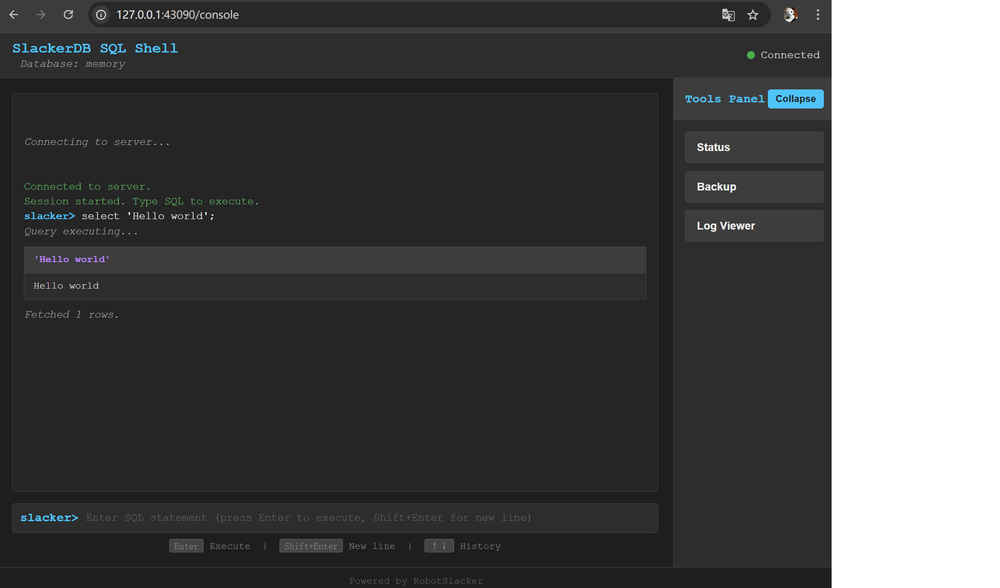

.RobotSlacker


== SlackerDB (DuckDB Postgres proxy)

=== What is SlackerDB?

SlackerDB is a Java‑based service layer that puts DuckDB on the network. It speaks the PostgreSQL wire protocol, so standard PostgreSQL clients connect without any special driver, and it lets several clients use the same DuckDB database at once — something a plain DuckDB process cannot do. On top of that it adds a registered‑SQL layer that turns queries into cacheable HTTP endpoints, and a bulk COPY path for loading data.

It runs either as a standalone server (`dbserver`) or embedded directly in a Java application.

==== Capabilities

* *PostgreSQL Wire Protocol* – Standard PostgreSQL clients connect as‑is: JDBC, ODBC, libpq, psql, Python, and database tools such as DBeaver. A system catalog compatibility layer (`pg_catalog` emulation) keeps third‑party client metadata queries working.
* *Multi‑Session Access* – One DuckDB database served to many concurrent client sessions, with a connection pool, per‑session state, and SQL executed off the network I/O threads.
* *Query Cancellation* – Client‑side cancellation and `KILL SESSION` reach the statement that is actually running.
* *High‑Performance Data Import* – PostgreSQL `COPY … FROM STDIN` in CSV and BINARY form, with a streaming decode path benchmarked at roughly 0.6–2.3 million rows/second depending on shape.
* *Registered SQL Services* – Register parameterized SQL as named HTTP endpoints at runtime, with result caching, service versioning, and per‑service search paths.
* *Server Management APIs* – Status and metrics, database backup, log viewing, and file upload/download on the management port.
* *Asynchronous SQL over WebSocket* – Execute SQL asynchronously and page through results, for queries too large or too slow for a single request.
* *Embeddable Design* – Run as a standalone process, or embed in Java code; multiple instances can run side by side on different ports.
* *Plugin System* – Extensible PF4J‑based plugin framework for custom functionality, HTTP endpoints, and background tasks, with runtime load/start/stop/unload.
* *Data Encryption* – Leverages DuckDB's native encryption for data‑at‑rest protection.

==== Use Cases

* *Analytical Application Backends* – Serve as the data engine for BI tools, dashboards, and reporting applications that expect a PostgreSQL connection.
* *Shared Internal Datasets* – Load an existing `.duckdb` file once and let several teams and tools query it concurrently without moving or re‑platforming the data.
* *Local Data Processing* – Run bulk import, transformation, and querying on a single machine without standing up a separate database system.
* *Embedded Service in Java* – Ship a networked analytical store inside a Java application, with the plugin framework available for application‑specific endpoints.

SlackerDB is aimed at teams that want DuckDB's analytical performance but need it reachable over the network, usable by existing PostgreSQL tooling, and shareable between concurrent clients.

=== Usage

==== Build from source:

....
    # make sure you have JDK17 and maven 3.6+ ready.
    # Download source code
    git clone ...
    # compile it
    cd slackerdb
    mvn clean compile package -Dmaven.test.skip=true

    # All compiled results will be placed in the dist directory:
    #    slackerdb-dist_0.2.1.zip
    #        distribution package - standalone jar packages, plugin jar,
    #        default configuration files and start/stop scripts.
    #    slackerdb-src_0.2.1.zip
    #        source package - the complete multi-module Maven project, the same
    #        content a shallow clone would give you (no git history, no build
    #        output). Unzip it and run the very same maven command inside to
    #        rebuild everything from source.
....

==== Start db server

....
    java -jar dbserver/target/slackerdb-dbserver-0.2.1-standalone.jar start
....

==== Stop db server

....
    java -jar dbserver/target/slackerdb-dbserver-0.2.1-standalone.jar stop
....

==== Check db status

....
    java -jar dbserver/target/slackerdb-dbserver-0.2.1-standalone.jar status
....

==== Start db proxy

....
    java -jar dbproxy/target/slackerdb-dbproxy-0.2.1-standalone.jar start
....

==== Stop db proxy

....
    java -jar dbproxy/target/slackerdb-dbproxy-0.2.1-standalone.jar stop
....

==== Check proxy status

....
    java -jar dbproxy/target/slackerdb-dbproxy-0.2.1-standalone.jar status
....

==== Server configuration file template

....
# Database name, default is none.
data=

# Path where data files are saved
# ":memory:" indicates in-memory mode (data will be lost after restart)
data_dir=:memory:

# Temporary files directory during operations
# Disk mode:   Defaults to data_dir if not specified
# Memory mode: Defaults to system temp directory if not specified
# Recommended: Use high-performance storage for temp_dir
temp_dir=

# Directory for extension plugins
# Default: $HOME/.duckdb/extensions
extension_dir=

# Directory for custom plugins
# Default: None
plugins_dir=

# Run as background daemon (true/false)
# Command line notes: `--daemon true|false`; a bare `--daemon` means true.
# An explicit `--daemon` on the command line overrides this setting.
# Only the `start` subcommand supports daemon mode.
daemon=

# PID file location
# - Locks exclusively during server operation
# - Startup aborts if file is locked by another process
# - No file created if not configured, and no lock.
pid=

# Log output destinations (comma-separated)
# "CONSOLE" for stdout, file paths for file logging
log=CONSOLE,logs/slackerdb.log

# Log verbosity level
log_level=INFO

# Main service port
# 0 = random port assignment
# -1 = disable network interface
# Default: 0 (disabled)
port=

# Used to indicate whether data encryption is enabled.
# If enabled, a key must be provided before accessing the database.
# default: false
data_encrypt=false

# Data service API port
# 0 = random port assignment
# -1 = disable interface (default)
port_x=

# Network binding address
bind=0.0.0.0

# Client connection idle timeout (seconds)
client_timeout=600

# Multicast service discovery: the group this server announces itself to.
# Format: <group>:<port> (IPv6 groups must be bracketed: [ff02::1]:46666)
# IPv4 groups must be inside 224.0.0.0/4; 224.0.0.0/24 is reserved and rejected.
# There is NO default: leaving it empty disables service discovery entirely.
# The proxy must use the EXACT same value in listener_address, otherwise nothing is
# discovered and nothing is logged about it here either.
# Example: 239.255.66.66:46666
advertise_address=

# Local network interface used to send the multicast announcement.
# Accepts an interface name (eth0, Ethernet) or a local IPv4 address. Leaving it empty
# picks the first usable interface (up, multicast-capable, non-loopback, with a
# non-link-local IPv4 address) using a deterministic rule, so the same machine always
# picks the same one. The chosen interface and address are logged at startup -- check
# there first when discovery does not work.
# Ignored when advertise_address is empty.
advertise_nic=

# Database opening mode.
# Default: READ_WRITE
access_mode=READ_WRITE

# Maximum concurrent connections
# Default: 256
max_connections=

# Maximum worker threads
# Default: CPU core count
max_workers=

# Business processing threads (executes SQL off the Netty I/O threads)
# Default: -1 = follow max_connections (one business thread per session)
#   0 = disabled (run SQL on the I/O threads; a slow query will block other
#       connections sharing the same I/O thread)
#  >0 = explicit thread count
# Note: connections sharing one business thread still queue behind each other.
# The number of connections affected by a slow query is about
# (connections / business_threads - 1), so keep this close to the number of
# concurrently active sessions.
business_threads=

# Database engine threads
# Default: memory_limit (GB) / 10 (minimum 1)
# Recommendation: adjust based on workload
threads=

# Auto workload threshold for memory limit calculation
# Value range: >0 and <=1, default: 0.8
# Used to compute default memory_limit if memory_limit is not set
auto_workload_threshold=

# Memory usage limit (K/M/G suffix)
# Default: 80% of total system memory
# -1 = unlimited (memory mode only)
memory_limit=

# Database template file
template=

# Initialization script(s)
# Executes only on first launch
# Accepts: .sql file or directory
init_script=

# Startup script(s)
# Executes on every launch
# Accepts: .sql file or directory
startup_script=

# System locale
# Default: OS setting
locale=

# SQL command history
# ON = enable tracking
# OFF = disable (default)
sql_history=OFF

# Minimum idle connections in pool
connection_pool_minimum_idle=3

# Maximum idle connections in pool
connection_pool_maximum_idle=10

# Connection lifetime (milliseconds)
connection_pool_maximum_lifecycle_time=900000

# Query result cache configuration (in bytes)
# - Only caches API request results (JDBC queries unaffected)
# - Default: 1GB (1073741824 bytes)
# - Set to 0 to disable caching
query_result_cache_size=

# Data service history
# ON = enable tracking
# OFF = disable (default)
data_service_history=

# Data service schema initialization file/path
# - Accepts:
#   * JSON file path (single schema)
#   * Directory path (loads all *.service files)
# - Schema files should contain service definitions in JSON format
data_service_schema=

# MCP definitions loaded at startup
# - Accepts:
#   * JSON file path (single config)
#   * Directory path (loads all *.mcp and *.service files, in name order)
# - Each tool entry may set "handler": "builtin:<name>" to bind to a real implementation
#   (run_sql, list_tables, describe_table, sample_rows, list_services,
#    open_session, close_session).
#   Without "handler" the tool only echoes its arguments.
#   Built-in tool names are reserved: a declared tool may not reuse one.
# Default: empty (no MCP definitions; the built-in tools are always available)
mcp_config=

# MCP LLM server configuration
# Format: <service>:<ip>:<port>:<model>
# Example: openai:api.openai.com:443:gpt-4
# Default: empty (no LLM server configuration)
mcp_llm_server=

# MCP LLM API key for services that require authentication
# Required for OpenAI API and optional for other services
# Example: sk-xxxxxxxxxxxxxxxxxxxxxxxxxxxxxxxx
# Default: empty (no API key)
mcp_llm_key=

# Unix Domain Socket file path
# Used for UDS (Unix Domain Socket) connections instead of TCP
# Default: empty (UDS disabled, use TCP)
# Note: Only supported on Linux/macOS. Ignored on Windows.
socket=
....

==== Proxy configuration file template

....
# PID file location
# - Locks exclusively during server operation
# - Startup aborts if file is locked by another process
# - No file created if not configured, and no lock.
pid=

# Log output destinations (comma-separated)
# "CONSOLE" for stdout, file paths for file logging
log=CONSOLE,logs/slackerdb-proxy.log

# Log level
log_level=INFO

# Run as background daemon (true/false)
# Command line notes: `--daemon true|false`; a bare `--daemon` means true.
# An explicit `--daemon` on the command line overrides this setting.
# Only the `start` subcommand supports daemon mode.
daemon=

# Main service port
# 0 = random port assignment
# -1 = disable network interface
# Default: 0 (disabled)
port=0

# Data service API port
# 0 = random port assignment
# -1 = disable interface (default)
port_x=0

# Network binding address
bind=0.0.0.0

# Client connection idle timeout (seconds)
client_timeout=600

# Maximum worker threads
# Default: CPU core count
max_workers=

# Business processing threads (executes SQL off the Netty I/O threads)
# Default: -1 = follow max_connections (one business thread per session)
#   0 = disabled (run SQL on the I/O threads); >0 = explicit thread count
business_threads=

# Database engine threads
# Default: memory_limit (GB) / 10 (minimum 1)
# Recommendation: adjust based on workload
threads=

# Auto workload threshold for memory limit calculation
# Value range: >0 and <=1, default: 0.8
# Used to compute default memory_limit if memory_limit is not set
auto_workload_threshold=

# Memory usage limit (K/M/G suffix)
# Default: 80% of total system memory
# -1 = unlimited (memory mode only)
memory_limit=

# System locale
# Default: OS setting
locale=
....

Note: All parameters are optional. +
You can keep only the parameters you need to modify. +
For parameters that are not configured, default values will be used.

==== Service discovery: migrating from the registration mechanism

In previous versions a dbserver registered itself by periodically sending a `REGISTER` command to a
fixed proxy address (`IP:PORT`) configured through `remote_listener`, and sent `UNREGISTER` on
shutdown. **That parameter has been removed** and replaced by UDP multicast discovery: the dbserver
periodically announces "I am here" to a multicast group, and the proxy joins the same group and
keeps its alias-to-backend map from those announcements.

.Parameter mapping
[cols="1,1,2",options="header"]
|===
| Old | New | Notes
| dbserver `remote_listener=IP:PORT` | dbserver `advertise_address=<group>:<port>` | Semantics changed: from a unicast address pointing at one proxy to a multicast group shared by a subnet
| — | dbserver `advertise_nic=<name or local IP>` | New. Empty means "pick the first usable interface"
| — | dbproxy `listener_address=<group>:<port>` | New. Must match the dbserver `advertise_address` exactly
|===

There is **no default value**: leaving both sides unconfigured disables discovery entirely rather
than falling back to a group that "looks usable".
There is also **no fallback channel**: the legacy unicast `REGISTER` / `UNREGISTER` commands have
been removed from the proxy, so both sides must be upgraded.

.Upgrade style
[cols="1,3",options="header"]
|===
| Style | Notes
| Stop both, upgrade, restart (recommended) | No discovery gap at all
| Rolling upgrade | There will be a gap, and it happens **whichever side goes first**: upgrade the dbserver first and the old proxy cannot receive multicast, so the new dbserver is invisible meanwhile; upgrade the proxy first and the old dbserver's registration is no longer accepted, so that dbserver is invisible meanwhile. Schedule a maintenance window in production
|===

.Upgrade steps
[cols="1,3",options="header"]
|===
| Step | Action
| 1 | Stop both the dbserver and the dbproxy
| 2 | Upgrade the **dbproxy** and add `listener_address=<group>:<port>` to its conf
| 3 | Upgrade the dbserver: **delete** `remote_listener=` from its conf and add `advertise_address=` (plus `advertise_nic=` if needed)
| 4 | Start both
| 5 | Run `status` on the proxy and confirm the aliases appear (the `Lease` column should show remaining time)
|===

WARNING: `remote_listener` was removed outright. Configuration parsing rejects unknown parameters
(`SLACKERDB-00004`), so a conf file that still contains `remote_listener=` makes a new dbserver
**fail to start** -- not "fail to register", but exit. The conf must be updated together with the
binary.

WARNING: Roll both sides back together, configuration included.

.Checklist when discovery does not work
[cols="1,3",options="header"]
|===
| Symptom | What to check
| Nothing shows up on the proxy | Whether both sides use exactly the same group; whether the dbserver startup log contains a `[DISCOVERY] Advertising ...` line; whether the proxy startup log contains a `[DISCOVERY] Listening on ...` line
| The dbserver fails at startup | Whether the interface name is misspelled; whether the host has any usable interface (try leaving `advertise_nic=` empty)
| The proxy log shows `Unknown admin command [REGISTER ...]` | A dbserver is still on the old version with the old registration parameter. It is now ignored by the discovery mechanism and must be upgraded
| Log says `No announcement received ... for 60 seconds` | Whether the firewall allows inbound UDP (default port 46666); whether the switches have IGMP snooping enabled; whether the two hosts are on different subnets (the multicast TTL is fixed at 1 and does not leave the subnet)
| An alias appears and then disappears | Whether the target host went silent for 15 seconds (process killed, machine suspended, network hiccup)
| Containers / Kubernetes | Most CNIs do not forward multicast, so this mechanism does not work there. Plan something else (host networking, or a unicast discovery mechanism)
|===

NOTE: The alias defaults to the database name, exactly as the old `AS <database>` did, so **client
connection strings do not change**.

NOTE: The advertised host defaults to the **source address of the UDP datagram**, not the address
the sender reports about itself -- the source address is by definition reachable from the proxy.
On multi-homed hosts either set `advertise_nic` explicitly or check the interface that the startup
log reports.

==== JDBC Support

SlackerDB provides full PostgreSQL wire protocol compatibility, allowing you to connect using standard JDBC drivers. This enables you to use any PostgreSQL‑compatible JDBC client, including the native SlackerDB JDBC driver for optimal integration.

*PostgreSQL JDBC Driver*
You can use the standard PostgreSQL JDBC driver (`org.postgresql.Driver`) with the connection URL format `jdbc:postgresql://host:port/database`. This is useful when you want to reuse existing PostgreSQL tooling.

*SlackerDB JDBC Driver*
For better integration and additional features, use the native SlackerDB JDBC driver (`org.slackerdb.jdbc.Driver`). The connection URL format is `jdbc:slackerdb://host:port/database`. This driver is included in the distribution and is recommended for new applications.

*Connection Examples*

....
// PostgreSQL JDBC driver
String url = "jdbc:postgresql://127.0.0.1:3175/db1";
Connection conn = DriverManager.getConnection(url, "main", "");
conn.setAutoCommit(false);

// SlackerDB JDBC driver
String url = "jdbc:slackerdb://127.0.0.1:3175/db1";
Connection conn = DriverManager.getConnection(url, "main", "");
conn.setAutoCommit(false);
....

*IDE Integration*

You can connect to SlackerDB from database tools DBeaver. (For other tools, we have not verified it.) +
*Use PostgreSQL driver* +
Download postgresql server and connect database like a pg.

*Use custom driver* +
Since native Postgres clients often use some data dictionary information
that duckdb doesn’t have, +
You can create a generic JDBC driver with the following settings: +

....
Dbeaver:
Database -> Driver Manager -> New
   Database type: generic database.
   Class name:    org.slackerdb.jdbc.Driver
   URL template:  jdbc:slackerdb://{host}:{port}/[{database}]
....


*ODBC and Python*
SlackerDB also supports ODBC and Python connections via the same PostgreSQL wire protocol. Refer to the respective client documentation for setup details.

==== Unix Domain Socket (UDS) Support

SlackerDB supports Unix Domain Socket (UDS) connections for local inter-process communication. UDS provides lower latency and higher throughput compared to TCP loopback connections, making it ideal for local client-server communication on the same machine.

NOTE: UDS is only supported on Linux and macOS. On Windows, the `socket` parameter is ignored and a log message is printed.

===== Server Configuration

You can enable UDS by setting the `socket` parameter in the server configuration file:

....
# dbserver/conf/dbserver.conf
socket=/tmp/.s.slackerdb.4309
....

Alternatively, use the `--socket` command-line parameter:

....
java -jar dbserver/target/slackerdb-dbserver-0.2.1-standalone.jar start --socket /tmp/.s.slackerdb.4309
....

When `socket` is configured, the server listens on both the TCP port and the UDS socket simultaneously. Clients can connect via either method.

===== JDBC Connection via UDS

To connect to SlackerDB via UDS using the SlackerDB JDBC driver, use the `jdbc:slackerdb://` protocol with the `socketFactory` and `socketFactoryArg` connection parameters:

....
// SlackerDB JDBC driver with UDS
String url = "jdbc:slackerdb:///mem";
Properties props = new Properties();
props.setProperty("user", "");
props.setProperty("password", "");
props.setProperty("socketFactory",
        "org.slackerdb.jdbc.UnixDomainSocketFactory");
props.setProperty("socketFactoryArg", "/tmp/.s.slackerdb.4309");

Connection conn = DriverManager.getConnection(url, props);
conn.setAutoCommit(false);
....

The `UnixDomainSocketFactory` class is included in the SlackerDB JDBC driver and uses Java's built-in `UnixDomainSocketAddress` API (Java 16+) to establish UDS connections.

Key points:
* The `socketFactory` parameter must be set to `org.slackerdb.jdbc.UnixDomainSocketFactory`
* The `socketFactoryArg` parameter specifies the UDS socket file path
* The `jdbc:slackerdb://` protocol is used (not `jdbc:postgresql://`)
* The host portion of the URL is ignored when using UDS; use `///database` format

==== Basic Services
The following HTTP endpoints provide basic administrative functions, such as backup, file upload/download, log viewing, and status monitoring. These endpoints are available when the Data Services API port (port_x) is enabled.

===== /backup (POST)

Performs a database backup. The backup file is saved in the `backup/` directory with the naming pattern `\{database\}_\{backupTag\}.db`.

.Request body (JSON):
[source,json]
----
{
  "backupTag": "mybackup"
}
----

.Response example (success):
[source,json]
----
{
  "retCode": 0,
  "retMsg": "Successful. Backup file has placed to [C:\\Work\\slackerdb\\backup\\mydb_mybackup.db]."
}
----

===== /download (GET)

Downloads a file from the server's working directory.

.Query parameters:
* `filename` (required) – relative path to the file.

.Example:
 GET /download?filename=logs/slackerdb.log

The endpoint supports Range requests for partial downloads.

===== /upload (POST)

Uploads a file to the server's working directory.

.Query parameters:
* `filename` (required) – target file path.

.Form data:
* `file` (required) – the file to upload.

.Example using curl:
[source,bash]
----
curl -X POST -F "file=@local.txt" "http://localhost:8080/upload?filename=uploads/remote.txt"
----

.Response:
[source,json]
----
"uploaded: C:\\Work\\slackerdb\\uploads\\remote.txt"
----

===== /viewLog (GET)

Retrieves the last N lines of a log file.

.Query parameters:
* `filename` (required) – path to the log file.
* `lines` (optional) – number of lines to return (default 100, max 10000).

.Example:
 GET /viewLog?filename=logs/slackerdb.log&lines=50

.Response (JSON array of strings):
[source,json]
----
[
  "2025-12-04 10:00:00 INFO  Server started",
  "2025-12-04 10:00:01 INFO  Listening on port 8080"
]
----

===== /status (GET)

Returns comprehensive server status information, including server details, database metrics, configuration parameters, usage statistics, installed extensions, and active sessions.

.Example:
 GET /status

.Response (abbreviated):
[source,json]
----
{
  "server": {
    "status": "RUNNING",
    "version": "0.2.1",
    "build": "2025-12-04 10:00:00.000 UTC",
    "pid": 12345,
    "now": "2025-12-04 15:20:00",
    "bootTime": "2025-12-04 10:00:00",
    "runTime": "5 hours, 20 minutes, 0 seconds"
  },
  "database": {
    "version": "v1.0.0",
    "size": "1.2 GB",
    "memoryUsage": "256 MB",
    "walSize": "0 B"
  },
  "parameters": {},
  "usage": {},
  "extensions": [],
  "sessions": []
}
----

==== PL/SQL Support

SlackerDB ships a PL/SQL engine for **anonymous blocks**: declare variables, branch, loop, iterate
cursors, fetch into variables and handle exceptions — all on top of DuckDB.

===== Running a block

Wrap the block in `DO $$ ... $$` (PostgreSQL style) and send it like any other statement:

[source,sql]
----
DO $$
DECLARE
    CURSOR cur IS SELECT id, name FROM users WHERE active = true;
    v_id   BIGINT;
    v_name TEXT;
    total  INTEGER := 0;
BEGIN
    OPEN cur;
    LOOP
        FETCH cur INTO v_id, v_name;
        EXIT WHEN cur%NOTFOUND;

        IF v_name IS NULL THEN
            CONTINUE;
        ELSIF length(v_name) > 20 THEN
            UPDATE users SET name = substr(:v_name, 1, 20) WHERE id = :v_id;
        ELSE
            INSERT INTO audit(user_id, note) VALUES (:v_id, 'ok: ' || :v_name);
        END IF;

        total := total + 1;
        EXIT WHEN total >= 1000;
    END LOOP;
    CLOSE cur;
EXCEPTION
    WHEN NO_DATA_FOUND THEN
        INSERT INTO audit(user_id, note) VALUES (NULL, 'no rows');
    WHEN OTHERS THEN
        ROLLBACK;
        RAISE;
END;
$$;
----

Supported wrappers: `DO $$ ... $$`, `DO $tag$ ... $tag$`, bare `$$ ... $$`, and unwrapped
`DECLARE ... BEGIN ... END;` scripts (the latter needs a client that does not split statements —
see *Client notes* below). One query string may contain several statements; they run in order.

===== Typical examples

The four blocks below are **self-contained**: each one creates its own tables, so you can paste any
of them into a client and run it as is. Two conventions to keep in mind: in the structural part
(`IF`, `WHILE`, `FETCH INTO`, assignments) variables can be written bare; while **variables inside
embedded SQL must be written as `:name`** (bind parameters).

*Variables, `IF`/`ELSIF` branching and a `WHILE` loop*:

[source,sql]
----
DO $$
DECLARE
    i     INTEGER := 1;
    total INTEGER := 0;
BEGIN
    CREATE OR REPLACE TABLE demo_numbers(n INTEGER, kind TEXT);

    WHILE i <= 6 LOOP
        IF i % 2 = 0 THEN
            INSERT INTO demo_numbers VALUES (:i, 'even');
        ELSIF i % 3 = 0 THEN
            INSERT INTO demo_numbers VALUES (:i, 'multiple of 3');
        ELSE
            INSERT INTO demo_numbers VALUES (:i, 'other');
        END IF;
        total := total + i;
        i := i + 1;
    END LOOP;

    INSERT INTO demo_numbers VALUES (:total, 'sum');
END;
$$;
----

Result: `demo_numbers` holds six classified rows (`other` / `even` / `multiple of 3`) plus the
summary row `(21, 'sum')`.

*Walking a cursor with `%NOTFOUND`, plus an exception handler*:

[source,sql]
----
DO $$
DECLARE
    CURSOR cur IS SELECT id, name FROM demo_emp ORDER BY id;
    v_id    INTEGER;
    v_name  TEXT;
    v_total INTEGER := 0;
BEGIN
    CREATE OR REPLACE TABLE demo_emp(id INTEGER, name TEXT);
    INSERT INTO demo_emp VALUES (1, 'alice'), (2, 'bob'), (3, 'carol');
    CREATE OR REPLACE TABLE demo_audit(id INTEGER, note TEXT);

    OPEN cur;
    LOOP
        FETCH cur INTO v_id, v_name;
        EXIT WHEN cur%NOTFOUND;

        IF v_name IS NULL THEN
            CONTINUE;
        END IF;

        INSERT INTO demo_audit VALUES (:v_id, 'ok: ' || :v_name);
        v_total := v_total + 1;
    END LOOP;
    CLOSE cur;

    INSERT INTO demo_audit VALUES (0, 'count = ' || CAST(:v_total AS TEXT));
EXCEPTION
    WHEN OTHERS THEN
        INSERT INTO demo_audit VALUES (-1, 'failed');
END;
$$;
----

Result: `demo_audit` receives three `ok: <name>` rows for ids `1/2/3`, plus `(0, 'count = 3')`.

*`SELECT ... INTO` with an exception handler that branches on the error code*:

[source,sql]
----
DO $$
DECLARE
    v_name TEXT;
    v_cnt  INTEGER;
BEGIN
    CREATE OR REPLACE TABLE demo_dept(id INTEGER, name TEXT);
    INSERT INTO demo_dept VALUES (1, 'sales'), (2, 'hr');

    SELECT count(*) INTO v_cnt FROM demo_dept;

    BEGIN
        SELECT name INTO v_name FROM demo_dept WHERE id = 99;
    EXCEPTION
        WHEN NO_DATA_FOUND THEN
            v_name := '(not found)';
        WHEN TOO_MANY_ROWS THEN
            v_name := '(too many rows)';
    END;

    CREATE OR REPLACE TABLE demo_result(cnt INTEGER, name TEXT);
    INSERT INTO demo_result VALUES (:v_cnt, :v_name);
END;
$$;
----

Result: `demo_result` holds `(2, '(not found)')` — when the query matches no row, `SELECT INTO`
raises `NO_DATA_FOUND`, which the inner block catches.

*Dynamic SQL: `EXECUTE IMMEDIATE` with `USING` and `INTO`*:

[source,sql]
----
DO $$
DECLARE
    v_table TEXT := 'demo_dyn';
    v_id    INTEGER := 7;
    v_cnt   INTEGER;
BEGIN
    EXECUTE IMMEDIATE 'CREATE OR REPLACE TABLE ' || v_table || '(id INTEGER)';
    EXECUTE IMMEDIATE 'INSERT INTO ' || v_table || ' VALUES (?)' USING v_id;
    EXECUTE IMMEDIATE 'SELECT count(*) FROM ' || v_table INTO v_cnt;
    EXECUTE IMMEDIATE 'INSERT INTO ' || v_table || ' VALUES (?)' USING v_cnt * 10;
END;
$$;
----

Result: `demo_dyn` holds the two rows `7` and `10`; `USING` values bind to the placeholders in the
order they appear (`?`, `:1` and `:name` all work, and `:name` also resolves from the current scope
when there is no `USING` clause).

===== What is supported

[cols="22%,78%",options="header",]
|===
|Area |Supported

|Declaration |`DECLARE` variables with `INTEGER`/`SMALLINT`/`BIGINT`/`DECIMAL(p,s)`/`REAL`/`DOUBLE`/`VARCHAR(n)`/`CHAR(n)`/`TEXT`/`BOOLEAN`/`DATE`/`TIME`/`TIMESTAMP [WITH TIME ZONE]`/`INTERVAL`, `NOT NULL`, defaults, and `CURSOR name [(params)] IS <query>`

|Assignment |`x := expr;` and `LET x = expr;`

|Conditionals |`IF / ELSIF / ELSE / END IF` (also `ELSEIF`, `ENDIF`, `==`, `!=`, `&&`, `!`)

|Loops |`LOOP`, `WHILE cond LOOP`, `FOR i IN [REVERSE] a..b LOOP` (inclusive), `FOR i IN [v1, v2] LOOP`, `EXIT [WHEN cond]`, `CONTINUE [WHEN cond]`, labelled loops

|Cursors |`OPEN` / `FETCH ... INTO` / `CLOSE`, `%FOUND`, `%NOTFOUND`, `%ROWCOUNT`, `%ISOPEN`

|Queries |`SELECT ... INTO v1[, v2]` (exactly one row), any DuckDB SQL statement, `:name` bind variables in SQL text

|Dynamic SQL |`EXECUTE IMMEDIATE <SQL text> [INTO targets...] [USING values...]`: the SQL text is evaluated at run time (build it with `\|\|`), placeholders may be `?` / `:1` / `:name`, and `USING` binds them in order of appearance; without `INTO` a result set is discarded, with `INTO` single-row semantics apply (`NO_DATA_FOUND` / `TOO_MANY_ROWS` / `24000`), and a placeholder/`USING` count mismatch raises `07001`

|Exceptions |`EXCEPTION WHEN NO_DATA_FOUND / TOO_MANY_ROWS / ZERO_DIVIDE / OTHERS / <custom> THEN`, `RAISE`, `RAISE name`, re-raise inside a handler, nested blocks (legacy `EXCEPTION:` = `WHEN OTHERS`)

|Expressions |Arithmetic, `\|\|` concatenation, comparisons, `IS [NOT] NULL`, `LIKE`, `IN`, `BETWEEN`, `CASE`, logical `AND`/`OR`/`NOT` with short-circuit, and any DuckDB function
|===

===== Semantics worth knowing

* Variables start as `NULL` (not `0`).
* `FOR i IN 1..5` iterates **1,2,3,4,5** (both bounds inclusive); `FOR i IN 5..1` iterates 0 times;
  `FOR i IN REVERSE 5..1` iterates 5,4,3,2,1.
* `EXIT` leaves only the innermost loop; `EXIT label` leaves the named loop.
* `SELECT ... INTO` with 0 rows raises `NO_DATA_FOUND`, with more than one row `TOO_MANY_ROWS` —
  it never silently picks a row.
* `:name` inside **string literals** is not substituted (`'Hello :name'` is literal text; use `||`).
* Expressions are evaluated with **bind parameters** — values are never spliced into SQL text.
* Division by zero raises `ZERO_DIVIDE`, so `WHEN ZERO_DIVIDE` works.
* A block never returns a result set; write results to tables instead.
* Runaway loops are stopped by a statement budget (200000 statements) → `54000`.

===== Error codes

[cols="22%,78%",options="header",]
|===
|SQLSTATE |Meaning

|`42601` |Syntax or semantic error (unknown variable/cursor, duplicate declaration, unsupported type) — reported with `line:column`
|`P0002` / `P0003` |`NO_DATA_FOUND` / `TOO_MANY_ROWS`
|`22012` |`ZERO_DIVIDE`
|`22001` / `22003` / `22P02` / `22007` / `42804` |String too long / numeric out of range / bad numeric text / bad datetime / datatype mismatch
|`24000` |Invalid cursor state; `INTO` target count mismatch
|`P0001` |User `RAISE`
|`57014` |Canceled by `CancelRequest` / `KILL SESSION` (long PL/SQL loops are interruptible)
|`54000` |Statement budget exceeded (possible infinite loop)
|===

===== Client notes

A PL/SQL block must reach the server **unsplit**. SlackerDB's own JDBC driver splits statements on
top-level semicolons in the extended protocol; it understands dollar quoting, so `DO $$ ... $$` is
sent as one statement while an unwrapped `DECLARE ... END;` block is not.

[cols=",",options="header",]
|===
|Block form |Extended protocol (default) |Simple query protocol (`preferQueryMode=simple`, psql)

|`DO $$ ... $$` |OK |OK
|bare `$$ ... $$` |OK |OK
|unwrapped `DECLARE ... END;` |split by the driver — use `DO $$` instead |OK
|===

===== Types and implicit conversion

Variables are typed at declaration. Every assignment converts the value to the declared type with
these rules:

[cols="30%,70%",options="header",]
|===
|Source → target |Result

|NULL → any |OK (stays NULL)
|between numeric types |OK; widening is lossless, narrowing rounds half-up, **overflow raises `22003`**
|string → numeric/date/time/timestamp |OK when the text parses as that literal, otherwise `22P02` (or `22007` for datetime)
|numeric/date/time/timestamp → string |OK (standard text form)
|string → `VARCHAR(n)`/`CHAR(n)` when longer than `n` |**`22001` — never silently truncated**
|anything involving `BOOLEAN` (except NULL) |`42804` — use an explicit function or `CAST`
|anything else |`42804`
|===

Identifiers are case-insensitive and folded to lower case unless quoted (`"Mixed"` keeps its case).
An uninitialised variable is `NULL`; `NOT NULL` declarations reject NULL assignment (`22004`).

===== Loop boundaries

[cols="45%,55%",options="header",]
|===
|Form |Iterations

|`FOR i IN 1..1` |1 (i = 1)
|`FOR i IN 1..5` |5 — **both bounds inclusive**
|`FOR i IN 1..0`, `FOR i IN 5..1` |0
|`FOR i IN REVERSE 5..1` |5 → 5,4,3,2,1
|`FOR i IN REVERSE 1..5` |0
|`FOR i IN -3..-1` |3 → -3,-2,-1
|`FOR i IN [v1, v2, v3]` |one iteration per list element (compatibility form)
|`WHILE NULL LOOP` |0 (NULL counts as false)
|`LOOP` that never exits |stopped by the statement budget → `54000`
|===

The loop variable is implicit, read-only, and invisible outside the loop. `EXIT` / `CONTINUE`
affect only the innermost loop; `EXIT name` leaves the loop that carries that label:

[source,sql]
----
<<outer_loop>>
LOOP
    ...
    EXIT outer_loop WHEN done = 1;
END LOOP outer_loop;
----

===== Expression semantics

* Precedence, high to low: `**` → unary `-` / `NOT` → `* / %` → `+ -` → `||` → comparisons
  (`= <> < <= > >=`, `IS [NOT] NULL`, `LIKE`, `IN`, `BETWEEN`) → `AND` → `OR`.
* `NULL` in a condition counts as false; `AND`/`OR` short-circuit, so `false AND (1/0 = 1)` is fine.
* `||` is **string concatenation** (SQL semantics) — write `OR` for logical or.
* Every variable value is passed as a bind parameter; values are never spliced into SQL text.
* Function calls are delegated to DuckDB, so any DuckDB scalar function works (qualified names such
  as `schema.func` are accepted).

Compatibility aliases kept from earlier versions:

[cols="30%,70%",options="header",]
|===
|Alias |Equivalent

|`LET x = e` |`x := e`
|`PASS` |`NULL;`
|`BREAK` |`EXIT`
|`==` `!=` `&&` `!` |`=` `<>` `AND` `NOT`
|`ELSEIF` / `ENDIF` |`ELSIF` / `END IF`
|`EXCEPTION:` + statements |`EXCEPTION WHEN OTHERS THEN`
|`FOR :i IN 1 TO 5` |`FOR i IN 1..5`
|`FOR i IN [v1, v2]` |list iteration
|`%notfound`, `%found`, `%rowcount`, `%isopen` |case-insensitive cursor attributes
|===

===== Cursor state machine

|===
|State \ operation |OPEN |FETCH |CLOSE |`%ISOPEN` |`%FOUND` |`%NOTFOUND` |`%ROWCOUNT`

|Closed (declared, not opened) |OK |`24000` |`24000` |false |`24000` |`24000` |`24000`
|Open, rows available |`24000` |OK, count+1 |OK |true |true |false |n
|Open, no rows |`24000` |OK → EOF, notFound=true |OK |true |false |true |0
|Open, after EOF |`24000` |OK (stays EOF, variables keep their values) |OK |true |false |true |n
|Closed after fetching |OK |`24000` |`24000` |false |`24000` |`24000` |`24000`
|===

A cursor opened in a block is closed automatically when that block ends (including on the exception
path); `CLOSE` followed by `OPEN` is allowed and resets `%ROWCOUNT`.

===== Statement routing

* Wrappers: `DO $$ … $$`, `DO $tag$ … $tag$`, bare `$$ … $$`, or an unwrapped `DECLARE … END;` script.
* Dollar quoting follows PostgreSQL: there are no escapes inside, the matching tag ends the string —
  use another tag (`$body$ … $body$`) when the body itself must contain `$$`.
* In the simple query protocol one query string may contain several statements separated by
  semicolons; they run in order and each returns its own `CommandComplete` (and result set).
* A PL/SQL block itself returns no rows: `CommandComplete` reports `DO`. Use `DESCRIBE`-visible
  statements (ordinary queries) or write into tables for output.
* In the extended protocol a PL/SQL portal is described as `NoData` and bound without parameters.

===== Limitations and known gaps

Stored procedures, functions, triggers, packages, records/`%ROWTYPE`, collections, cursor `FOR`
loops and `GOTO` are **not** supported. Unsupported constructs fail with an explicit error instead
of being silently ignored.

* `%FOUND` / `%NOTFOUND` applied to a name that is not a cursor is not rejected at compile time.
* Division by zero is detected when the divisor can be resolved locally (literal, variable, cursor
  attribute); a divisor computed by a query keeps the backend behaviour (`Infinity`).
* `TIMESTAMP WITH TIME ZONE` keeps the backend representation; values are not normalised to UTC.
* A block that fails does not roll back by itself — issue `ROLLBACK` in an `EXCEPTION` handler or
  from the client, exactly as with PostgreSQL `DO`.

===== How it works

A block is compiled before anything runs:

```
source text
  └─ detector          classify SQL / block / multi-statement script, unwrap DO $$ … $$
       └─ preparer     replace embedded SQL with equal-length placeholders (line/column preserved)
            └─ ANTLR    structure-only grammar (keywords, control flow, cursors, expressions)
                 └─ AST   statements + expression tree
                      └─ semantic check (unknown names, duplicates) before execution
                           └─ interpreter (scopes, cursors, exceptions, budget, cancellation)
```

Embedded SQL is never guessed by the parser and never re-written; expressions are compiled to
`SELECT <expr>` with bind parameters and cached per syntax node, while purely local expressions are
evaluated in the JVM (that is why a tight loop costs about a microsecond per iteration instead of a
database round trip).

The grammars live under `src/main/antlr4` — `plsql/src/main/antlr4/org/slackerdb/plsql/block/` for
the block structure and `dbserver/src/main/antlr4/org/slackerdb/dbserver/sql/antlr/` for `COPY`.
Nothing has to be generated by hand: the `antlr4-maven-plugin` runs during `generate-sources` and
writes the parsers into `target/generated-sources/antlr4`, which is registered as a compile source
root automatically. That is ordinary build output — `mvn clean` removes it and git never sees it — so
edit only the `.g4` files and let the next build regenerate the rest.

==== Data Service

* Data service work with port_x, please make sure you have enabled it in
server configuration or from command parameter. It’s important to note
that we have no consider on data security. This means data services must
work in a trusted environment.

===== user login

User login (note: this is optional). After success, a token will be
provided. +
Context operations or SQL access that requires context variables will
require token. +
If your program does not involve context feature, you can ignore this
login. +
Put it simplify, the token is currently used as the user ID.

[cols=",",options="header",]
|===
|Attribute |Value
|Protocol |HTTP
|Method |POST
|Path |`+/api/login+`
|===

Response example:

....
Success response (200)

  {
    "retCode": 0,
    "token": “yJhbGciOiJIUzI1NiIsInR5cCI6IkpXVCJ9”,
    "retMsg": "Login successful."
  }
....

===== user logout

User logout

[cols=",",options="header",]
|===
|Attribute |Value
|Protocol |HTTP
|Method |POST
|Path |`+/api/logout+`
|===

headers:

[cols=",",options="header",]
|===
|Attribute |Value
|Authorization |NzJjYjE3NmQtN2Y2ZC00OWMyLWIwODAtYTU1MDE3YzVmZDU1
|===

The token information here is obtained when call /login in earlier

Response example:

....
Success response (200)

  {
    "retCode": 0,
    "retMsg": "Successful."
  }
....

===== set context

set context

[cols=",",options="header",]
|===
|Attribute |Value
|Protocol |HTTP
|Method |POST
|Path |`+/api/setContext+`
|===

headers:

[cols=",",options="header",]
|===
|Attribute |Value
|Authorization |NzJjYjE3NmQtN2Y2ZC00OWMyLWIwODAtYTU1MDE3YzVmZDU1
|===

The token information here is obtained when call /login in earlier

request body:

[cols=",",options="header",]
|===
|Attribute |Value
|key1 |value1
|key2 |value2
|… |…
|keyx |valuex
|===

You can set one or more key-value pairs at once, or you can set multiple
key-value pairs by calling setContext multiple times.

Response example:

....
Success response (200)

  {
    "retCode": 0,
    "retMsg": "Successful."
  }
....

===== removeContext

remove context

[cols=",",options="header",]
|===
|Attribute |Value
|Protocol |HTTP
|Method |POST
|Path |`+/api/removeContext+`
|===

headers:

[cols=",",options="header",]
|===
|Attribute |Value
|Authorization |NzJjYjE3NmQtN2Y2ZC00OWMyLWIwODAtYTU1MDE3YzVmZDU1
|===

The token information here is obtained when call /login in earlier

request body:

[cols=",",options="header",]
|===
|Attribute |Value
|removedKeyList |[key1,key2, ….]
|===

You can remove one or more key-value pairs at once, or you can remove
multiple key-value pairs by calling removeContext multiple times.

Response example:

....
Success response (200)

  {
    "retCode": 0,
    "retMsg": "Successful."
  }
....

===== registerService

register a service

[cols=",",options="header",]
|===
|Attribute |Value
|Protocol |HTTP
|Method |POST
|Path |`+/api/registerService+`
|===

request body:

[width="100%",cols="20%,80%",options="header",]
|===
|Attribute |Value
|serviceName |service name

|serviceVersion |service version

|serviceType |service type, GET/POST

|category |Optional. Grouping label; when services are saved into a directory it becomes the file name
(`<category>.service`, services without a category go to `uncategorized.service`).

|searchPath |sql default search path, Optional parameter

|sql |SQL statement, can contain such $\{var1} variable information

|description |description

|snapshotLimit |how long the query result will be cached, Optional
parameter

|parameter |parameter default value when query api not provide parameter
value
|===

snapshotLimit format: 3 hours / 30 minutes / 45 seconds

Request example:

....
  {
    "serviceName": "queryTest1",
    "serviceVersion": "1.0",
    "serviceType": "GET",
    "sql": "SELECT 1"
  }
....

Response example:

....
Success response (200)

  {
    "retCode": 0,
    "retMsg": "Successful."
  }
....

Registering a service name + version that is already registered is rejected with
`retCode = -1` and `retMsg = "Rejected. [<name>#<version>] is already registered."`.
There is no "update" semantic: unregister first (`/api/unRegisterService`) and register again.

===== unRegisterService

unregister a service

[cols=",",options="header",]
|===
|Attribute |Value
|Protocol |HTTP
|Method |POST
|Path |`+/api/unRegisterService+`
|===

request body:

[width="100%",cols="20%,80%",options="header",]
|===
|Attribute |Value
|serviceName |service name
|serviceVersion |service version
|serviceType |service type, GET/POST
|===

Request example:

....
  {
    "serviceName": "queryTest1",
    "serviceVersion": "1.0",
    "serviceType": "GET"
  }
....

Response example:

....
Success response (200)

  {
    "retCode": 0,
    "retMsg": "Successful."
  }
....

===== listRegisteredService

list all service

[cols=",",options="header",]
|===
|Attribute |Value
|Protocol |HTTP
|Method |GET
|Path |`+/api/listRegisteredService+`
|===

Response example:

....
Success response (200)

  [
    {
      "serviceName" : "Query1",
      "serviceVersion" : "1.0",
      "serviceType" : "GET",
      "category" : "test",
      "searchPath" : "main",
      "sql" : "SELECT 1",
      "description" : "NO DESCRIPTION.",
      "snapshotLimit" : "5 minutes",
      "parameter" : {}
    }
  ]
....

The response is a bare JSON **array** of service definitions (no `retCode` wrapper):
each item contains `serviceName`, `serviceVersion`, `serviceType`, `category`,
`searchPath`, `sql`, `description`, `snapshotLimit` and `parameter`.

Related management endpoints (all POST, empty body):

* `/api/dumpRegisteredService` - same array, returned as a JSON attachment;
* `/api/downloadRegisteredService` - same payload (the endpoint the web console uses);
* `/api/saveRegisterService` - writes the current definitions back to `data_service_schema`
  (a single file, or one `<category>.service` file per category when it is a directory);
* `/api/loadRegisterService` - loads definitions from the request body (a single object or an array).

===== /api/\{apiVersion}/\{apiName}

API query

[cols=",",options="header",]
|===
|Attribute |Value
|Protocol |HTTP
|Method |POST or GET
|Path |`+/api/{apiVersion}/{apiName}+`
|===

headers:

[width="100%",cols="18%,82%",options="header",]
|===
|Attribute |Value
|Authorization |NzJjYjE3NmQtN2Y2ZC00OWMyLWIwODAtYTU1MDE3YzVmZDU1

|snapshotLimit |Optional. used to overwrite service definition. 0 means
no result cache
|===

The token information here is obtained when call /login. +
The token is optional, if you use context in your sql statement, you
must set it. +
snapshotLimit format: 3 hours / 30 minutes / 45 seconds

GET Request example:

....
  GET /api/1.0/queryApi?context1=xxx&context2=yyy
....

POST Request example:

....
  POST /api/1.0/queryApi

  {
    "context1": "xxx",
    "context2": "yyy",
  }
....

Response example:

....
Success response (200)

  {
    "retCode": 0,
    "retMsg": "Successful.",
    "description": "test 1",
    "cached": false,
    "timestamp": 17777700,
    "data":
      {
        "columnNames":["col1","col2","col3"],
        "columnTypes":["INTEGER","INTEGER","VARCHAR"],
        "dataset":[[1,2,"中国"]]
      }
  }
....

Requesting a service that is not registered answers **HTTP 404** with
`{"retCode": 404, "retMsg": "GET /api/1.0/xxx is not registered."}`.

`${var}` placeholders are always validated: when a placeholder has no value
(no request parameter, no default in `parameters`, no token/context variable),
the request is rejected with `retCode = -1` and
`retMsg = "Missing required parameters: <names>"` - the SQL is never executed with a
literal `${var}` left inside it.

===== Result value types

Both the HTTP data service and the SQL REPL return the same JSON representations,
so a client never needs driver-specific knowledge:

[cols="1,2",options="header",]
|===
|Value type |JSON representation

|INTEGER/BIGINT/HUGEINT/DECIMAL/DOUBLE |number
|VARCHAR/UUID/INTERVAL |string
|BOOLEAN |true/false
|DATE/TIME |ISO-8601 string (`2026-10-09`, `12:34:56`)
|TIMESTAMP |ISO-8601 string without zone (`2026-10-09T12:34:56`)
|TIMESTAMP WITH TIME ZONE |ISO-8601 string with offset (`2026-10-09T20:34:56+08:00`)
|BLOB |Base64 string
|LIST/ARRAY |JSON array
|STRUCT |JSON object keyed by field name
|MAP |JSON object
|JSON |the JSON value itself (not a string-escaped copy, not driver internals)
|NULL |null
|===

A result set is materialised into a single response: the data service API has no
cursor/streaming variant, so very large results are bounded by memory.

==== MCP Server

SlackerDB runs a Model Context Protocol (MCP) server on the management port, so AI assistants and other
MCP clients can inspect and query the database.

The implementation targets the **`2026-07-28`** revision of the specification and also accepts earlier
revisions (dual-era support), because installed clients lag the spec.

===== Protocol surface

[cols="1,3",options="header",]
|===
|Item |Behaviour

|Transport |Streamable HTTP: every message is a `POST` to `/mcp` (`/jsonrpc` is kept as a compatibility alias).
|Sessions |**None at the protocol level.** The `initialize` handshake and `Mcp-Session-Id` were removed in
`2026-07-28`. Every request carries its protocol version and client capabilities in
`params._meta` (`io.modelcontextprotocol/protocolVersion`, `.../clientCapabilities`). A version mismatch
returns `UnsupportedProtocolVersionError` (`-32020`).
|`server/discover` |Implemented, as the specification requires. Advertises supported protocol versions,
capabilities, server identity and usage instructions. Sent as a normal `POST`.
|GET requests |Answer `405 Method Not Allowed` (with `Allow: POST`). The specification removed the GET
endpoint, and installed clients probe it to decide whether an SSE stream is offered — 405 is the documented
"none available" answer, so this keeps older SDK clients connecting cleanly.
|Result envelope |Every result carries `resultType` (`complete` or `input_required`).
|Caching |`tools/list`, `prompts/list`, `resources/list`, `resources/read` and `resources/templates/list`
carry `ttlMs` and `cacheScope`.
|`tools/list` |Deterministic (sorted by name) so client-side caches and LLM prompt caches stay effective.
|Removed methods |`ping` and `logging/setLevel` answer with an explicit "removed in 2026-07-28" error rather
than being silently accepted. The `GET /sse` endpoint is gone; log level is per-request via `_meta`.
|===

===== Built-in tools

[cols="1,3",options="header",]
|===
|Tool |Description

|`open_session` |Opens a stateful SQL session and returns a **server-minted handle**. Pass that handle to
`run_sql` to keep temporary tables, transactions and session settings across calls. Sessions expire when
idle and are closed by `close_session`.
|`close_session` |Closes a session and releases its connection immediately.
|`run_sql` |Runs read-only SQL and returns at most `max_rows` rows, with `truncated` reported. The result
also carries `read_only`, `statement_type` (`query`/`update`) and `elapsed_ms`.
|`list_tables` |Lists tables and views as a `tables` array of `{schema, name, type}`, optionally filtered by
schema.
|`describe_table` |Column definitions (name, type, nullable, default) for one table or view, as a `columns`
result grid plus the resolved `schema`/`table`.
|`sample_rows` |A small sample of real values from a table.
|`list_services` |The registered data services (see *Data Service*), so an agent prefers curated, cached,
versioned services over ad-hoc SQL. Each entry carries the endpoint and its parameters; service SQL text is
deliberately not exposed. The same list is also available as the resource `slackerdb://services`, because not
every MCP client consumes resources.
|===

Because protocol-level sessions no longer exist, cross-call state is expressed the way the specification
prescribes: as an explicit handle passed as an ordinary tool argument (the specification's own guidance
names "a database transaction" as the motivating case).

===== Enforcement: read-only by default, capped and timed

* **Read-only by default.** Write statements are rejected **at parse level**, not by wrapping the query in a
  read-only transaction — `BEGIN TRANSACTION READ ONLY` is trivially escaped by statements such as
  `WITH x AS (DELETE FROM t RETURNING *) SELECT * FROM x`, so the check happens before the statement reaches
  the engine and defaults to deny. Write access requires an explicit session:
  `open_session(read_only=false)`. When the server itself runs with `access_mode=READ_ONLY`, that opt-out is
  refused, so MCP cannot become a bypass around `access_mode`.
* **Row cap.** `run_sql` returns at most `max_rows` rows (default 100, ceiling 5000) and reports `truncated`.
* **Statement timeout.** Every statement runs under a timeout (default 30 s, ceiling 300 s) enforced in the
  application layer, since DuckDB has no per-query timeout.
* **Same execution path as everything else.** Tool calls take connections from the ordinary dbserver pool,
  so the connection cap and session handling apply to agents exactly as they do to other clients.

===== Resources and prompts

[cols="1,2",options="header",]
|===
|URI / name |Content

|`slackerdb://schema/tables` |Every table and view with schema and type.
|`slackerdb://schema/table/{table}` |Column definitions for one table (resource template).
|`slackerdb://services` |The registered data services (see *Data Service*), so an agent prefers curated,
cached, versioned services over ad-hoc SQL. Service SQL text is deliberately not exposed.
|`answer_with_services` (prompt) |A service-first answering policy that can be handed to the model.
|===

===== Configuration

Definitions can be loaded at startup from `mcp_config` (a single JSON file, or a directory of `*.mcp` /
`*.service` files):

[source,properties]
----
mcp_config=conf/mcp_config_example.service
----

A tool entry may bind to a built-in implementation instead of being an echo stub:

[source,json]
----
{
  "name": "query",
  "description": "Execute a read-only SQL query",
  "handler": "builtin:run_sql"
}
----

Recognised `builtin:` handlers are `run_sql`, `list_tables`, `describe_table`, `sample_rows`,
`list_services`, `open_session` and `close_session`; the legacy aliases `query`, `sql`, `runquery`,
`tables`, `show_tables`, `describe` and `sample` are mapped onto them. A tool without `handler` keeps the
legacy behaviour of echoing its arguments, and is registered with a description that says so.

`conf/mcp_config_example.service` in the distribution is a working sample of that shape: an echo stub, two
bindings to built-in tools under custom names (`top_tables` -> `list_tables`, `peek_rows` -> `sample_rows`)
and one static resource. The built-in tools themselves are always present and never need to be declared. A
`handler` entry needs no `inputSchema` of its own: the built-in's real schema (including `outputSchema`) is
used instead, so a declaration cannot drift from the implementation.

Two rules apply to those names. A name a built-in tool already uses is **reserved**: such a declaration is
skipped while loading, `/mcp/registerMCPTool` and the single-object form of `/mcp/loadMCPTool` reject it with
`retCode = -1`, and the array form of `/mcp/loadMCPTool` skips that entry (`tools/list` would otherwise
advertise two tools with the same name, and calls would always reach the built-in). And the binding survives a
round trip: `saveMCPTool` / `dumpMCPTool` write
`"handler": "builtin:<name>"` back into the file, so saving and restarting keeps a tool bound to its real
implementation instead of degrading it to an echo stub.

The optional `mcp_llm_server` / `mcp_llm_key` settings enable the private `/aichat` WebSocket endpoint,
which routes natural-language questions to registered data services (`<service>:<ip>:<port>:<model>`;
`ollama` and `openai` are supported). It is independent of the MCP protocol surface.

===== Connecting an MCP client (DeepSeek Harness example)

The endpoint lives on the **management** port, so the management interface must be enabled (`port_x` /
`--portx`; the default `-1` disables it) and the port has to be explicit — leaving it empty assigns a random
port that a client configuration cannot address.

**1. Start the server with MCP enabled.**

[source,shell]
----
java -jar slackerdb-dbserver-0.2.1-standalone.jar --conf conf/dbserver.conf \
  --port 15432 --portx 18080 start
----

`--mcp-config` is deliberately left out here: it is optional, the built-in tools exist without it, and it only
declares your own extra tools and resources (see the `mcp_config` setting above).

**2. Point the client at `http://<host>:18080/mcp`** using the Streamable HTTP transport. For the DeepSeek
Harness, add one row to the profile patch (`$DSH_HOME/profiles/<profile>/cordis.patch.yml`):

[source,yaml]
----
- insert:
    - id: mcp-slacker
      name: '@deepseek-ai/dsh-mcp-client'
      config:
        serverName: slacker
        transport: streamable-http
        url: 'http://127.0.0.1:18080/mcp'
----

Use a unique `serverName` per server; the namespace is local configuration and never taken from the
server's advertised name.

**3. Verify by asking a question in the client.** Server tools reach the model as
`mcp__<serverName>__<tool>`, and naming the tool is the most reliable form:

[source,text]
----
Run SELECT 42 AS answer with mcp__slacker__run_sql and tell me the result.
----

The model calls `mcp__slacker__run_sql` and gets back `rows = [[42]]`. Naming no tool also works
("query SELECT 42 AS answer with SlackerDB's MCP tools"), but naming it makes the hit certain.

Two things to keep in mind:

* **Start the server before the client.** The client connects once at start-up: with the server absent it
  retries a few times, then gives up and unregisters every tool, and only a client restart brings them back
  (restarting the server alone does not).
* **Resources do not reach the model through this kind of bridge.** Clients that carry tools only cannot see
  the `slackerdb://` resources, though the resources stay readable over HTTP.

==== MCP Tool administration

The endpoints in this section register and manage MCP tool definitions at runtime. They are
administration operations used by scripts and by the web console, and are not part of the MCP protocol
surface described under *MCP Server*.

===== registerMCPTool
Register an MCP tool.

[cols=",",options="header",]
|===
|Attribute |Value
|Protocol |HTTP
|Method |POST
|Path |`+/mcp/registerMCPTool+`
|===

request body:

[width="100%",cols="20%,80%",options="header",]
|===
|Attribute |Value
|name |tool name (required). A name a built-in tool already uses is rejected.

|description |tool description (required)

|inputSchema |JSON Schema of the arguments (required here; a definition loaded from `mcp_config` may omit it when it declares a `handler`)

|category |tool category (optional); used as the file name when definitions are saved into a directory
|===

A tool registered here is an echo stub: it carries no `handler`, so calling it returns its arguments. Tools
bound to real implementations come from `mcp_config`.

Request example:

....
  {
    "name": "queryDatabase",
    "description": "Echo the request back, for connectivity checks",
    "category": "database",
    "inputSchema": {
      "type": "object",
      "properties": {"sql": {"type": "string"}},
      "required": ["sql"]
    }
  }
....

Response example:

....
Success response (200)

  {
    "retCode": 0,
    "retMsg": "Tool registered successfully"
  }
....

===== unregisterMCPTool

Unregister an MCP tool.

[cols=",",options="header",]
|===
|Attribute |Value
|Protocol |HTTP
|Method |POST
|Path |`+/mcp/unregisterMCPTool+`
|===

request body:

[width="100%",cols="20%,80%",options="header",]
|===
|Attribute |Value
|name |tool name (required)
|===

Request example:

....
  {
    "name": "queryDatabase"
  }
....

Response example:

....
Success response (200)

  {
    "retCode": 0,
    "retMsg": "Tool unregistered successfully"
  }
....

===== loadMCPTool

Load MCP tool definitions from JSON.

[cols=",",options="header",]
|===
|Attribute |Value
|Protocol |HTTP
|Method |POST
|Path |`+/mcp/loadMCPTool+`
|===

request body: JSON array of tool definitions or a single tool definition object. A definition whose name a
built-in tool already uses is skipped in the array form, and rejected with `retCode = -1` in the single-object
form.

Response example:

....
Success response (200)

  {
    "retCode": 0,
    "retMsg": "Tools loaded successfully"
  }
....

===== saveMCPTool

Save MCP tool definitions to configuration file.

Tools bound to a built-in implementation are written back with their `"handler": "builtin:<name>"`, so loading
the saved file restores the binding instead of turning the tool into an echo stub.

[cols=",",options="header",]
|===
|Attribute |Value
|Protocol |HTTP
|Method |POST
|Path |`+/mcp/saveMCPTool+`
|===

Response example:

....
Success response (200)

  {
    "retCode": 0,
    "retMsg": "Tools saved successfully",
    "savedPath": "/path/to/config/file"
  }
....

===== dumpMCPTool

Dump MCP tool definitions as JSON for download.

[cols=",",options="header",]
|===
|Attribute |Value
|Protocol |HTTP
|Method |POST
|Path |`+/mcp/dumpMCPTool+`
|===

Response: JSON file download with Content-Disposition header.

==== MCP Resource

MCP (Model Context Protocol) Resource provides a way to register, manage, and access resources through the MCP protocol. These resources can be used by AI assistants and other clients that support MCP to access data, files, or other resources.

===== registerMCPResource

Register an MCP resource.

[cols=",",options="header",]
|===
|Attribute |Value
|Protocol |HTTP
|Method |POST
|Path |`+/mcp/registerMCPResource+`
|===

request body:

[width="100%",cols="20%,80%",options="header",]
|===
|Attribute |Value
|name |resource name (required)

|type |resource type (required, e.g., "file", "database", "api")

|description |resource description (required)

|uri |resource URI or path (required)

|metadata |additional metadata (optional object)

|access_method |access method (optional, e.g., "read", "write", "both")
|===

Request example:

....
  {
    "name": "customerData",
    "type": "database",
    "description": "Customer database table",
    "uri": "duckdb://localhost/customers",
    "metadata": {
      "schema": "public",
      "table": "customers"
    },
    "access_method": "read"
  }
....

Response example:

....
Success response (200)

  {
    "retCode": 0,
    "retMsg": "Resource registered successfully"
  }
....

===== unregisterMCPResource

Unregister an MCP resource.

[cols=",",options="header",]
|===
|Attribute |Value
|Protocol |HTTP
|Method |POST
|Path |`+/mcp/unregisterMCPResource+`
|===

request body:

[width="100%",cols="20%,80%",options="header",]
|===
|Attribute |Value
|name |resource name (required)
|===

Request example:

....
  {
    "name": "customerData"
  }
....

Response example:

....
Success response (200)

  {
    "retCode": 0,
    "retMsg": "Resource unregistered successfully"
  }
....

===== loadMCPResource

Load MCP resource definitions from JSON.

[cols=",",options="header",]
|===
|Attribute |Value
|Protocol |HTTP
|Method |POST
|Path |`+/mcp/loadMCPResource+`
|===

request body: JSON array of resource definitions or a single resource definition object.

Response example:

....
Success response (200)

  {
    "retCode": 0,
    "retMsg": "Resources loaded successfully"
  }
....

===== saveMCPResource

Save MCP resource definitions to configuration file.

[cols=",",options="header",]
|===
|Attribute |Value
|Protocol |HTTP
|Method |POST
|Path |`+/mcp/saveMCPSource+`
|===

Response example:

....
Success response (200)

  {
    "retCode": 0,
    "retMsg": "Resources saved successfully",
    "savedPath": "/path/to/config/file"
  }
....

===== dumpMCPResource

Dump MCP resource definitions as JSON for download.

[cols=",",options="header",]
|===
|Attribute |Value
|Protocol |HTTP
|Method |POST
|Path |`+/mcp/dumpMCPSource+`
|===

Response: JSON file download with Content-Disposition header.

==== MCP Service

MCP (Model Context Protocol) Service provides a way to register, manage, and invoke services through the MCP protocol. These services can be used by AI assistants and other clients that support MCP.

===== registerMCPService

Register an MCP service.

[cols=",",options="header",]
|===
|Attribute |Value
|Protocol |HTTP
|Method |POST
|Path |`+/mcp/registerMCPService+`
|===

request body:

[width="100%",cols="20%,80%",options="header",]
|===
|Attribute |Value
|name |service name (required)

|apiName |API name (required)

|version |service version (required)

|method |service method, GET/POST (required)

|description |service description (required)

|category |service category (optional)

|capabilities |list of capabilities (optional array)

|use_cases |list of use cases (optional array)

|parameters |list of parameters (optional array of objects with name, type, required, description)

|examples |list of examples (optional array of objects with user_query, parameters)
|===

Request example:

....
  {
    "name": "queryCustomer",
    "apiName": "queryCustomer",
    "version": "1.0",
    "method": "GET",
    "description": "Query customer information",
    "category": "database",
    "capabilities": ["query", "filter"],
    "use_cases": ["customer lookup", "data analysis"],
    "parameters": [
      {
        "name": "customer_id",
        "type": "integer",
        "required": true,
        "description": "Customer ID to query"
      }
    ],
    "examples": [
      {
        "user_query": "Get customer with ID 123",
        "parameters": {"customer_id": 123}
      }
    ]
  }
....

Response example:

....
Success response (200)

  {
    "retCode": 0,
    "retMsg": "Service registered successfully"
  }
....

===== unregisterMCPService

Unregister an MCP service.

[cols=",",options="header",]
|===
|Attribute |Value
|Protocol |HTTP
|Method |POST
|Path |`+/mcp/unregisterMCPService+`
|===

request body:

[width="100%",cols="20%,80%",options="header",]
|===
|Attribute |Value
|name |service name (required)
|===

Request example:

....
  {
    "name": "queryCustomer"
  }
....

Response example:

....
Success response (200)

  {
    "retCode": 0,
    "retMsg": "Service unregistered successfully"
  }
....

===== loadMCPService

Load MCP service definitions from JSON.

[cols=",",options="header",]
|===
|Attribute |Value
|Protocol |HTTP
|Method |POST
|Path |`+/mcp/loadMCPService+`
|===

request body: JSON array of service definitions or a single service definition object.

Response example:

....
Success response (200)

  {
    "retCode": 0,
    "retMsg": "Services loaded successfully"
  }
....

===== saveMCPService

Save MCP service definitions to configuration file.

[cols=",",options="header",]
|===
|Attribute |Value
|Protocol |HTTP
|Method |POST
|Path |`+/mcp/saveMCPService+`
|===

Response example:

....
Success response (200)

  {
    "retCode": 0,
    "retMsg": "Services saved successfully",
    "savedPath": "/path/to/config/file"
  }
....

===== dumpMCPService

Dump MCP service definitions as JSON for download.

[cols=",",options="header",]
|===
|Attribute |Value
|Protocol |HTTP
|Method |POST
|Path |`+/mcp/dumpMCPService+`
|===

Response: JSON file download with Content-Disposition header.

==== SQL REPL Server

SQL REPL Server provides an asynchronous WebSocket interface for executing SQL queries and fetching results in pages.
It is useful for long-running queries where you want to avoid blocking the client, and aligns with the MCP (Model Context Protocol) philosophy of using WebSocket for bidirectional communication.

To use it, ensure the data service API port (port_x) is enabled in server configuration.

===== WebSocket Endpoint

Connect to the WebSocket endpoint:

[cols=",",options="header",]
|===
|Attribute |Value
|Protocol |WebSocket (ws:// or wss://)
|Path |`+/sql/ws+`
|===

Once connected, you can send JSON messages with the following general format:

....
{
  "id": "unique-request-id",   // used to match responses, echoed back unchanged
  "type": "message-type",      // one of: start, exec, fetch, cancel, close
  "data": { ... }              // payload specific to the message type; defaults to {}
}
....

The server replies with the same three fields: `id`, `type` (same as the request) and `data`.
There is **no** `retCode` / `retMsg` — success or failure is reported by `data.status`.
When a message fails validation or refers to an unknown session, the server replies with an error
object that carries neither `id` nor `type`:

....
{ "error": "Field 'sessionId' must be a string" }
....

Validation errors you may see: `Field 'id' must be a string`, `Field 'type' must be a string`,
`Field 'data' must be an object`, `Unknown type: <type>`, `Field 'sessionId' must be a string`,
`Field 'sql' must be a string`, `Field 'fetchSize' must be a number`,
`Field 'maxRows' must be a number`, `Field 'maxRows' must be a positive number`,
`Invalid session`, `Invalid taskId`, `Another SQL is already running`.

`maxRows` must be a positive number: a previous version accepted `0` and answered an empty
page with `hasMore = true`, which left clients looping forever on a page that never advances.

===== Session Management

A session is created by sending a `start` message. The server returns a `sessionId` that must be included in subsequent messages for the same session.

A session owns its own backend connection. Sessions are released in three ways:

* explicitly, with a `close` message (the session id stops being valid immediately);
* when the connection that created them disappears - detected by a 10-second heartbeat,
  because the WebSocket `onClose` callback is not delivered by the Jetty/Javalin
  combination in use;
* when a session stays idle (no `start`/`exec`/`fetch`/`cancel`) for longer than
  `client_timeout` seconds (default 600). Sessions with a running task are never
  collected this way.

A session that is still running a task is not collected by the idle rule.

Start message:

....
{
  "id": "1",
  "type": "start",
  "data": {}
}
....

Response:

....
{
  "id": "1",
  "type": "start",
  "data": { "sessionId": "session-123" }
}
....

All further messages for this session must include `"sessionId": "session-123"` in their `data` field.

A session owns its own backend connection and can run **one task at a time**; sending `exec` while a
task is still running answers `{"error": "Another SQL is already running"}`.

===== Execute SQL (async)

Submits a SQL statement for asynchronous execution. Returns a task ID that can be used to fetch results later.

Message:

....
{
  "id": "2",
  "type": "exec",
  "data": {
    "sessionId": "session-123",
    "sql": "SELECT * FROM large_table",
    "fetchSize": 100   // optional, default 100; applied to the underlying Statement
  }
}
....

Response (returned as soon as the task is accepted, while it is still running):

....
{
  "id": "2",
  "type": "exec",
  "data": {
    "taskId": "550e8400-e29b-41d4-a716-446655440000",
    "status": "running"
  }
}
....

If the SQL fails while executing, the task status becomes `error` and `fetch` reports it as
`data.status = "error"` with the message in `data.error` (the `exec` response itself only means the
task was accepted).

`exec` accepts the same SQL as the PostgreSQL wire protocol, including:

* **PL/SQL anonymous blocks** - `DO $$ ... $$`, bare `$$ ... $$` and unwrapped
  `DECLARE ... BEGIN ... END;` scripts, executed by the same engine the PG path uses;
* **multi-statement scripts** - every statement is executed in order; if the last statement
  returns a result set, that result set is the one `fetch` pages through, otherwise the
  affected-row count of the script's DML statements is reported as `updateCount`.
  Earlier result sets are discarded, so a script is not a way to get several result sets.

Result values use the representations listed in *Result value types* above
(ISO-8601 dates/times, Base64 BLOBs, JSON arrays for LIST, JSON objects for STRUCT/MAP).

===== Fetch Results

Retrieves a page of results for a given task ID. The endpoint returns a fixed number of rows (up to `fetchSize` specified in execute) and indicates whether more rows are available.

Message:

....
{
  "id": "3",
  "type": "fetch",
  "data": {
    "sessionId": "session-123",
    "taskId": "550e8400-e29b-41d4-a716-446655440000",
    "maxRows": 100   // optional, overrides the default page size
  }
}
....

Response:

....
{
  "id": "3",
  "type": "fetch",
  "data": {
    "status": "completed",
    "columns": ["id", "name"],
    "rows": [
      {"id": 1, "name": "Alice"},
      {"id": 2, "name": "Bob"}
    ],
    "hasMore": false,     // true while there are more rows
    "fetched": 2          // rows read so far for this task
  }
}
....

The values of `data.status` and the payload that comes with them:

* `running` — the task is still executing; the payload is **only** `{"status": "running"}`
  (there are no `rows` / `hasMore` yet);
* `error` — execution failed: `{"status": "error", "error": "<message>"}`;
* `completed` with a result set — `columns`, `rows`, `hasMore` and `fetched`; keep calling `fetch`
  while `hasMore` is true;
* `completed` without a result set (INSERT/UPDATE/DDL) — `{"status": "completed", "updateCount": <n>}`,
  with no `rows`;
* `idle` — the task has finished and its result set/statement have been closed (all rows consumed);
  a later `fetch` answers with this status.

You can send multiple `fetch` messages until `hasMore` becomes false. Each call returns the next page of rows.

===== Cancel Task

Cancels the task that is currently running in the session. Only `sessionId` is read — `taskId` is
ignored (a session has at most one running task): the server interrupts the executing thread and
calls `Statement.cancel()`.

Message:

....
{
  "id": "4",
  "type": "cancel",
  "data": {
    "sessionId": "session-123"
  }
}
....

Response:

....
{
  "id": "4",
  "type": "cancel",
  "data": {
    "status": "canceled",   // "no-running-statement" when there was nothing to cancel
    "detail": "statement canceled"
  }
}
....

When `status` is `canceled`, `detail` is either `"future canceled"` (the executing thread was
interrupted) or `"statement canceled"` (the running statement was cancelled); when there was nothing
to cancel, `status` is `no-running-statement` and `detail` is an empty string. A successful cancel
resets the task, so a later `fetch` with the old `taskId` answers `Invalid taskId`.

===== Close Session

Closes the session and releases all associated resources (including any pending tasks).

Message:

....
{
  "id": "5",
  "type": "close",
  "data": {
    "sessionId": "session-123"
  }
}
....

Response:

....
{
  "id": "5",
  "type": "close",
  "data": {
    "status": "closed"
  }
}
....

After closing, the session ID is no longer valid.

===== Example Workflow (using JavaScript/Node.js)

1. Connect to WebSocket endpoint:
+
[source,javascript]
----
const WebSocket = require('ws');
const ws = new WebSocket('ws://localhost:8080/sql/ws');
----

2. Create a session:
+
[source,javascript]
----
ws.send(JSON.stringify({
  id: "1",
  type: "start",
  data: {}
}));
----

3. Execute a long query:
+
[source,javascript]
----
ws.send(JSON.stringify({
  id: "2",
  type: "exec",
  data: {
    sessionId: "session-123",
    sql: "SELECT * FROM huge_table",
    fetchSize: 500
  }
}));
----

4. Fetch first page:
+
[source,javascript]
----
ws.send(JSON.stringify({
  id: "3",
  type: "fetch",
  data: {
    sessionId: "session-123",
    taskId: "abc123",
    maxRows: 100
  }
}));
----

5. Fetch subsequent pages until `hasMore` becomes false.

6. Optionally cancel (only `sessionId` is read — it cancels the session's current task):
+
[source,javascript]
----
ws.send(JSON.stringify({
  id: "4",
  type: "cancel",
  data: {
    sessionId: "session-123"
  }
}));
----

7. Close the session when done:
+
[source,javascript]
----
ws.send(JSON.stringify({
  id: "5",
  type: "close",
  data: {
    sessionId: "session-123"
  }
}));
----

*Note:* The examples above assume you handle incoming messages asynchronously. In a real client you would match responses by their `id`.

==== Web-based SQL Console



*Note: The web console is **not a production‑ready feature**. It is a demonstration tool designed to help you understand and verify the backend services (Data Service, MCP Tool, and MCP Resource) in a visual, interactive way.*

SlackerDB includes a web‑based SQL console that provides an interactive interface for executing SQL queries, viewing results, and performing administrative tasks directly from your browser. In addition to the core SQL REPL, the console offers dedicated panels for managing **Data Service**, **MCP Tool**, and **MCP Resource** – three key extension mechanisms of the SlackerDB ecosystem.

*Access:* After starting the server with the data‑service API port (`port_x`) enabled, open `http://<server>:<port_x>/console.html` in a modern browser.

*Features:*

* **Interactive SQL Shell:** Type SQL statements at the prompt and execute them with Enter. Command history is available with up/down arrows.
* **WebSocket Connection:** The console automatically connects to the SQL REPL server via WebSocket (`/sql/ws`) and manages sessions.
* **Tabular Results:** Query results are displayed as formatted tables with column names and types.
* **Sidebar Tools Panel:** Provides quick access to:
** *Server Status* – detailed modal with server metrics, database parameters, usage statistics, extensions, and active sessions.
** *Backup Database* – modal to create a backup with optional download of the resulting file.
** *Log Viewer* – modal to inspect server logs in real time.
* **Connection Indicator:** Visual indicator shows whether the console is connected to the server.
* **Asynchronous Execution:** Long‑running queries are executed asynchronously; results can be fetched in pages.
* **Data Service Management Panel:** Register, list, load, save, and unregister data services. You can also download the service definitions as a JSON file (the download will prompt you to choose a save location via the browser’s file‑picker dialog).
* **MCP Tool Management Panel:** List, load, save, and unregister MCP (Model Context Protocol) tools. Download the tool definitions as JSON (with file‑picker dialog).
* **MCP Resource Management Panel:** List, load, save, and unregister MCP resources. Download the resource definitions as JSON (with file‑picker dialog).

*Usage:*

1. Ensure the server is running with `port_x` configured (e.g., `port_x=8080`).
2. Navigate to `http://localhost:8080/console.html`.
3. The console will attempt to connect automatically. Once connected, you can start typing SQL.
4. Use the left‑sidebar buttons to switch between the **Console**, **Data Service**, **MCP Tool**, and **MCP Resource** views.
5. In each management panel you can:
   * Refresh the list of registered items.
   * Select items with checkboxes and perform batch operations (unregister, download).
   * Load definitions from a JSON file.
   * Save definitions to the server’s configuration directory.
   * Download definitions as a JSON file – the browser will show a file‑save dialog, allowing you to choose the location and filename.
6. Use the right‑sidebar buttons to open status, backup, or log modals.

The console is built with plain HTML/JavaScript and requires no additional installation. It is intended for development, testing, and administrative purposes in trusted environments. Its primary goal is to demonstrate how the backend services work and to provide a convenient way to experiment with the Data Service, MCP Tool, and MCP Resource subsystems.

==== Embed the db server in your code

....
  // create configuration,  and update as your need
  ServerConfiguration serverConfiguration = new ServerConfiguration();
  serverConfiguration.setPort(4309);
  serverConfiguration.setData("data1");

  // init database
  DBInstance dbInstance = new DBInstance(serverConfiguration);

  // startup database
  dbInstance.start();

  // shutdown database
  dbInstance.stop();

  // We currently supports starting multiple instances running at the same time.
  // But each instance must have his own port and instance name.
....

==== Embed the db proxy in your code

....
    ServerConfiguration proxyConfiguration = new ServerConfiguration();
    proxyConfiguration.setPort(dbPort);
    ProxyInstance proxyInstance = new ProxyInstance(proxyConfiguration);
    proxyInstance.start();

    // Waiting for server ready
    while (!proxyInstance.instanceState.equalsIgnoreCase("RUNNING")) {
        Sleeper.sleep(1000);
    }
....

==== Data Security
Based on DuckDB's secure encryption mechanism, we support data encryption.

To use this feature, you need to:

1. Set the parameter data_encrypt to true.
2. Set the database key through any of the following three methods:
     . Environment variable: SLACKERDB_<dbName>_KEY (where <dbName> is replaced with the name of your database instance).
     . Java property: Specify it when starting the program as -DSLACKERDB_<dbName>_KEY=....
     . After startup, specify it via the statement:  ALTER DATABASE <dbName> SET Encrypt Key <key>.


=== Known Issues

==== 1. User and password authorization

We do not support user password authentication, just for compatibility,
keep these two options. +
you can fill anything as you like, it doesn’t make sense.

==== 2. Limited support for duckdb datatype

Only some duckdb data types are supported, mainly simple types, such as
int, number, double, varchar, … Complex types are either still under
development or cannot be represented in the PG protocol (blob, list, map…),
and they are rejected with an explicit error rather than silently converted.

==== 3. postgresql-fdw

SlackerDB speaks the PostgreSQL wire protocol, so `postgres_fdw` can attach a SlackerDB
instance as a foreign server. The protocol layer handles the FDW's session and statement
traffic, including the cursor-based data path it uses to read rows.

Statements PostgreSQL 17's `postgres_fdw` actually sends, and where we stand:

*Supported*

* Connection setup: `SET search_path`, `SET timezone`, `SET datestyle`,
  `SET intervalstyle`, `SET extra_float_digits`; `application_name` and
  `client_encoding` in the startup packet; `GSSENCRequest` is answered with `N`.
* Extended protocol: Parse / Bind / Describe / Execute / Close / Sync / Flush —
  named and unnamed statements and portals, per-column result-format negotiation
  (the `Int16[R]` list in Bind is honoured, text or binary), `PortalSuspended`
  paging, `RETURNING`, `DEALLOCATE ALL` / `DEALLOCATE <name>`, `RESET ALL`,
  `DISCARD ALL`.
* Cursors: `DECLARE ... CURSOR [WITH HOLD] FOR`, `FETCH` (`NEXT` / `FORWARD n` /
  `ALL` / bare count), `MOVE`, `CLOSE [ALL]` — on both the simple and the extended
  protocol path. Cursors without `WITH HOLD` are dropped when the transaction ends,
  as in PostgreSQL; `WITH HOLD` cursors survive `COMMIT` and are materialised in
  memory to do so. Only forward directions are supported: `BACKWARD` / `ABSOLUTE` /
  `RELATIVE` are rejected with `0A000` rather than silently misbehaving, because a
  DuckDB JDBC result set cannot scroll backwards.
* Transactions: `BEGIN` / `START TRANSACTION [ISOLATION LEVEL ...]` really open a DuckDB
  transaction, and `COMMIT` / `COMMIT TRANSACTION` / `END` / `ROLLBACK` / `ABORT` end it
  (a `COMMIT` inside a failed transaction rolls back, as in PostgreSQL; `COMMIT` with no
  transaction in progress only raises a `NOTICE`). Isolation levels: `READ ONLY` is passed
  through and enforced by DuckDB, `READ COMMITTED` / `REPEATABLE READ` are treated as
  satisfied, `SERIALIZABLE` / `DEFERRABLE` are accepted with a `NOTICE` saying they are not
  enforced. `SET TRANSACTION ...` is accepted inside a transaction block (with a `NOTICE`)
  and rejected with `25P01` outside one.
* `SET <PostgreSQL-only parameter>` (for example `statement_timeout`, `lock_timeout`,
  `server_version_num`) is accepted, remembered per session and answered with a
  `NOTICE` saying it has no effect; DuckDB's own parameters still pass through.
* `ANALYZE <foreign table>` works: SlackDB answers both statements PostgreSQL sends for it
  (`SELECT pg_catalog.pg_relation_size('schema.table'::pg_catalog.regclass) / 8192` and
  `SELECT reltuples, relkind FROM pg_catalog.pg_class WHERE oid = …`) by translating the
  `regclass` cast into a real OID lookup, and serves the row sample through a cursor.
  `relpages` comes from DuckDB's own `estimated_size`, so it stays 0 for small tables;
  the remote division is a floating-point division, which `postgres_fdw` truncates with `atoi`.
* Errors follow the protocol: after an extended-protocol error the backend discards
  messages until `Sync`; `Describe`/`Close` of an unknown statement or portal return
  `26000`/`34000`; a malformed Bind message returns `08P01` instead of stalling the
  client until the idle timeout.

*Not implemented yet*

* `SAVEPOINT` / `RELEASE SAVEPOINT` / `ROLLBACK TO SAVEPOINT`: DuckDB has no subtransactions,
  so these fail predictably instead of degrading — `25P01` outside a transaction block, and
  `0A000` (with an explanation) inside one. In particular `ROLLBACK TO SAVEPOINT` never rolls
  back the whole transaction. Consequence for the FDW: `postgres_fdw` emits `SAVEPOINT sN`
  whenever a remote statement runs inside a local subtransaction, so **foreign tables cannot be
  used inside a subtransaction** (an explicit `SAVEPOINT`, or a PL/pgSQL `EXCEPTION` block), and
  the failure additionally leaves that foreign server's connection unusable for the rest of the
  transaction (`connection to server "sdb" cannot be used due to abort cleanup failure`).
* `SELECT ... FOR UPDATE` / `FOR SHARE`: `postgres_fdw` pushes the locking clause to the remote,
  and DuckDB rejects it (`Parser Error: SELECT locking clause is not supported!`), so such queries
  fail. `ctid` matters only if you declare `OPTIONS (rowid 'ctid')` on a foreign table; ordinary
  `UPDATE`/`DELETE` works without a remote key — verified, including on a table with duplicate
  rows, where the whole predicate is pushed down instead of using `ctid`.
* `IMPORT FOREIGN SCHEMA` only works with `import_collate 'false'`
  (`pg_collation.collnamespace` is not exposed); column defaults are not imported
  because `pg_get_expr` is unavailable.

*Example*

[source,sql]
----
CREATE EXTENSION postgres_fdw;
CREATE SERVER sdb FOREIGN DATA WRAPPER postgres_fdw
  OPTIONS (host '127.0.0.1', port '15499', dbname 'fdwdb',
           use_remote_estimate 'false');
CREATE USER MAPPING FOR CURRENT_USER SERVER sdb OPTIONS (user 'main', password 'main');
CREATE FOREIGN TABLE orders (id integer, amount numeric(38,4))
  SERVER sdb OPTIONS (schema_name 'main', table_name 'orders');

-- IMPORT FOREIGN SCHEMA 也可以直接把表导进来（需要 import_collate 'false'）
IMPORT FOREIGN SCHEMA "main" FROM SERVER sdb INTO public
  OPTIONS (import_collate 'false');
----

Two points that are easy to get wrong:

* `dbname` is the **instance name** the server was started with (`--data fdwdb`), not a
  PostgreSQL-style database name. `memory` (and other reserved words) cannot be used as
  an instance name, so `--data memory` fails at startup.
* `import_collate` is an option of `IMPORT FOREIGN SCHEMA`, **not** of `CREATE SERVER`;
  PostgreSQL rejects it in the server options (`invalid option "import_collate"`).
  Keep `use_remote_estimate` off: it makes `postgres_fdw` parse PostgreSQL's
  `EXPLAIN (cost=... rows=... width=...)` text, which DuckDB does not produce.

*Verified end-to-end*: PostgreSQL 18.6 with `postgres_fdw` 1.2, two SlackDB instances
attached at once (a local query joined a foreign table from each instance), plus
`INSERT`/`UPDATE`/`DELETE ... RETURNING`, `EXPLAIN (VERBOSE)` and `IMPORT FOREIGN SCHEMA`.
The remote statement stream captured in SlackDB's own SQL history shows exactly what
`postgres_fdw` sends: `SET search_path = pg_catalog` … `START TRANSACTION ISOLATION LEVEL
REPEATABLE READ`, `DECLARE c1 CURSOR FOR SELECT …`, `FETCH 100 FROM c1`, `CLOSE c1`,
`COMMIT TRANSACTION`.

=== Plugin System

SlackerDB provides a PF4J‑based plugin framework that allows developers to extend the database server's functionality. Plugins can access database connections, loggers, and the Javalin web application instance, enabling them to register custom HTTP endpoints, execute background tasks, or integrate external services.

==== Plugin Mechanism Overview

The plugin system is built on top of PF4J (Plugin Framework for Java) and is customized to provide database‑specific context. The core components are:

* *DBPlugin* – Abstract plugin base class that extends PF4J's `Plugin` class and implements the `IDBPluginContext` interface. Plugins must extend this class and implement lifecycle methods.
* *DBPluginContext* – Plugin context object that contains a database connection, a logger, and the Javalin application instance. The plugin manager injects this context before the plugin starts.
* *DBPluginManager* – Custom plugin manager responsible for loading, starting, stopping, and unloading plugins. It uses a custom `DBPluginFactory` to ensure the context is automatically injected when a plugin is created.
* *DBPluginFactory* – Custom plugin factory that, after creating a plugin instance, checks whether the plugin implements `IDBPluginContext` and, if so, injects the `DBPluginContext`.

Plugin lifecycle:
1. *Load* – When the server starts, it scans the configured plugin directory (`plugins_dir`) and loads all JAR packages that conform to the PF4J specification.
2. *Create* – The plugin instance is created via `DBPluginFactory`, and the `DBPluginContext` is injected.
3. *Start* – The plugin's `start()` method is called, which executes `beforeStart()`, `onStart()`, and `afterStart()` in order.
4. *Run* – The plugin executes its custom logic in `onStart()`, e.g., registering Javalin routes, initializing database tables, etc.
5. *Stop* – When the server shuts down, the plugin's `stop()` method is called, executing `beforeStop()`, `onStop()`, and `afterStop()`.
6. *Delete* – When a plugin is unloaded, its `delete()` method is called, executing `beforeDelete()`, `onDelete()`, and `afterDelete()`.

Plugins can access the following resources:
* *Database connection* – Obtain a new connection to the backend database via `getDbConnection()` (created via `DuckDBConnection.duplicate()`).
* *Logger* – Obtain a configured SLF4J logger via `getLogger()`.
* *Web application instance* – Obtain the Javalin application instance via `getJavalinApp()`, which can be used to register HTTP routes and middleware.

==== How to Write a Plugin

The following steps are based on the `plugin‑example` module and demonstrate how to write a SlackerDB plugin.

===== 1. Create a Maven Project

The plugin project needs to depend on the `slackerdb‑plugin` module. Add the following dependency to your `pom.xml`:

[source,xml]
----
<dependency>
    <groupId>org.slackerdb</groupId>
    <artifactId>slackerdb-plugin</artifactId>
    <version>0.2.1</version>
    <scope>provided</scope>
</dependency>
----

The PF4J core library is also required (usually already a transitive dependency of `slackerdb‑plugin`).

===== 2. Implement the Plugin Main Class

Create a class that extends `DBPlugin` and implements the necessary lifecycle methods. Example:

[source,java]
----
package org.slackerdb.myplugin;

import io.javalin.Javalin;
import org.pf4j.PluginWrapper;
import org.slackerdb.plugin.DBPlugin;
import org.slf4j.Logger;

import java.sql.Connection;
import java.sql.SQLException;

public class MyPlugin extends DBPlugin {
    private Connection conn;
    private Javalin app;
    private Logger logger;

    public MyPlugin(PluginWrapper wrapper) {
        super(wrapper);
    }

    @Override
    protected void onStart() {
        // Obtain resources
        try {
            this.conn = getDbConnection();
        } catch (SQLException e) {
            // Handle exception
        }
        this.logger = getLogger();
        this.app = getJavalinApp();

        // Register a custom HTTP endpoint
        app.get("/myplugin/hello", ctx -> ctx.result("Hello from MyPlugin!"));

        // Initialize a database table
        try (var stmt = conn.createStatement()) {
            stmt.execute("CREATE TABLE IF NOT EXISTS myplugin_data (id INTEGER, name VARCHAR)");
        } catch (SQLException e) {
            logger.error("Failed to create table", e);
        }

        logger.info("MyPlugin started successfully");
    }

    @Override
    protected void onStop() {
        // Clean up resources
        if (conn != null) {
            try { conn.close(); } catch (SQLException ignored) {}
        }
        logger.info("MyPlugin stopped");
    }

    // Optional: override other lifecycle hook methods
    // beforeStart, afterStart, beforeStop, afterStop, beforeDelete, afterDelete
}
----

===== 3. Configure the Plugin Descriptor File

Create a `plugin.properties` file in the `src/main/resources` directory with the following content:

[source,properties]
----
# Plugin unique identifier, must match the plugin JAR filename (without extension)
plugin.id=myplugin

# Fully qualified name of the plugin main class, must extend org.slackerdb.plugin.DBPlugin
plugin.class=org.slackerdb.myplugin.MyPlugin

# Plugin version number, follows semantic versioning
plugin.version=1.0.0

# Plugin dependency requirement, * means no specific dependency
plugin.requires=*
----

===== 4. Build the Plugin

Package the plugin with Maven:

[source,bash]
----
mvn clean package
----

The resulting JAR file (e.g., `myplugin‑1.0.0.jar`) should contain the plugin class and the `plugin.properties` file.

===== 5. Deploy the Plugin

Place the plugin JAR file into the SlackerDB server's plugin directory (specified by the `plugins_dir` parameter in the configuration file, default is `$HOME/.slackerdb/plugins`). Ensure the directory exists and the server has read permission.

===== 6. Start the Server

Start the SlackerDB server; the plugin will be loaded and started automatically. Check the server logs to confirm successful plugin loading:

[source]
----
[SERVER][PLUGIN     ] Load plugin [myplugin] ...
[SERVER][PLUGIN     ] start plugin [myplugin] ...
----

If the plugin registered an HTTP endpoint, you can access it at `http://localhost:<port_x>/myplugin/hello` (assuming the management port `port_x` is enabled).

===== 7. Debugging Plugins

* *Logging* – Plugins can output logs via `getLogger()`; the log level is controlled by the server's `log_level` configuration.
* *Error handling* – Exceptions in plugin lifecycle methods are caught and wrapped as `RuntimeException`, causing the plugin to fail to start. Error messages are recorded in the server log.
* *Hot reload* – Hot reloading is not currently supported; you must restart the server after modifying a plugin.

==== Plugin Example

This section shows a complete, working plugin: its basic structure, resource access methods and
lifecycle. It is reproduced in full here so you can copy the files it describes.

===== Module Structure

The plugin‑example module contains the following key components:

* *The main plugin class* – extends `DBPlugin` and implements all lifecycle methods. Its full source
  is reproduced in this section.
* *A standalone runner* – demonstrates how to execute a plugin without the full PF4J framework
  (also reproduced below).
* *The plugin descriptor* – a `plugin.properties` file that defines the plugin's metadata.
* *The Maven build* – configuration with a dependency on `slackerdb‑plugin`.

===== PluginExample Class Overview

The `PluginExample` class extends `DBPlugin` and provides implementations for all lifecycle methods:

[source,java]
----
public class PluginExample extends DBPlugin {
    private Connection conn;
    private Javalin    app = null;
    private Logger     logger = null;

    public PluginExample(PluginWrapper wrapper) {
        super(wrapper);
    }

    @Override
    protected void onStart() {
        // Example: Obtain plugin resources
        // try {
        //     this.conn = getDbConnection();
        // } catch (SQLException ignored) {}
        // this.logger = getLogger();
        // this.app = getJavalinApp();
        
        // Add plugin startup logic here
    }

    protected void onStop() {
        // Clean up resources
    }

    protected void onDelete() {
        // Permanent cleanup operations
    }

    // Lifecycle hook methods: beforeStart, afterStart, beforeStop, afterStop,
    // beforeDelete, afterDelete

    // Standalone mode support
    public static PluginExample standAloneInstance() throws Exception {
        return DBPlugin.Standalone.createInstance(PluginExample.class);
    }
}
----

===== Key Features Demonstrated

1. *Resource Access* – Shows how to obtain database connections, loggers, and Javalin application instances via `getDbConnection()`, `getLogger()`, and `getJavalinApp()`.
2. *Lifecycle Management* – Implements all lifecycle methods (`onStart`, `onStop`, `onDelete`) and their corresponding hook methods (`beforeStart`, `afterStart`, etc).
3. *Standalone Mode* – Includes a `standAloneInstance()` method that enables the plugin to be executed without the PF4J framework (see the "Plugin Standalone Mode" section below).
4. *Thread Safety* – The plugin instance is a singleton; developers should ensure thread‑safe access to shared resources.

===== Building and Running the Example

1. *Build the plugin*:
+
[source,bash]
----
cd plugin-example
mvn clean package
----
+
The resulting JAR file (`plugin‑example‑0.2.1.jar`) will be placed in the `target` directory.

2. *Deploy to a SlackerDB server*:
   - Copy the JAR file to the server's plugin directory (configured via `plugins_dir` parameter).
   - Start the server; the plugin will be loaded automatically.
   - Check server logs for plugin loading messages.

3. *Run in standalone mode* (for testing):
+
[source,bash]
----
cd plugin-example
mvn compile exec:java -Dexec.mainClass="org.slackerdb.pluginExample.SimplePluginRunner"
----
+
This executes the `SimplePluginRunner` class, which demonstrates how to run the plugin without a full SlackerDB server.

===== Customizing the Example

To create your own plugin based on this example:

1. *Rename the package and class* – Change `org.slackerdb.pluginExample` to your own package name.
2. *Update plugin.properties* – Modify `plugin.id`, `plugin.class`, and `plugin.version` accordingly.
3. *Implement business logic* – Uncomment the resource acquisition code in `onStart()` and add your custom functionality.
4. *Add dependencies* – Update `pom.xml` with any additional libraries your plugin requires.
5. *Test thoroughly* – Use the standalone mode for quick testing before deploying to a production server.

===== Plugin Descriptor File

The `src/main/resources/plugin.properties` file contains the plugin metadata:

[source,properties]
----
plugin.id=plugin-example
plugin.class=org.slackerdb.pluginExample.PluginExample
plugin.version=0.2.1
plugin.requires=*
----

* `plugin.id` is the unique plugin identifier and is read from `plugin.properties` by PF4J (in practice the JAR filename does not have to match it, though keeping them consistent is recommended for clarity).
* `plugin.class` must be the fully qualified name of the plugin main class.
* `plugin.version` follows semantic versioning.
* `plugin.requires` specifies plugin dependencies (`*` means no specific dependency).

===== Plugin Standalone Mode

In addition to the standard PF4J-based plugin loading mechanism, SlackerDB provides a *standalone mode* that allows plugins to be executed directly without the full PF4J framework. This is useful for testing, debugging, or embedding plugin logic in custom applications.

The standalone mode works by:
1. Creating a plugin instance via the `standAloneInstance()` method (available in plugins that extend `DBPlugin`)
2. Manually constructing a `DBPluginContext` with the required resources (database connection, logger, Javalin app)
3. Injecting the context into the plugin via `setDBPluginContext()`
4. Calling the plugin's lifecycle methods (`start()`, `stop()`) directly

===== Using the Standalone Mode

The `plugin-example` module includes a `SimplePluginRunner` class that demonstrates how to run a plugin in standalone mode. Here's a simplified version:

[source,java]
----
package org.slackerdb.pluginExample;

import io.javalin.Javalin;
import org.slf4j.Logger;
import org.slf4j.LoggerFactory;
import org.slackerdb.plugin.DBPluginContext;

import java.sql.Connection;
import java.sql.DriverManager;

public class SimplePluginRunner {
    public static void main(String[] args) throws Exception {
        // 1. Create database connection
        Connection conn = DriverManager.getConnection("jdbc:duckdb:memory:");
        
        // 2. Create Javalin app instance
        Javalin javalin = Javalin.create();
        
        // 3. Create logger
        Logger pluginLogger = LoggerFactory.getLogger(PluginExample.class);
        
        // 4. Create and configure DBPluginContext
        DBPluginContext ctx = new DBPluginContext();
        ctx.setDbBackendConn(conn);
        ctx.setLogger(pluginLogger);
        ctx.setJavalin(javalin);
        
        // 5. Create plugin instance via standalone mode
        PluginExample plugin = PluginExample.standAloneInstance();
        
        // 6. Inject context
        plugin.setDBPluginContext(ctx);
        
        // 7. Start the plugin
        plugin.start();
        
        // 8. (Optional) Wait and then stop
        Thread.sleep(1000);
        plugin.stop();
        
        // 9. Clean up resources
        conn.close();
    }
}
----

===== Key Points

* *Resource Management* – In standalone mode, you are responsible for creating and managing all resources (database connection, Javalin instance, logger).
* *Lifecycle Control* – You control when the plugin starts and stops by calling `start()` and `stop()` directly.
* *No PF4J Overhead* – The standalone mode bypasses the PF4J plugin manager, making it lightweight and suitable for integration into existing applications.
* *Testing and Debugging* – This mode is ideal for unit testing plugin logic or debugging plugin behavior without deploying it to a full SlackerDB server.

===== When to Use Standalone Mode

* *Development and Testing* – Quickly test plugin logic during development.
* *Embedded Scenarios* – Embed plugin functionality in custom applications that don't need the full PF4J framework.
* *Prototyping* – Experiment with plugin ideas without building complete JAR packages.
* *CI/CD Pipelines* – Run plugin tests in automated build environments.

===== Limitations

* *No Hot Reload* – Plugins cannot be reloaded dynamically; you must restart the application.
* *Manual Resource Management* – You must handle resource creation, injection, and cleanup.
* *No Plugin Manager Features* – Features like dependency resolution, version management, and plugin discovery are not available.

==== Job Scheduler Plugin (plugin-scheduler)

SlackerDB can load a job scheduler plugin that **runs HOP workflows or scripts on a schedule, driven by project templates**.

Typical usage: put a HOP project (`.hwf`/`.hpl` files, including the steps that execute SQL) into a "project template",
create an instance and bring it online with one call — the plugin first runs the one-off initialization tasks
in order, then automatically runs the main flow on its cron schedule, recording logs and history for every run.

It is an **optional plugin**: whether it is loaded is decided by the server's `plugins_dir` setting.

===== Quick Start

. *Prepare HOP*: the plugin does not bundle HOP. Prepare a HOP distribution and note the path of `hop-run.bat`/`hop-run.sh`.
. *Deploy the plugin*: put the plugin JAR into the plugin directory and enable it in the server configuration file:
+
[source,properties]
----
plugins_dir=plugins
plugin-scheduler.home=data/scheduler
plugin-scheduler.projectHome=data/scheduler/projects
plugin-scheduler.hop.runScript=D:/hop/hop-run.bat
plugin-scheduler.hop.javaHome=D:/jdk17
----
. *Prepare a template*: create a directory named after the template under `data/scheduler/projects/` (see the next section).
. *Create and start an instance* (`<management port>` is the server's management port):
+
[source,bash]
----
# Create an instance: projectType is the template directory name
curl -X POST http://127.0.0.1:<management port>/scheduler/run/create \
     -H "Content-Type: application/json" \
     -d '{"projectType":"jtls"}'

# Start it (orchestrated in template order: one-off tasks first, then periodic ones)
curl -X POST http://127.0.0.1:<management port>/scheduler/run/<runId>/start

# Check task status and the next fire time
curl http://127.0.0.1:<management port>/scheduler/run/<runId>/task/list

# Read the tail of a task log
curl "http://127.0.0.1:<management port>/scheduler/run/<runId>/log?taskName=main&tail=200"
----

===== Preparing a Project Template

Each template is a directory whose name is the template name (`projectType`).
**The template directory itself is the HOP project directory**:

[source]
----
data/scheduler/projects/                 ← template root (projectHome)
├── default/                             ← HOP "parent project" (optional, shared configuration)
│   ├── project-config.json
│   └── metadata/
└── jtls/                                ← template name, also the HOP project directory
    ├── conf/
    │   ├── defaultSchedulerTask.json     ← task list
    │   └── variables.properties          ← variables (optional, see next section)
    ├── project-config.json               ← HOP project configuration
    ├── metadata/                         ← HOP metadata (database connections, run configurations)
    ├── sql/                              ← SQL scripts referenced by the workflows
    └── *.hwf / *.hpl                     ← workflows and pipelines
----

The task list `conf/defaultSchedulerTask.json` is **keyed by task name**:

[source,json]
----
{
  "groups": ["SETUP_GROUP", "MAIN_GROUP"],
  "setup": {
    "taskScript": "setup.hwf",
    "taskRunPolicy": "RUN_ONCE",
    "taskTimeout": 600,
    "taskGroup": "SETUP_GROUP",
    "taskMandatory": true
  },
  "main": {
    "taskScript": "main.hwf",
    "taskRunPolicy": "CRONTAB",
    "taskCrontabExpr": "0 1/2 * * * ? *",
    "taskParallelPolicy": "SERIAL_DISCARD",
    "taskFailPolicy": "CONTINUE",
    "taskTimeout": 600,
    "taskGroup": "MAIN_GROUP"
  }
}
----

[cols="1,3"]
|===
| Field | Description

| `taskScript` | For `HOP` tasks: the `.hwf`/`.hpl` file name; for `SHELL`/`COMMAND` tasks: the command line
| `taskScriptType` | `HOP` (default) / `SHELL` / `COMMAND`
| `taskRunPolicy` | `RUN_ONCE` run once (default) / `CRONTAB` on a cron schedule / `INTERVAL` at a fixed interval
| `taskCrontabExpr` | Quartz cron (6 or 7 fields, e.g. `0 1/2 * * * ? *`); validate it with the `describeCrontabExpr` endpoint
| `taskInterval` | Interval in seconds for `INTERVAL`
| `taskTimeout` | Timeout in seconds, 0 means unlimited; on timeout the task (including its child processes) is terminated
| `taskGroup` / `taskStartupOrder` | Grouping and order inside a group; `groups` declares the order of the groups
| `taskMandatory` | Mandatory task: if it fails the instance is marked failed and later stages are not started
| `taskParallelPolicy` | Re-entrancy policy: `PARALLEL` / `SERIAL_DISCARD` skip this fire / `SERIAL_DELAY`, `SERIAL_CATCHUP` queue it
| `taskFailPolicy` | `CONTINUE` (default) / `STOP` pause the task on failure / `RETRY` retry (with `taskRetryTimes`, `taskRetryInterval`)
| `taskEnabled` | Whether the task is enabled, default `true`
| `variables` | Task-specific variables (optional)
|===

The task list may also be placed at the template root (`projects/conf/defaultSchedulerTask.json`) and shared by all
templates; a missing task list is not an error — the instance simply has no pre-configured tasks. Tasks can also be
supplied directly through the `tasks` parameter of the create-instance endpoint.

===== Variables: Passing Connection Information to HOP

Both the `${XXX}` placeholders inside HOP workflows and the HOP connection metadata (`${HOST}`, `${PORT}`, ... in
`metadata/rdbms/*.json`) are resolved from these variables. They can be defined in four places; later ones win:

. `data/scheduler/variables.properties` (global)
. template directory `jtls/conf/variables.properties`
. the `configJson` field of the create-instance request
. the `variables` object of a specific task in the task list

[source,properties]
----
DB_HOST=10.0.0.5
DB_PORT=5432
DB_USER=main
DB_PASSWORD=******
----

A variable value may reference other variables, for example `EXERCISE_CODE=${RUN_ID}` (built-in variables such as
`RUN_ID`, `PROJECT_TYPE` and `TASK_NAME` are available). The built-in variables are `PROJECT_HOME`, `RUN_HOME`,
`RUN_ID`, `PROJECT_TYPE`, `TASK_NAME`, `LOG_DIR` and `AUDIT_DIR`.
`GET /scheduler/run/{runId}/variables` shows the currently effective values (secrets are masked).

===== Instance and Task Lifecycle

[cols="1,3"]
|===
| Operation | Description

| Create instance | Creates an isolated run directory (`runs/<runId>/`) from the template and loads its task list
| Start | Orchestrates by group and order: runs one-off tasks one after another, then activates that group's periodic tasks
| Stop | Pauses all tasks (definitions are kept, the instance can be started again)
| Abort | Interrupts running tasks and pauses everything
| Drop | Deletes the instance, its task definitions and its run directory
| After a server restart | Instances are put into the "stopped" state; one-off tasks are **not** re-run automatically — start the instance manually to resume
|===

Individual tasks can also be scheduled, started, paused and aborted on their own.

Logs and history: every run writes to `runs/<runId>/logs/<taskName>.log` and is recorded in the history, which can be
queried through the API; expired history rows and log files are cleaned up automatically after the configured number of days.

===== API Reference

[cols="1,1"]
|===
| Endpoint | Description

| `GET /scheduler/status` | Scheduler status
| `GET /scheduler/project/list`, `GET /scheduler/project/{projectType}` | Template list / template details (including the parsed task list and warnings)
| `POST /scheduler/run/create` | Create an instance
| `GET /scheduler/run/list`, `GET /scheduler/run/{runId}` | Instance list / details
| `POST /scheduler/run/{runId}/start\|stop\|abort\|drop` | Start / stop / abort / drop an instance
| `POST /scheduler/run/{runId}/task/schedule` | Schedule a single task
| `POST /scheduler/run/{runId}/task/start\|stop\|abort` | Start / pause / abort a single task
| `GET /scheduler/run/{runId}/task/list` | Task list: state, next fire time, last result, whether it is running
| `GET /scheduler/run/{runId}/task/history` | Execution history
| `GET /scheduler/run/{runId}/log?taskName=&tail=200` | Read task logs; without `taskName` it lists the log files
| `GET /scheduler/run/{runId}/variables?taskName=` | Show variables (secrets masked)
| `GET /scheduler/describeCrontabExpr?expr=` | Validate a cron expression and return the next 5 fire times
|===

===== Notes

* HOP is **not** bundled with the plugin; provide a HOP distribution and configure `plugin-scheduler.hop.runScript`.
  HOP runs as a separate process, so no JVM parameters of the database server need to be changed
* The HOP project must satisfy the following (the plugin self-checks this when an instance is created and warns):
  **if the template's `project-config.json` declares `"parentProjectName": "default"`, a `default/` project must exist
  under the template root and its own `parentProjectName` must be empty** (a parent project is optional — in that case
  leave `parentProjectName` empty in the template itself);
  **`metadata/workflow-run-configuration/local.json` must exist** (it corresponds to the default runconfig `local`)
* Termination is best-effort: timeouts and aborts terminate `hop-run` and its child processes, but long-running
  transactions inside HOP are not guaranteed to roll back immediately
* Single-node scheduling only; multiple nodes are not supported
* The plugin has no built-in authentication — expose the management port only on trusted networks

==== Plugin Management API

SlackerDB provides a set of HTTP endpoints for managing plugins at runtime. These endpoints allow you to load, unload, start, stop, and list plugins without restarting the server. All endpoints return JSON responses with a standard format: `{"retCode": 0/-1, "retMsg": "message"}`.

===== /plugin/load (POST)

Loads a plugin from a JAR file in the server's plugin directory.

.Request body (JSON):
[source,json]
----
{
  "filename": "myplugin.jar"
}
----

* `filename` – Plugin JAR filename (e.g., "myplugin.jar") or full path to the JAR file. If a simple filename is provided, it will be loaded from the server's plugin directory (configured via `plugins_dir` parameter). If a full path is provided, it will be loaded directly from that location.

.Response example (success):
[source,json]
----
{
  "retCode": 0,
  "retMsg": "Plugin loaded successfully",
  "pluginId": "myplugin"
}
----

.Response example (error):
[source,json]
----
{
  "retCode": -1,
  "retMsg": "Plugin file does not exist: /path/to/plugins/myplugin.jar"
}
----

===== /plugin/unload (POST)

Unloads a previously loaded plugin. The plugin will be stopped first if it is running.

.Request body (JSON):
[source,json]
----
{
  "plugid": "myplugin"
}
----

.Response example (success):
[source,json]
----
{
  "retCode": 0,
  "retMsg": "Plugin unloaded successfully"
}
----

===== /plugin/start (POST)

Starts a loaded plugin. The plugin's `start()` method will be called, which triggers the plugin's lifecycle hooks (`beforeStart()`, `onStart()`, `afterStart()`).

.Request body (JSON):
[source,json]
----
{
  "plugid": "myplugin"
}
----

.Response example (success):
[source,json]
----
{
  "retCode": 0,
  "retMsg": "Plugin started successfully"
}
----

===== /plugin/stop (POST)

Stops a running plugin. The plugin's `stop()` method will be called, which triggers the plugin's lifecycle hooks (`beforeStop()`, `onStop()`, `afterStop()`).

.Request body (JSON):
[source,json]
----
{
  "plugid": "myplugin"
}
----

.Response example (success):
[source,json]
----
{
  "retCode": 0,
  "retMsg": "Plugin stopped successfully"
}
----

===== /plugin/list (GET)

Lists all currently loaded plugins with their details.

.Response example:
[source,json]
----
{
  "retCode": 0,
  "retMsg": "Success",
  "plugins": [
    {
      "pluginId": "myplugin",
      "pluginState": "STARTED",
      "version": "1.0.0",
      "description": "My example plugin"
    },
    {
      "pluginId": "anotherplugin",
      "pluginState": "STOPPED",
      "version": "2.0.0",
      "description": "Another plugin"
    }
  ]
}
----

The `pluginState` field can be one of: `CREATED`, `DISABLED`, `LOADED`, `STARTED`, `STOPPED`, `UNLOADED`.

==== Notes

1. *Thread safety* – The plugin instance is a singleton during the server's lifetime; ensure that methods like `onStart()` are thread‑safe.
2. *Resource management* – Database connections obtained via `getDbConnection()` must be managed by the plugin and closed when the plugin stops.
3. *Dependency conflicts* – Avoid introducing library versions that conflict with server dependencies; it is recommended to use the `provided` scope for libraries already provided by the server.
4. *Performance impact* – Plugin execution consumes server resources; avoid performing long‑blocking operations in plugins.

=== Roadmap

…
